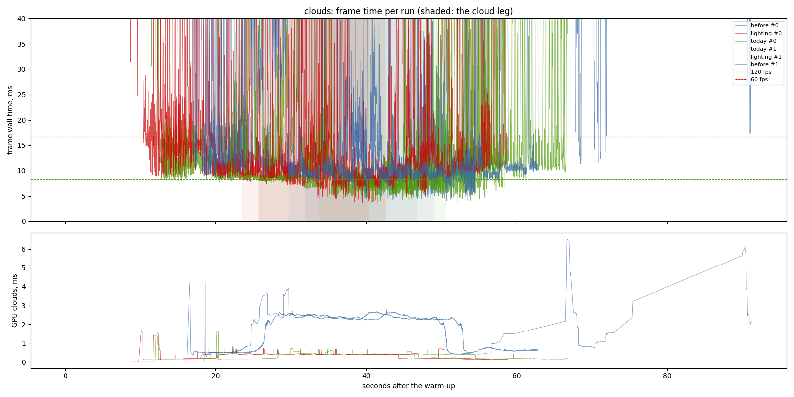
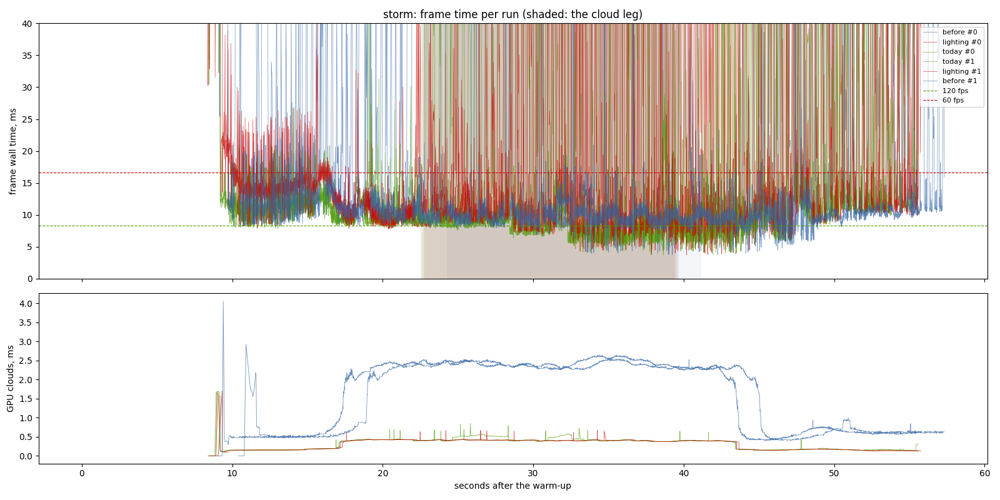
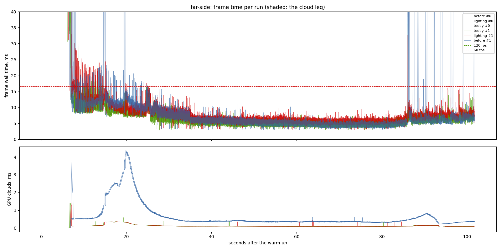
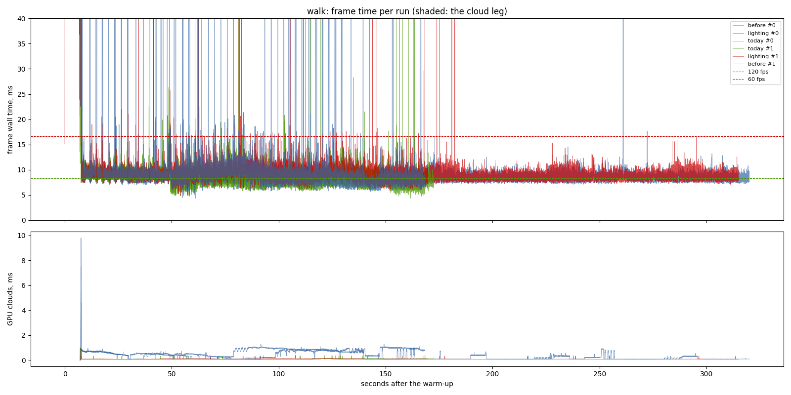
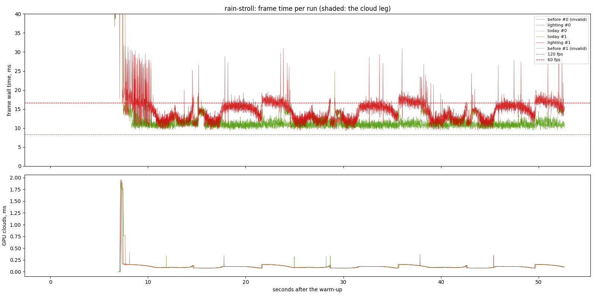
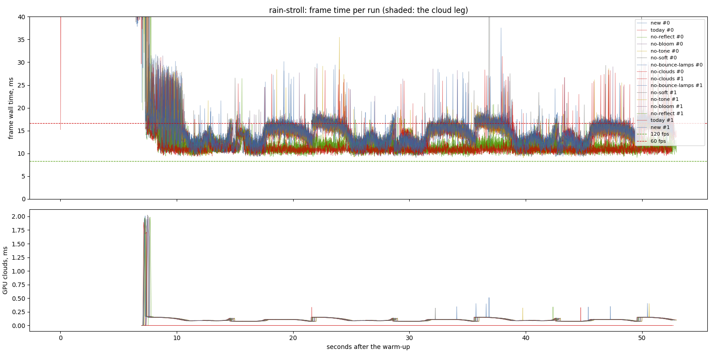
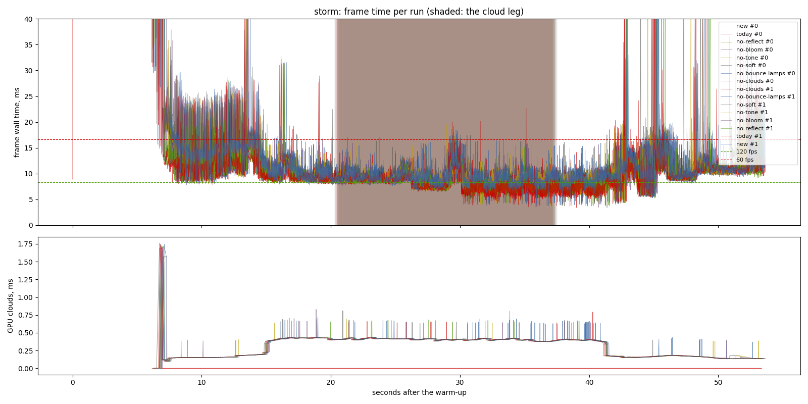
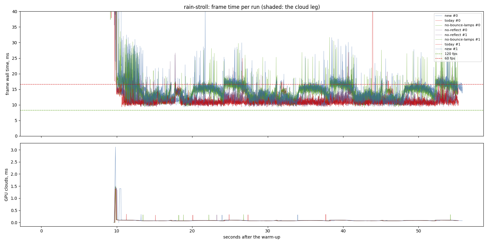

> **Superseded and contaminated (2026-11-12).** This sitting ran while
> other agents rendered mockups in headless Edge on SwiftShader (CPU WebGL)
> and ran Python art scripts. That is where its 50-55 s cold starts and much
> of its flight tails came from. Use the clean re-run in
> [`../2026-11-12-lighting-model-clean/`](../2026-11-12-lighting-model-clean/report.md)
> (the same exes, assets and scenarios on a quiet machine). The numbers below
> are kept as they were measured, for the record only.

# The lighting model on the owner's desktop (2026-11-11)

Three sittings in one evening on the owner's desktop: RTX 3070 (driver
617.14, Vulkan), i7-9700F, Windows 10, window 1440 x 900, uncapped
(`--no-vsync`), release builds, two repeats per variant, interleaved.

- **A/B** (21:53): `before` = `db25fe2` (main before the lighting merge,
  run on its own assets), `lighting` = `f15a647` (main with PR #27),
  `today` = `f15a647` with `PBD_LIGHTING=today` (the old model in the same
  exe, which isolates the model from the other work in the merge). Clock at
  10:00. Scenarios `clouds`, `storm`, `far-side`, `walk`, `rain-stroll`.
- **By part** (22:49): `f15a647` with one part off at a time, on the two
  scenarios where the model costs the most, `rain-stroll` and `storm`.
- **Night** (23:20): `rain-stroll` at 22:00, Holbrook's lane lit by its
  lamps.

The plan that follows from these numbers is
`openspec/changes/lighting-perf` (written up, not built).

## Findings

- **On foot in the rain the new model costs 2.8 ms at p50 and 3.7 ms at p95**: `rain-stroll` 11.18 to 13.97 ms p50, 14.33 to 17.99 ms p95, 15.33 to 27.01 ms p99 (the old model against the new in the same exe; spread between repeats 0.23 ms p50). It takes the stroll from inside the 60 fps floor at p99 to outside it. This is the model's most expensive case.
- **Almost all of that is L8, reflections.** With `PBD_REFLECT=0` the stroll reads 11.24 ms p50, the old model 11.30 ms. L8 costs 2.64 ms p50, 3.72 ms p95 and 7.2 ms p99 there, and GPU total falls 2.5 ms with it off, so the frame is GPU-bound in it.
- **The cost depends on where the eye looks.** The stroll walks a lane up and back in 7 s legs. With the new model one direction reads 15-18 ms, the other 11-13 ms. The old model reads 11 ms both ways. That fits a ray march whose length depends on what the reflected ray meets. Reading the code, a reflected ray that misses keeps marching up to 72 voxel steps, then runs a 32-step screen trace as well.
- **In the dry and in flight the model costs 0.8-1.1 ms at p50**: clouds 8.86 to 9.97 ms, storm 8.82 to 9.65, far-side 5.24 to 6.16, walk 8.26 to 9.19 ms. Every p50 difference is larger than its spread (0.03-0.42 ms) except the A/B storm, whose today runs spread 0.9 ms. The by-part sitting is the clean measure of the storm.
- **In the storm, L8 is most of the tail**: 0.66 ms of the 0.83 ms at p50, but 2.5 of 3.1 ms at p95 and 4.6 of 6.1 ms at p99.
- **Tone, grade and bloom cost 0.4-0.6 ms p50**, and bloom is most of that (0.36-0.37 ms).
- **L3 (soft shadows) and L4 + L7 (sun bounce, lamp bake) cost nothing measurable**, by day or at night in a lamp-lit lane (L4 + L7 off: -0.04 ms at night). That agrees with the Mac's sitting of 2026-10-29.
- **Night is the day's picture.** The model costs 2.58 ms p50 at 22:00 and L8 is 2.44 ms of it.
- **Against main before the merge (`before`)**, `f15a647` is 0.7 ms faster at p50 in `clouds` (10.69 to 9.97 ms). This is because GPU cloud time falls from 2.3 to 0.4 ms (`puff-frustum-cull`, `wet-near-detail` and the puff renderer came in the same merge). It is 0.4-0.9 ms slower in storm, far-side and walk. `before` cannot run `rain-stroll` (no `--stroll` in that build).
- **The flight tails are not the lighting model's.** Frames of 50-450 ms come with fine-set landings and town bakes, in every variant and in `before`. Each row's `max` (6-11 s) is the fresh world's 6.3 s planet rebuild and town survey, which lands after the 10 s warm-up in every run.
- **Ranked optimizations** (the plan; the costs are measured, the savings are estimates):
  1. Make the L8 terrain trace stop when its ray can no longer hit anything, and skip the screen fallback then. Of 2.6 ms, an estimated 0.8-1.8 ms saved on foot in rain.
  2. Run the L8 sea trace only where its 53 m reach covers pixels. Of 0.66 ms (2.5 ms p95) in the storm, an estimated 0.3-0.6 ms.
  3. Skip the L8 capture when nothing wet and no sea is on screen. An estimated 0.1-0.3 ms.
  4. Stop rebuilding the cloud-puff sites every frame. The log measures 0.35-0.4 ms of main-thread time a frame.
  5. Cache small per-frame CPU work.
  6. Skip the lamp bake when no lamps are in reach. It has no measured cost.
  7. Fold bloom's composite into the tone pass. Of 0.37 ms, an estimated 0.1-0.2 ms.
- **Side finding**: every run of `f15a647`, and of `db25fe2` before it, logs `Path not found: assets/textures/settlement/flame.png`. No such file exists in the repository.

## Limits

- **The machine was shared.** Other agents ran light Python/PIL image scripts and Chrome windows during all three sittings, at the owner's request ("run it anyway"). The A/B flights show it: the tails of one variant spread 10-20 ms between repeats (storm `today` p95 15.8 against 36.7 ms; clouds `today` p95 15.0 against 25.5 ms). Their p95 and p99 are not results. The by-part sitting ran on a quieter machine, and its storm tails agree within 0.3 ms between repeats. The p50s agree within 0.03-0.42 ms in every sitting.
- **The first run of each exe started cold.** Its first frame came 50-55 s after launch (a shader cache filling), so the 10 s warm-up, counted from launch, did not cover the frames right after load. This shows in `clouds` `before` and `lighting` run 0 (p99 178 and 89 ms) and in the fps column, which divides by the whole run.
- **Two repeats per variant.** A difference smaller than the spread named beside it is not a result.
- **L8's three parts (terrain trace, sea trace, capture) are not priced apart.** There is no toggle for each, and the frame log has no per-pass GPU column. Those are the first tasks of `lighting-perf`.
- **No town walk.** The `town` scenario lives only on the `town-frame-time` branch, whose work is not in main. Its exe (`2cf5ae1`) was left out of this sitting to keep the lighting model the headline.
- The raw CSVs and logs are local: `output/perf/2026-11-11-lighting-model`, `-lighting-price` and `-lighting-night` in the `pbd-perf-main` worktree.

# A/B: before, lighting, today

- revision: `f15a647`
- adapter: NVIDIA GeForce RTX 3070 (Vulkan); window 1440 x 900, uncapped (`--no-vsync`)
- clock pinned at 10.0 h; first 10.0 s of each run thrown away; 2 run(s) per variant, interleaved
- budgets: p95 within 8.3 ms (120 fps), p99 within 16.7 ms (60 fps); **over** marks a miss. Each cell is the median over the valid runs.

## clouds

| variant | valid runs | fps | p50 | p95 | p99 | p99.9 | max | GPU total p50 | GPU clouds p50 / p95 |
| --- | ---: | ---: | ---: | ---: | ---: | ---: | ---: | ---: | ---: |
| before | 2/2 | 19.33 | 10.69 | 34.27 **over** | 185.19 **over** | 6591.95 | 55762.15 | 6.81 | 2.30 / 2.61 |
| lighting | 2/2 | 31.20 | 9.97 | 28.43 **over** | 93.68 **over** | 544.94 | 49910.03 | 5.22 | 0.40 / 0.43 |
| today | 2/2 | 46.62 | 8.86 | 25.57 **over** | 74.19 **over** | 275.15 | 17811.39 | 4.06 | 0.40 / 0.44 |

On the cloud leg only (the stretch the plan flies through cloud):

| variant | fps | p50 | p95 | p99 | max | GPU total p50 / p95 | GPU clouds p50 / p95 |
| --- | ---: | ---: | ---: | ---: | ---: | ---: | ---: |
| before | 70.33 | 10.41 | 27.76 **over** | 47.23 **over** | 342.00 | 6.56 / 8.21 | 2.40 / 2.62 |
| lighting | 85.09 | 9.01 | 30.71 **over** | 59.12 **over** | 127.27 | 4.66 / 6.28 | 0.41 / 0.42 |
| today | 116.92 | 7.66 | 11.76 **over** | 27.34 **over** | 152.74 | 3.77 / 5.22 | 0.41 / 0.43 |

## storm

| variant | valid runs | fps | p50 | p95 | p99 | p99.9 | max | GPU total p50 | GPU clouds p50 / p95 |
| --- | ---: | ---: | ---: | ---: | ---: | ---: | ---: | ---: | ---: |
| before | 2/2 | 58.27 | 10.01 | 26.98 **over** | 72.54 **over** | 283.41 | 14407.73 | 6.69 | 2.31 / 2.53 |
| lighting | 2/2 | 48.51 | 10.45 | 35.36 **over** | 92.76 **over** | 259.28 | 12422.96 | 5.02 | 0.39 / 0.42 |
| today | 2/2 | 51.66 | 9.68 | 37.61 **over** | 85.58 **over** | 175.28 | 14543.14 | 4.06 | 0.40 / 0.51 |

On the cloud leg only (the stretch the plan flies through cloud):

| variant | fps | p50 | p95 | p99 | max | GPU total p50 / p95 | GPU clouds p50 / p95 |
| --- | ---: | ---: | ---: | ---: | ---: | ---: | ---: |
| before | 92.90 | 9.66 | 13.77 **over** | 21.32 **over** | 244.36 | 6.67 / 8.30 | 2.40 / 2.60 |
| lighting | 74.23 | 9.38 | 36.16 **over** | 88.85 **over** | 159.30 | 4.41 / 6.17 | 0.41 / 0.42 |
| today | 76.57 | 8.68 | 43.83 **over** | 88.00 **over** | 125.14 | 3.77 / 5.28 | 0.41 / 0.55 |

## far-side

| variant | valid runs | fps | p50 | p95 | p99 | p99.9 | max | GPU total p50 | GPU clouds p50 / p95 |
| --- | ---: | ---: | ---: | ---: | ---: | ---: | ---: | ---: | ---: |
| before | 2/2 | 149.79 | 5.30 | 11.07 **over** | 13.90 | 90.57 | 6532.20 | 2.82 | 0.36 / 1.40 |
| lighting | 2/2 | 133.55 | 6.16 | 11.31 **over** | 15.31 | 24.45 | 6383.32 | 2.78 | 0.09 / 0.21 |
| today | 2/2 | 157.85 | 5.24 | 9.21 **over** | 11.93 | 18.25 | 6241.69 | 2.46 | 0.09 / 0.20 |

## walk

| variant | valid runs | fps | p50 | p95 | p99 | p99.9 | max | GPU total p50 | GPU clouds p50 / p95 |
| --- | ---: | ---: | ---: | ---: | ---: | ---: | ---: | ---: | ---: |
| before | 2/2 | 100.92 | 8.72 | 11.25 **over** | 14.26 | 208.22 | 6816.55 | 5.63 | 0.54 / 0.98 |
| lighting | 2/2 | 100.92 | 9.19 | 11.54 **over** | 13.77 | 19.70 | 6850.71 | 5.13 | 0.08 / 0.15 |
| today | 2/2 | 112.89 | 8.26 | 10.39 **over** | 12.06 | 34.16 | 6712.07 | 4.58 | 0.08 / 0.12 |

## rain-stroll

| variant | valid runs | fps | p50 | p95 | p99 | p99.9 | max | GPU total p50 | GPU clouds p50 / p95 |
| --- | ---: | ---: | ---: | ---: | ---: | ---: | ---: | ---: | ---: |
| before | 0/2 | - | - | - | - | - | - | - | - / - |
| lighting | 2/2 | 58.11 | 13.97 | 17.99 **over** | 27.01 **over** | 120.18 | 6628.94 | 9.48 | 0.09 / 0.15 |
| today | 2/2 | 71.85 | 11.18 | 14.33 **over** | 15.33 | 129.87 | 6623.09 | 6.11 | 0.10 / 0.15 |
- invalid: before run 0: exit code 101; no STROLL_DONE line; only 0 frames after the warm-up
- invalid: before run 1: exit code 101; no STROLL_DONE line; only 0 frames after the warm-up

# By part: one part off at a time (f15a647)

- revision: `f15a647`
- adapter: NVIDIA GeForce RTX 3070 (Vulkan); window 1440 x 900, uncapped (`--no-vsync`)
- clock pinned at 10.0 h; first 10.0 s of each run thrown away; 2 run(s) per variant, interleaved
- budgets: p95 within 8.3 ms (120 fps), p99 within 16.7 ms (60 fps); **over** marks a miss. Each cell is the median over the valid runs.

## rain-stroll

| variant | valid runs | fps | p50 | p95 | p99 | p99.9 | max | GPU total p50 | GPU clouds p50 / p95 |
| --- | ---: | ---: | ---: | ---: | ---: | ---: | ---: | ---: | ---: |
| new | 2/2 | 58.13 | 13.88 | 17.90 **over** | 23.21 **over** | 128.24 | 6681.04 | 9.33 | 0.09 / 0.15 |
| today | 2/2 | 70.89 | 11.30 | 14.45 **over** | 15.44 | 90.44 | 6906.13 | 6.11 | 0.10 / 0.15 |
| no-reflect | 2/2 | 70.80 | 11.24 | 14.18 **over** | 15.98 | 72.00 | 6925.53 | 6.85 | 0.10 / 0.15 |
| no-bloom | 2/2 | 59.69 | 13.52 | 17.52 **over** | 24.69 **over** | 98.40 | 6799.74 | 9.36 | 0.09 / 0.15 |
| no-tone | 2/2 | 60.95 | 13.32 | 17.27 **over** | 23.53 **over** | 111.20 | 6645.08 | 9.04 | 0.09 / 0.15 |
| no-soft | 2/2 | 57.88 | 14.01 | 18.05 **over** | 25.04 **over** | 126.87 | 6767.79 | 9.36 | 0.09 / 0.15 |
| no-bounce-lamps | 2/2 | 59.23 | 13.72 | 17.53 **over** | 26.75 **over** | 70.80 | 6571.59 | 9.25 | 0.09 / 0.15 |
| no-clouds | 2/2 | 60.20 | 13.47 | 17.55 **over** | 26.72 **over** | 106.97 | 6657.22 | 9.35 | -0.00 / -0.00 |

## storm

| variant | valid runs | fps | p50 | p95 | p99 | p99.9 | max | GPU total p50 | GPU clouds p50 / p95 |
| --- | ---: | ---: | ---: | ---: | ---: | ---: | ---: | ---: | ---: |
| new | 2/2 | 79.46 | 9.65 | 15.84 **over** | 23.82 **over** | 81.21 | 6426.72 | 5.38 | 0.40 / 0.43 |
| today | 2/2 | 92.83 | 8.82 | 12.71 **over** | 17.73 **over** | 62.28 | 6501.57 | 4.13 | 0.40 / 0.43 |
| no-reflect | 2/2 | 88.59 | 8.99 | 13.37 **over** | 19.22 **over** | 63.04 | 6377.04 | 4.27 | 0.40 / 0.43 |
| no-bloom | 2/2 | 82.65 | 9.28 | 15.17 **over** | 23.39 **over** | 69.90 | 6425.73 | 5.33 | 0.40 / 0.43 |
| no-tone | 2/2 | 83.41 | 9.27 | 15.16 **over** | 23.11 **over** | 74.61 | 6261.33 | 5.37 | 0.40 / 0.43 |
| no-soft | 2/2 | 79.84 | 9.69 | 15.86 **over** | 23.88 **over** | 62.46 | 6260.53 | 5.51 | 0.40 / 0.43 |
| no-bounce-lamps | 2/2 | 79.82 | 9.60 | 15.94 **over** | 23.81 **over** | 103.76 | 6299.53 | 5.40 | 0.40 / 0.43 |
| no-clouds | 2/2 | 86.38 | 9.09 | 15.11 **over** | 22.79 **over** | 68.21 | 6190.86 | 5.01 | -0.00 / -0.00 |

On the cloud leg only (the stretch the plan flies through cloud):

| variant | fps | p50 | p95 | p99 | max | GPU total p50 / p95 | GPU clouds p50 / p95 |
| --- | ---: | ---: | ---: | ---: | ---: | ---: | ---: |
| new | 109.44 | 8.97 | 11.61 **over** | 14.05 | 18.45 | 4.99 / 6.58 | 0.41 / 0.42 |
| today | 126.29 | 7.73 | 10.29 **over** | 12.38 | 16.38 | 3.77 / 5.28 | 0.41 / 0.42 |
| no-reflect | 120.78 | 8.20 | 10.75 **over** | 12.54 | 17.04 | 3.87 / 5.39 | 0.41 / 0.42 |
| no-bloom | 114.38 | 8.70 | 11.05 **over** | 12.90 | 17.98 | 4.93 / 6.52 | 0.41 / 0.42 |
| no-tone | 115.16 | 8.60 | 11.10 **over** | 13.37 | 19.71 | 4.94 / 6.53 | 0.41 / 0.42 |
| no-soft | 109.07 | 9.00 | 11.65 **over** | 13.71 | 19.12 | 5.02 / 6.62 | 0.41 / 0.42 |
| no-bounce-lamps | 109.60 | 8.98 | 11.51 **over** | 14.58 | 17.48 | 4.98 / 6.57 | 0.41 / 0.42 |
| no-clouds | 119.71 | 8.30 | 11.11 **over** | 12.64 | 22.70 | 4.53 / 6.10 | -0.00 / -0.00 |

# Night: rain-stroll at 22:00 (f15a647)

- revision: `f15a647`
- adapter: NVIDIA GeForce RTX 3070 (Vulkan); window 1440 x 900, uncapped (`--no-vsync`)
- clock pinned at 22.0 h; first 10.0 s of each run thrown away; 2 run(s) per variant, interleaved
- budgets: p95 within 8.3 ms (120 fps), p99 within 16.7 ms (60 fps); **over** marks a miss. Each cell is the median over the valid runs.

## rain-stroll

| variant | valid runs | fps | p50 | p95 | p99 | p99.9 | max | GPU total p50 | GPU clouds p50 / p95 |
| --- | ---: | ---: | ---: | ---: | ---: | ---: | ---: | ---: | ---: |
| new | 2/2 | 48.58 | 13.73 | 18.20 **over** | 28.49 **over** | 190.24 | 10850.02 | 9.23 | 0.07 / 0.10 |
| today | 2/2 | 60.31 | 11.15 | 14.39 **over** | 15.47 | 111.27 | 10535.47 | 6.12 | 0.07 / 0.10 |
| no-bounce-lamps | 2/2 | 49.46 | 13.77 | 18.10 **over** | 26.39 **over** | 177.62 | 10592.69 | 9.31 | 0.07 / 0.10 |
| no-reflect | 2/2 | 59.08 | 11.29 | 14.59 **over** | 18.40 **over** | 130.21 | 10380.63 | 6.81 | 0.07 / 0.10 |

