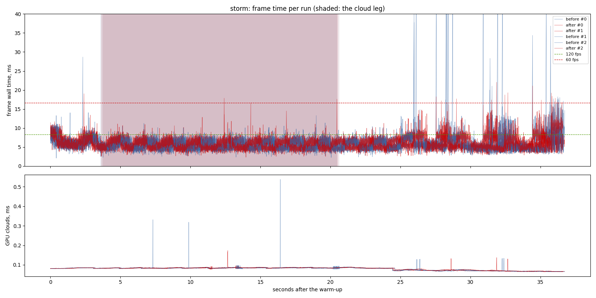

# The storm descent's spikes (`descent-spikes`), 2026-11-12

**What was measured.** The `storm` route, `claude/perf-tuning` at `f160a7e`
("before") against the same with Avian's collider-tree optimization run in
place and the towns' casters chunked on their cut task ("after"), release
builds, `--frame-latency 2`, three runs each, interleaved, the RTX 3070
desktop with nothing else running (the perf lock held).

**Findings.**

1. **The four descent spikes are gone.** Frames over 30 ms a run: 5, 5, 4
   before; 0, 0, 0 after. The worst frame a run: 63, 59, 91 ms before;
   21, 22, 19 ms after.
2. **The rest of the frame is unchanged within the spread.** p95 7.96-8.17
   against 8.17-8.32 ms, p99 10.19-11.25 against 10.21-10.99, p99.9
   14.0-18.0 against 14.5-16.7. p50 is 0.1 ms higher after (5.22-5.33
   against 5.33-5.46), at the edge of the spread.
3. **Why** (`openspec/changes/descent-spikes/design.md`): Avian blocked its
   step on a collider-tree optimization task queued on the async pool behind
   the game's fine-set builds and town cuts.

- revision: `f160a7e` (uncommitted changes)
- adapter: NVIDIA GeForce RTX 3070 (Vulkan); window 1440 x 900, uncapped (`--no-vsync`)
- clock pinned at 10.0 h; first 10.0 s after loading (the ready line, else the first frame) thrown away; 3 run(s) per variant, interleaved
- budgets: p95 within 8.3 ms (120 fps), p99 within 16.7 ms (60 fps); **over** marks a miss. Each cell is the median over the valid runs.

## storm

| variant | valid runs | fps | p50 | p95 | p99 | p99.9 | max | GPU total p50 | GPU clouds p50 / p95 |
| --- | ---: | ---: | ---: | ---: | ---: | ---: | ---: | ---: | ---: |
| before | 3/3 | 177.26 | 5.32 | 8.16 | 10.72 | 17.45 | 63.21 | 4.92 | 0.08 / 0.09 |
| after | 3/3 | 174.86 | 5.43 | 8.22 | 10.62 | 14.64 | 21.08 | 4.96 | 0.08 / 0.09 |

On the cloud leg only (the stretch the plan flies through cloud):

| variant | fps | p50 | p95 | p99 | max | GPU total p50 / p95 | GPU clouds p50 / p95 |
| --- | ---: | ---: | ---: | ---: | ---: | ---: | ---: |
| before | 184.69 | 5.20 | 7.57 | 8.42 | 11.25 | 4.87 / 6.97 | 0.08 / 0.09 |
| after | 183.13 | 5.25 | 7.59 | 8.43 | 17.60 | 4.91 / 6.99 | 0.08 / 0.09 |

GPU time per pass, p50 (ms; median over the valid runs):

| variant | cloud_march | cloud_puffs | cloud_resolve | lens_mist | lite_bloom | main_opaque_pass_3d | main_transparent_pass_3d | other | planet_cull | planet_shadow | rain | rain_half | ssr_capture | tonemapping | upscaling | water_compose | water_lens | weather_overlay |
| --- | ---: | ---: | ---: | ---: | ---: | ---: | ---: | ---: | ---: | ---: | ---: | ---: | ---: | ---: | ---: | ---: | ---: | ---: |
| before | 0.17 | 0.15 | 0.00 | 0.01 | 0.08 | 0.00 | 2.42 | 0.04 | 0.16 | 0.79 | 0.00 | 0.00 | 0.03 | 0.00 | 0.02 | 0.51 | 0.10 | 0.00 |
| after | 0.17 | 0.15 | 0.00 | 0.01 | 0.08 | 0.00 | 2.54 | 0.04 | 0.17 | 0.82 | 0.00 | 0.00 | 0.03 | 0.00 | 0.02 | 0.50 | 0.09 | 0.00 |

Frames over 30 ms per run, and how many recur at the same place (25 m of route, 5 m of walk, or 1 s) in at least half of the scenario's other runs, of any variant. Those that recur are the game's own work at that place; the rest come and go between repeats (async work landing at another moment, or the machine):

| variant | spikes per run | recurring | not recurring |
| --- | --- | ---: | ---: |
| before | 5, 5, 4 | 0 | 14 |
| after | 0, 0, 0 | 0 | 0 |

