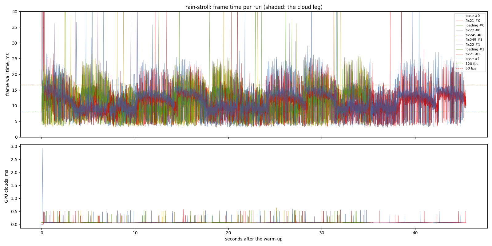
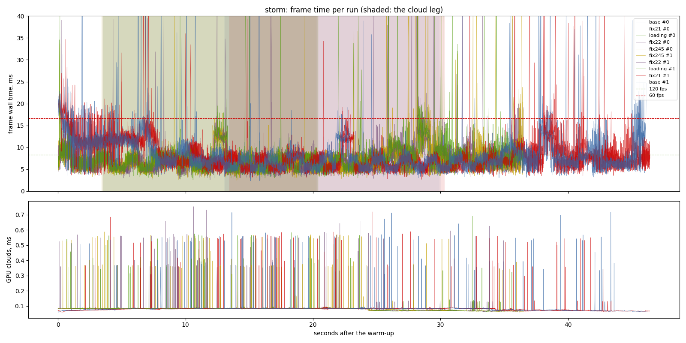
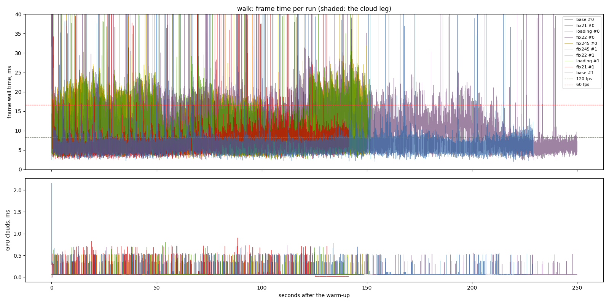

# lighting-perf fixes 2.1, 2.2, 2.4 + 2.5 (2026-11-12)

Five variants in one interleaved sitting, 2 repeats, frame latency 2, RTX
3070 (Vulkan), i7-9700F, 1440 x 900, uncapped, release, clock 10:00:
`base` (`57d94b5`, `--frame-latency 2`), `fix21` (`e9ed506`), `loading`
(the loading screen, `e8016e0`), `fix22` (`2185478`), `fix245`
(`6ec3ff8`). The sitting waited 30 min for another agent's lock and ran
10:24-11:18 on a quiet machine (CPU samples in `cpu/`).

## Findings

The per-fix table and what it means are in
`openspec/changes/lighting-perf/design.md`, "The fixes, measured".

- 2.1: `rain-stroll` p50 / p95 / p99 10.89 / 17.48 / 24.42 to 10.34 /
  16.80 / 21.70 ms; the terrain pass 4.43 to 3.99 ms of GPU.
- 2.2: `storm` 6.51 / 11.26 / 14.85 to 6.25 / 10.79 / 15.40 ms; the
  terrain pass 2.80 to 2.59 ms.
- 2.4 + 2.5: the puffs' build 0.41 to 0.28 ms a frame; wall time inside
  the spread.

## Limits

- **Read each fix only against the variant before it on the same side of
  the loading screen.** The builds before it start their warm-up at the
  first frame and then freeze for the towns' ground; those after it start
  at `READY`.
- **`walk` cannot be compared across the loading screen**: its world
  opens in a storm with it and dry without it (a bug, reported).
- Two repeats. A difference under the spread named in the design is not
  a result.
- The raw CSVs and logs are local: `output/perf/2026-11-12-fixes`.

# Performance suite, 2026-11-12 10:24

- revision: `eb8da2d`
- adapter: NVIDIA GeForce RTX 3070 (Vulkan); window 1440 x 900, uncapped (`--no-vsync`)
- clock pinned at 10.0 h; first 10.0 s after loading (the ready line, else the first frame) thrown away; 2 run(s) per variant, interleaved
- budgets: p95 within 8.3 ms (120 fps), p99 within 16.7 ms (60 fps); **over** marks a miss. Each cell is the median over the valid runs.

## rain-stroll

| variant | valid runs | fps | p50 | p95 | p99 | p99.9 | max | GPU total p50 | GPU clouds p50 / p95 |
| --- | ---: | ---: | ---: | ---: | ---: | ---: | ---: | ---: | ---: |
| base | 2/2 | 87.78 | 10.89 | 17.48 **over** | 24.42 **over** | 64.91 | 223.57 | 9.94 | 0.06 / 0.07 |
| fix21 | 2/2 | 92.92 | 10.34 | 16.80 **over** | 21.70 **over** | 45.24 | 539.27 | 9.56 | 0.06 / 0.07 |
| loading | 2/2 | 92.94 | 10.44 | 17.20 **over** | 22.13 **over** | 34.75 | 50.43 | 9.85 | 0.06 / 0.07 |
| fix22 | 2/2 | 93.64 | 10.35 | 17.13 **over** | 21.98 **over** | 36.21 | 52.92 | 9.80 | 0.06 / 0.07 |
| fix245 | 2/2 | 94.10 | 10.39 | 17.54 **over** | 21.57 **over** | 42.04 | 68.34 | 9.76 | 0.06 / 0.07 |

GPU time per pass, p50 (ms; median over the valid runs):

| variant | cloud_march | cloud_puffs | cloud_resolve | lens_mist | lite_bloom | main_opaque_pass_3d | main_transparent_pass_3d | other | planet_cull | planet_shadow | rain | ssr_capture | tonemapping | upscaling | water_compose | water_lens | weather_overlay |
| --- | ---: | ---: | ---: | ---: | ---: | ---: | ---: | ---: | ---: | ---: | ---: | ---: | ---: | ---: | ---: | ---: | ---: |
| base | 0.00 | 0.03 | 0.00 | 0.00 | 0.09 | 0.61 | 4.43 | 0.04 | 0.18 | 2.09 | 1.44 | 0.03 | 0.03 | 0.02 | 0.07 | 0.29 | 0.00 |
| fix21 | 0.00 | 0.03 | 0.00 | 0.00 | 0.09 | 0.58 | 3.99 | 0.04 | 0.18 | 2.11 | 1.46 | 0.03 | 0.03 | 0.02 | 0.07 | 0.29 | 0.00 |
| loading | 0.00 | 0.04 | 0.00 | 0.00 | 0.09 | 0.53 | 4.61 | 0.04 | 0.18 | 2.14 | 1.45 | 0.03 | 0.03 | 0.02 | 0.07 | 0.29 | 0.00 |
| fix22 | 0.00 | 0.04 | 0.00 | 0.00 | 0.09 | 0.52 | 4.49 | 0.04 | 0.18 | 2.13 | 1.46 | 0.03 | 0.03 | 0.02 | 0.07 | 0.28 | 0.00 |
| fix245 | 0.00 | 0.04 | 0.00 | 0.00 | 0.09 | 0.52 | 4.51 | 0.04 | 0.18 | 2.06 | 1.45 | 0.03 | 0.03 | 0.02 | 0.07 | 0.29 | 0.00 |

Left out: the fresh world's planet rebuild, 4 frame(s) of 6463-7292 ms.

## storm

| variant | valid runs | fps | p50 | p95 | p99 | p99.9 | max | GPU total p50 | GPU clouds p50 / p95 |
| --- | ---: | ---: | ---: | ---: | ---: | ---: | ---: | ---: | ---: |
| base | 2/2 | 130.67 | 6.87 | 12.90 **over** | 19.34 **over** | 47.23 | 74.78 | 6.12 | 0.08 / 0.09 |
| fix21 | 2/2 | 132.53 | 6.73 | 13.03 **over** | 17.99 **over** | 41.56 | 74.77 | 6.04 | 0.08 / 0.09 |
| loading | 2/2 | 142.63 | 6.51 | 11.26 **over** | 14.85 | 45.63 | 65.30 | 5.75 | 0.08 / 0.09 |
| fix22 | 2/2 | 149.19 | 6.25 | 10.79 **over** | 15.40 | 40.28 | 66.05 | 5.57 | 0.08 / 0.09 |
| fix245 | 2/2 | 148.26 | 6.24 | 10.42 **over** | 13.76 | 43.42 | 87.61 | 5.49 | 0.08 / 0.09 |

On the cloud leg only (the stretch the plan flies through cloud):

| variant | fps | p50 | p95 | p99 | max | GPU total p50 / p95 | GPU clouds p50 / p95 |
| --- | ---: | ---: | ---: | ---: | ---: | ---: | ---: |
| base | 153.02 | 6.24 | 9.39 **over** | 12.86 | 68.69 | 5.52 / 7.77 | 0.08 / 0.09 |
| fix21 | 156.06 | 6.04 | 9.16 **over** | 12.74 | 39.37 | 5.30 / 7.76 | 0.08 / 0.09 |
| loading | 153.50 | 6.09 | 9.24 **over** | 13.43 | 58.10 | 5.26 / 7.71 | 0.08 / 0.09 |
| fix22 | 160.27 | 5.83 | 9.06 **over** | 13.12 | 47.81 | 5.10 / 7.43 | 0.08 / 0.09 |
| fix245 | 159.65 | 5.88 | 8.92 **over** | 12.97 | 45.91 | 5.13 / 7.52 | 0.08 / 0.09 |

GPU time per pass, p50 (ms; median over the valid runs):

| variant | cloud_march | cloud_puffs | cloud_resolve | lens_mist | lite_bloom | main_opaque_pass_3d | main_transparent_pass_3d | other | planet_cull | planet_shadow | rain | ssr_capture | tonemapping | upscaling | water_compose | water_lens | weather_overlay |
| --- | ---: | ---: | ---: | ---: | ---: | ---: | ---: | ---: | ---: | ---: | ---: | ---: | ---: | ---: | ---: | ---: | ---: |
| base | 0.17 | 0.14 | 0.00 | 0.01 | 0.08 | 0.00 | 3.10 | 0.04 | 0.17 | 0.95 | 0.00 | 0.04 | 0.03 | 0.02 | 0.48 | 0.11 | 0.00 |
| fix21 | 0.17 | 0.14 | 0.00 | 0.01 | 0.08 | 0.00 | 3.05 | 0.04 | 0.17 | 1.00 | 0.00 | 0.04 | 0.03 | 0.02 | 0.51 | 0.11 | 0.00 |
| loading | 0.17 | 0.15 | 0.00 | 0.01 | 0.08 | 0.00 | 2.80 | 0.04 | 0.17 | 0.93 | 0.00 | 0.04 | 0.00 | 0.02 | 0.51 | 0.10 | 0.00 |
| fix22 | 0.17 | 0.15 | 0.00 | 0.01 | 0.08 | 0.00 | 2.59 | 0.04 | 0.17 | 0.90 | 0.00 | 0.03 | 0.00 | 0.02 | 0.51 | 0.09 | 0.00 |
| fix245 | 0.17 | 0.15 | 0.00 | 0.01 | 0.08 | 0.00 | 2.57 | 0.04 | 0.17 | 0.90 | 0.00 | 0.03 | 0.00 | 0.02 | 0.56 | 0.10 | 0.00 |

Left out: the fresh world's planet rebuild, 4 frame(s) of 6342-6794 ms.

## walk

| variant | valid runs | fps | p50 | p95 | p99 | p99.9 | max | GPU total p50 | GPU clouds p50 / p95 |
| --- | ---: | ---: | ---: | ---: | ---: | ---: | ---: | ---: | ---: |
| base | 2/2 | 151.44 | 6.32 | 9.41 **over** | 11.83 | 37.61 | 419.54 | 5.87 | 0.07 / 0.07 |
| fix21 | 2/2 | 141.93 | 6.63 | 10.41 **over** | 13.52 | 40.65 | 476.51 | 6.10 | 0.07 / 0.07 |
| loading | 2/2 | 93.22 | 10.38 | 16.82 **over** | 22.38 **over** | 39.44 | 66.93 | 9.86 | 0.06 / 0.07 |
| fix22 | 2/2 | 94.45 | 10.25 | 16.80 **over** | 22.05 **over** | 45.37 | 77.22 | 9.93 | 0.06 / 0.07 |
| fix245 | 2/2 | 92.24 | 10.55 | 17.33 **over** | 22.58 **over** | 39.45 | 78.54 | 10.02 | 0.06 / 0.07 |

GPU time per pass, p50 (ms; median over the valid runs):

| variant | cloud_march | cloud_puffs | cloud_resolve | lens_mist | lite_bloom | main_opaque_pass_3d | main_transparent_pass_3d | other | planet_cull | planet_shadow | rain | ssr_capture | tonemapping | upscaling | water_compose | water_lens | weather_overlay |
| --- | ---: | ---: | ---: | ---: | ---: | ---: | ---: | ---: | ---: | ---: | ---: | ---: | ---: | ---: | ---: | ---: | ---: |
| base | 0.00 | 0.01 | 0.00 | 0.00 | 0.08 | 0.01 | 2.71 | 0.04 | 0.18 | 2.23 | 0.24 | 0.03 | 0.03 | 0.02 | 0.07 | 0.00 | 0.00 |
| fix21 | 0.00 | 0.03 | 0.00 | 0.00 | 0.08 | 0.01 | 2.79 | 0.04 | 0.18 | 2.42 | 0.23 | 0.02 | 0.03 | 0.02 | 0.11 | 0.00 | 0.00 |
| loading | 0.00 | 0.02 | 0.00 | 0.00 | 0.08 | 0.05 | 5.91 | 0.04 | 0.18 | 2.06 | 1.15 | 0.03 | 0.02 | 0.02 | 0.08 | 0.29 | 0.00 |
| fix22 | 0.00 | 0.04 | 0.00 | 0.00 | 0.09 | 0.02 | 5.84 | 0.04 | 0.18 | 2.08 | 1.37 | 0.03 | 0.03 | 0.02 | 0.08 | 0.29 | 0.00 |
| fix245 | 0.00 | 0.02 | 0.00 | 0.00 | 0.08 | 0.02 | 6.12 | 0.04 | 0.18 | 2.05 | 1.07 | 0.03 | 0.02 | 0.02 | 0.09 | 0.29 | 0.00 |

Left out: the fresh world's planet rebuild, 4 frame(s) of 6727-7493 ms.

