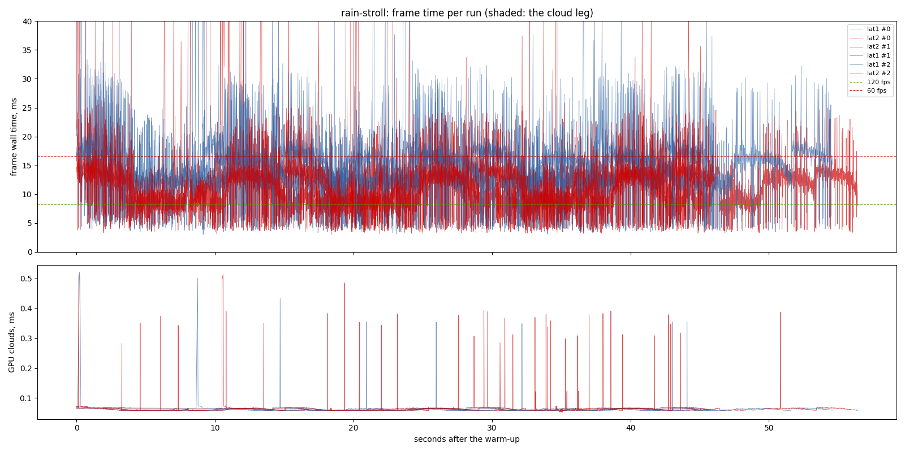
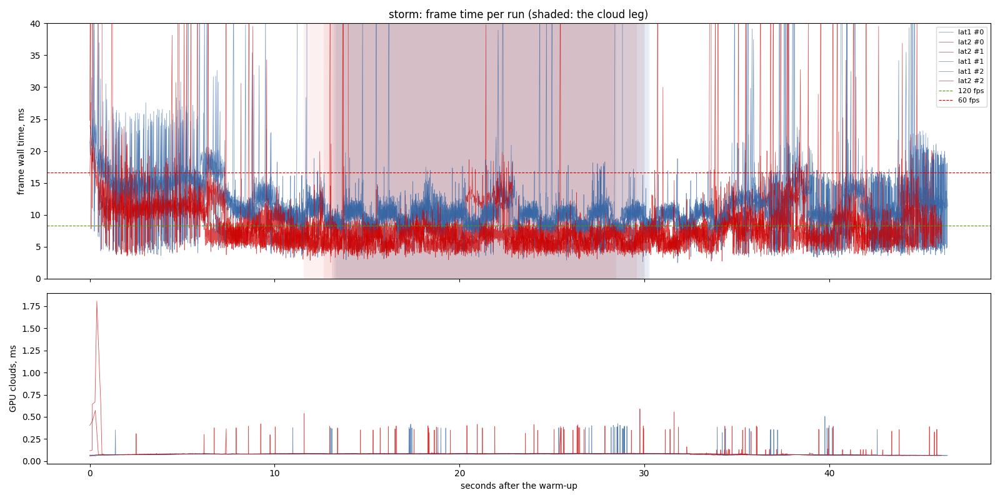
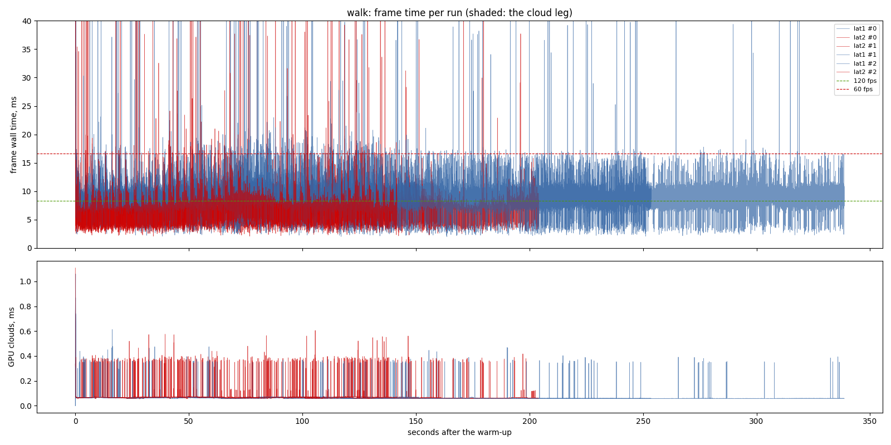
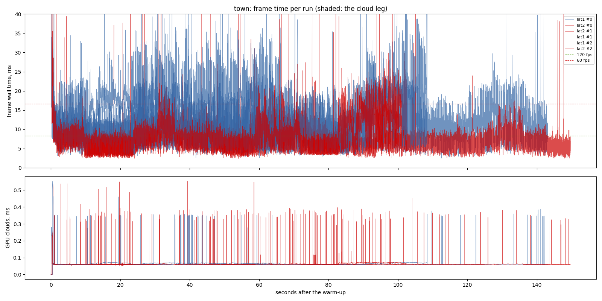

# Frame latency 1 against 2 (2026-11-12)

`crab-breeze-lessons` task 1.2 (the uncapped half) and the first sitting of
`lighting-perf`. One exe (`57d94b5`, the `lighting-perf` instruments), the
same assets, `--frame-latency 1` (the default until now) against
`--frame-latency 2` (wgpu's default, what Crab Breeze runs). Machine: RTX 3070
(Vulkan), i7-9700F, Windows 10, window 1440 x 900, uncapped (`--no-vsync`),
release build, 3 repeats per variant interleaved, clock at 10:00. The sitting
started at 06:51 after waiting 13.5 min for another agent's release build to
end (nothing else ran during it; CPU sample in `cpu/`).

## Findings

- **A queue of two frames takes 3.2-4.3 ms off p50 in every scenario**, and
  more off the tail. p50 / p95 / p99, latency 1 then 2 (median of 3):
  - `rain-stroll`: 14.18 / 21.63 / 30.30 to **10.49 / 16.10 / 23.34** (-3.69 / -5.53 / -6.96)
  - `storm`: 10.17 / 16.61 / 24.04 to **6.67 / 12.49 / 16.86** (-3.50 / -4.12 / -7.18)
  - `walk`: 9.05 / 12.07 / 16.09 to **5.81 / 8.47 / 10.52** (-3.24 / -3.60 / -5.57)
  - `town`: 11.16 / 19.91 / 28.92 to **6.91 / 13.60 / 18.73** (-4.25 / -6.31 / -10.19)
- **The spread between repeats is far smaller than that**: at p50, 0.20 and
  0.19 ms on `rain-stroll`, 0.07 and 0.19 on `storm`, 0.76 and 0.29 on
  `walk`. `town` is noisy at latency 1 (10.30, 11.16, 16.08) and steady at 2
  (6.79-7.36); every one of its latency-2 runs is faster than every one of
  its latency-1 runs.
- **The GPU does the same work either way** (GPU total p50 9.75 / 9.86 ms on
  the stroll, 5.88 / 5.94 in the storm, 5.13 / 5.35 on the walk). With a
  queue of one, the render world could not start the next frame until the
  GPU had finished the last, so CPU and GPU time partly added up. With two
  they overlap: the storm and the walk now run at about their GPU time, and
  the stroll is GPU-bound (10.5 ms wall against 9.9 ms of GPU).
- **Decision** (`crab-breeze-lessons` 1.3, recommendation taken (ask only
  with screenshots)): 2 is the default from this commit;
  `--frame-latency 1` stays. The price is up to one frame more between input
  and photon. Mouse look still applies each frame's raw displacement
  (CLAUDE.md), and nothing else about input changes. Every later
  `lighting-perf` A/B runs at the new default.
- **The GPU per pass on the stroll** (latency 2, p50): the terrain pass
  (`main_transparent_pass_3d`, which holds L8's traces) 4.34 ms, the sun's
  cascades (`planet_shadow`) 2.03 ms, the rain volume 1.44 ms, the opaque
  pass 0.57 ms, the lens 0.29 ms, bloom 0.09 ms, the reflection capture 0.03
  ms. That price list is what the rest of `lighting-perf` works from.

## Limits

- **Uncapped only.** The vsync half of `crab-breeze-lessons` 1.2 (counting
  refreshes missed with vsync on) is not run here; that task stays open.
- **Input latency is not measured.** The extra frame is the mechanism's
  cost, read, not timed.
- Three repeats. The fresh world's planet rebuild (6.2-6.9 s, every run)
  is left out of the statistics (`lighting-perf` 1.3) and listed per
  scenario.
- The raw CSVs and logs are local: `output/perf/2026-11-12-frame-latency`.

# Performance suite, 2026-11-12 06:51

- revision: `57d94b5` (uncommitted changes)
- adapter: NVIDIA GeForce RTX 3070 (Vulkan); window 1440 x 900, uncapped (`--no-vsync`)
- clock pinned at 10.0 h; first 10.0 s after loading (the ready line, else the first frame) thrown away; 3 run(s) per variant, interleaved
- budgets: p95 within 8.3 ms (120 fps), p99 within 16.7 ms (60 fps); **over** marks a miss. Each cell is the median over the valid runs.

## rain-stroll

| variant | valid runs | fps | p50 | p95 | p99 | p99.9 | max | GPU total p50 | GPU clouds p50 / p95 |
| --- | ---: | ---: | ---: | ---: | ---: | ---: | ---: | ---: | ---: |
| lat1 | 3/3 | 68.38 | 14.18 | 21.63 **over** | 30.30 **over** | 69.40 | 191.13 | 9.75 | 0.06 / 0.07 |
| lat2 | 3/3 | 89.52 | 10.49 | 16.10 **over** | 23.34 **over** | 79.60 | 290.39 | 9.86 | 0.06 / 0.07 |

GPU time per pass, p50 (ms; median over the valid runs):

| variant | cloud_march | cloud_puffs | cloud_resolve | lens_mist | lite_bloom | main_opaque_pass_3d | main_transparent_pass_3d | other | planet_cull | planet_shadow | rain | ssr_capture | tonemapping | upscaling | water_compose | water_lens | weather_overlay |
| --- | ---: | ---: | ---: | ---: | ---: | ---: | ---: | ---: | ---: | ---: | ---: | ---: | ---: | ---: | ---: | ---: | ---: |
| lat1 | 0.00 | 0.03 | 0.00 | 0.00 | 0.08 | 0.53 | 4.38 | 0.04 | 0.19 | 2.02 | 1.43 | 0.03 | 0.03 | 0.02 | 0.07 | 0.29 | 0.00 |
| lat2 | 0.00 | 0.03 | 0.00 | 0.00 | 0.09 | 0.57 | 4.34 | 0.04 | 0.18 | 2.03 | 1.44 | 0.03 | 0.03 | 0.02 | 0.07 | 0.29 | 0.00 |

Left out: the fresh world's planet rebuild, 6 frame(s) of 6350-6778 ms.

## storm

| variant | valid runs | fps | p50 | p95 | p99 | p99.9 | max | GPU total p50 | GPU clouds p50 / p95 |
| --- | ---: | ---: | ---: | ---: | ---: | ---: | ---: | ---: | ---: |
| lat1 | 3/3 | 90.94 | 10.17 | 16.61 **over** | 24.04 **over** | 49.49 | 96.83 | 5.88 | 0.08 / 0.08 |
| lat2 | 3/3 | 134.69 | 6.67 | 12.49 **over** | 16.86 **over** | 51.28 | 217.81 | 5.94 | 0.08 / 0.09 |

On the cloud leg only (the stretch the plan flies through cloud):

| variant | fps | p50 | p95 | p99 | max | GPU total p50 / p95 | GPU clouds p50 / p95 |
| --- | ---: | ---: | ---: | ---: | ---: | ---: | ---: |
| lat1 | 102.58 | 9.53 | 12.68 **over** | 16.21 | 45.22 | 5.37 / 7.40 | 0.08 / 0.08 |
| lat2 | 157.11 | 6.03 | 8.93 **over** | 13.03 | 70.01 | 5.26 / 7.50 | 0.08 / 0.09 |

GPU time per pass, p50 (ms; median over the valid runs):

| variant | cloud_march | cloud_puffs | cloud_resolve | lens_mist | lite_bloom | main_opaque_pass_3d | main_transparent_pass_3d | other | planet_cull | planet_shadow | rain | ssr_capture | tonemapping | upscaling | water_compose | water_lens | weather_overlay |
| --- | ---: | ---: | ---: | ---: | ---: | ---: | ---: | ---: | ---: | ---: | ---: | ---: | ---: | ---: | ---: | ---: | ---: |
| lat1 | 0.17 | 0.14 | 0.00 | 0.01 | 0.08 | 0.01 | 3.24 | 0.04 | 0.17 | 0.95 | 0.00 | 0.04 | 0.03 | 0.02 | 0.45 | 0.09 | 0.00 |
| lat2 | 0.17 | 0.14 | 0.00 | 0.01 | 0.08 | 0.00 | 2.97 | 0.04 | 0.17 | 0.96 | 0.00 | 0.04 | 0.03 | 0.02 | 0.49 | 0.09 | 0.00 |

Left out: the fresh world's planet rebuild, 6 frame(s) of 6198-6480 ms.

## walk

| variant | valid runs | fps | p50 | p95 | p99 | p99.9 | max | GPU total p50 | GPU clouds p50 / p95 |
| --- | ---: | ---: | ---: | ---: | ---: | ---: | ---: | ---: | ---: |
| lat1 | 3/3 | 108.38 | 9.05 | 12.07 **over** | 16.09 | 40.51 | 93.65 | 5.13 | 0.06 / 0.07 |
| lat2 | 3/3 | 165.52 | 5.81 | 8.47 **over** | 10.52 | 28.31 | 71.25 | 5.35 | 0.07 / 0.07 |

GPU time per pass, p50 (ms; median over the valid runs):

| variant | cloud_march | cloud_puffs | cloud_resolve | lens_mist | lite_bloom | main_opaque_pass_3d | main_transparent_pass_3d | other | planet_cull | planet_shadow | rain | ssr_capture | tonemapping | upscaling | water_compose | water_lens | weather_overlay |
| --- | ---: | ---: | ---: | ---: | ---: | ---: | ---: | ---: | ---: | ---: | ---: | ---: | ---: | ---: | ---: | ---: | ---: |
| lat1 | 0.00 | 0.02 | 0.00 | 0.00 | 0.07 | 0.01 | 2.37 | 0.04 | 0.19 | 1.97 | 0.15 | 0.02 | 0.02 | 0.02 | 0.06 | 0.00 | 0.00 |
| lat2 | 0.00 | 0.01 | 0.00 | 0.00 | 0.08 | 0.01 | 2.58 | 0.04 | 0.18 | 2.00 | 0.23 | 0.03 | 0.02 | 0.02 | 0.06 | 0.00 | 0.00 |

Left out: the fresh world's planet rebuild, 6 frame(s) of 6630-6819 ms.

## town

| variant | valid runs | fps | p50 | p95 | p99 | p99.9 | max | GPU total p50 | GPU clouds p50 / p95 |
| --- | ---: | ---: | ---: | ---: | ---: | ---: | ---: | ---: | ---: |
| lat1 | 3/3 | 87.09 | 11.16 | 19.91 **over** | 28.92 **over** | 42.30 | 364.15 | 6.64 | 0.06 / 0.07 |
| lat2 | 3/3 | 131.61 | 6.91 | 13.60 **over** | 18.73 **over** | 33.54 | 387.44 | 6.12 | 0.06 / 0.07 |

GPU time per pass, p50 (ms; median over the valid runs):

| variant | cloud_march | cloud_puffs | cloud_resolve | lens_mist | lite_bloom | main_opaque_pass_3d | main_transparent_pass_3d | other | planet_cull | planet_shadow | rain | ssr_capture | tonemapping | upscaling | water_compose | water_lens | weather_overlay |
| --- | ---: | ---: | ---: | ---: | ---: | ---: | ---: | ---: | ---: | ---: | ---: | ---: | ---: | ---: | ---: | ---: | ---: |
| lat1 | 0.00 | 0.03 | 0.00 | 0.00 | 0.07 | 0.52 | 1.85 | 0.04 | 0.19 | 2.07 | 0.80 | 0.02 | 0.02 | 0.02 | 0.17 | 0.00 | 0.00 |
| lat2 | 0.00 | 0.03 | 0.00 | 0.00 | 0.07 | 0.74 | 1.86 | 0.04 | 0.19 | 2.09 | 0.66 | 0.02 | 0.02 | 0.02 | 0.12 | 0.00 | 0.00 |

Left out: the fresh world's planet rebuild, 6 frame(s) of 6666-6875 ms.

