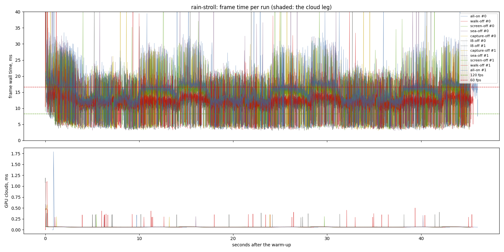
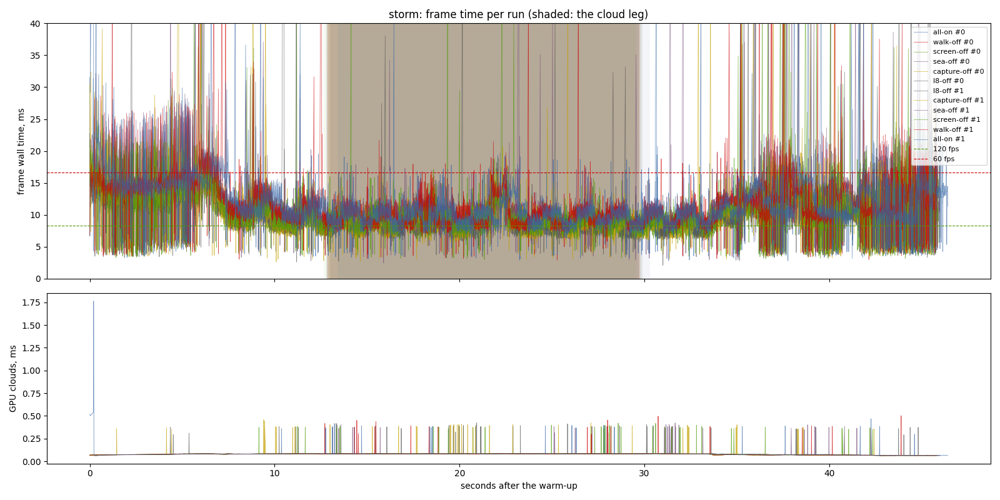

# L8 by part (2026-11-12)

`lighting-perf` task 1.1. One exe (`57d94b5`), `PBD_REFLECT` switching one
part of the reflections off per variant: `walk` (wet ground's voxel walk),
`screen` (wet ground's screen trace), `sea` (the sea's screen trace),
`capture` (last frame's capture, which both screen traces read), `0` (all).
RTX 3070 (Vulkan), i7-9700F, 1440 x 900, uncapped, release, 2 repeats
interleaved, clock at 10:00, frame latency 1 (the default when this ran).
The second half of the sitting whose first half is
`2026-11-12-frame-latency` (CPU samples before and after in `cpu/`).

## Findings

- **On foot in the rain, L8 is the voxel walk**: of 2.77 ms p50 (4.05 p95,
  9.54 p99) the walk is 2.10 (3.07, 7.54). In GPU time it is 1.50 of the
  terrain pass's 4.29 ms.
- **In the storm, L8 is wet ground's screen trace**: of 1.36 ms p50 (2.62
  p95, 5.30 p99) the trace is 1.10 (2.07, 4.59), 1.09 ms of the terrain
  pass. The sea's trace is 0.14 ms of GPU (in `water_compose`) and 0.16 ms
  of wall.
- **The capture pass costs 0.03-0.04 ms of GPU.** With it off its two
  readers bail out, so its row is the screen traces' cost, not its own.
- The per-part costs, the GPU per pass and the re-ranking are in
  `openspec/changes/lighting-perf/design.md`.

## Limits

- Two repeats; `all-on`'s two stroll runs differ by 1.0 ms at p95, so the
  p95 column of the small parts (sea, capture) is inside the spread.
- Latency 1: wall time partly adds CPU and GPU time here. The GPU columns
  do not depend on it.
- The raw CSVs and logs are local: `output/perf/2026-11-12-l8-split`.

# Performance suite, 2026-11-12 07:42

- revision: `57d94b5` (uncommitted changes)
- adapter: NVIDIA GeForce RTX 3070 (Vulkan); window 1440 x 900, uncapped (`--no-vsync`)
- clock pinned at 10.0 h; first 10.0 s after loading (the ready line, else the first frame) thrown away; 2 run(s) per variant, interleaved
- budgets: p95 within 8.3 ms (120 fps), p99 within 16.7 ms (60 fps); **over** marks a miss. Each cell is the median over the valid runs.

## rain-stroll

| variant | valid runs | fps | p50 | p95 | p99 | p99.9 | max | GPU total p50 | GPU clouds p50 / p95 |
| --- | ---: | ---: | ---: | ---: | ---: | ---: | ---: | ---: | ---: |
| all-on | 2/2 | 67.29 | 14.32 | 22.67 **over** | 30.36 **over** | 45.81 | 689.54 | 9.75 | 0.06 / 0.07 |
| walk-off | 2/2 | 79.34 | 12.22 | 19.60 **over** | 22.82 **over** | 45.47 | 671.37 | 7.80 | 0.06 / 0.07 |
| screen-off | 2/2 | 71.70 | 13.86 | 20.99 **over** | 27.82 **over** | 35.22 | 64.74 | 9.36 | 0.06 / 0.07 |
| sea-off | 2/2 | 68.98 | 14.19 | 20.90 **over** | 29.98 **over** | 53.78 | 91.95 | 9.60 | 0.06 / 0.07 |
| capture-off | 2/2 | 71.37 | 13.77 | 22.56 **over** | 28.25 **over** | 48.76 | 82.57 | 9.40 | 0.06 / 0.07 |
| l8-off | 2/2 | 85.08 | 11.55 | 18.62 **over** | 20.82 **over** | 46.26 | 166.12 | 7.12 | 0.06 / 0.07 |

GPU time per pass, p50 (ms; median over the valid runs):

| variant | cloud_march | cloud_puffs | cloud_resolve | lens_mist | lite_bloom | main_opaque_pass_3d | main_transparent_pass_3d | other | planet_cull | planet_shadow | rain | ssr_capture | tonemapping | upscaling | water_compose | water_lens | weather_overlay |
| --- | ---: | ---: | ---: | ---: | ---: | ---: | ---: | ---: | ---: | ---: | ---: | ---: | ---: | ---: | ---: | ---: | ---: |
| all-on | 0.00 | 0.03 | 0.00 | 0.00 | 0.08 | 0.54 | 4.29 | 0.04 | 0.19 | 2.02 | 1.43 | 0.03 | 0.03 | 0.02 | 0.07 | 0.29 | 0.00 |
| walk-off | 0.00 | 0.04 | 0.00 | 0.00 | 0.09 | 0.47 | 2.79 | 0.04 | 0.19 | 2.02 | 1.44 | 0.03 | 0.03 | 0.02 | 0.07 | 0.29 | 0.00 |
| screen-off | 0.00 | 0.03 | 0.00 | 0.00 | 0.09 | 0.52 | 4.08 | 0.04 | 0.19 | 2.02 | 1.44 | 0.03 | 0.03 | 0.02 | 0.07 | 0.29 | 0.00 |
| sea-off | 0.00 | 0.03 | 0.00 | 0.00 | 0.08 | 0.53 | 4.34 | 0.04 | 0.19 | 2.02 | 1.44 | 0.03 | 0.03 | 0.02 | 0.07 | 0.29 | 0.00 |
| capture-off | 0.00 | 0.03 | 0.00 | 0.00 | 0.08 | 0.52 | 4.12 | 0.04 | 0.19 | 2.02 | 1.44 | 0.00 | 0.03 | 0.02 | 0.07 | 0.29 | 0.00 |
| l8-off | 0.00 | 0.04 | 0.00 | 0.00 | 0.08 | 0.45 | 2.23 | 0.04 | 0.19 | 2.02 | 1.44 | 0.00 | 0.03 | 0.02 | 0.07 | 0.29 | 0.00 |

Left out: the fresh world's planet rebuild, 12 frame(s) of 6373-7114 ms.

## storm

| variant | valid runs | fps | p50 | p95 | p99 | p99.9 | max | GPU total p50 | GPU clouds p50 / p95 |
| --- | ---: | ---: | ---: | ---: | ---: | ---: | ---: | ---: | ---: |
| all-on | 2/2 | 90.03 | 10.36 | 17.09 **over** | 25.48 **over** | 55.62 | 144.72 | 6.06 | 0.08 / 0.08 |
| walk-off | 2/2 | 90.70 | 10.39 | 16.56 **over** | 23.61 **over** | 51.69 | 96.24 | 6.07 | 0.08 / 0.08 |
| screen-off | 2/2 | 101.19 | 9.26 | 15.02 **over** | 20.89 **over** | 45.60 | 64.40 | 4.98 | 0.08 / 0.08 |
| sea-off | 2/2 | 91.65 | 10.20 | 17.02 **over** | 25.10 **over** | 49.65 | 81.02 | 5.93 | 0.08 / 0.08 |
| capture-off | 2/2 | 104.15 | 9.00 | 14.74 **over** | 20.94 **over** | 46.27 | 75.36 | 4.83 | 0.08 / 0.08 |
| l8-off | 2/2 | 103.46 | 9.00 | 14.47 **over** | 20.18 **over** | 55.22 | 75.23 | 4.81 | 0.08 / 0.08 |

On the cloud leg only (the stretch the plan flies through cloud):

| variant | fps | p50 | p95 | p99 | max | GPU total p50 / p95 | GPU clouds p50 / p95 |
| --- | ---: | ---: | ---: | ---: | ---: | ---: | ---: |
| all-on | 102.98 | 9.56 | 12.59 **over** | 16.12 | 41.59 | 5.39 / 7.42 | 0.08 / 0.08 |
| walk-off | 102.87 | 9.55 | 12.91 **over** | 15.42 | 50.63 | 5.37 / 7.42 | 0.08 / 0.08 |
| screen-off | 112.11 | 8.68 | 11.82 **over** | 15.09 | 58.57 | 4.54 / 6.49 | 0.08 / 0.08 |
| sea-off | 105.14 | 9.29 | 12.30 **over** | 16.47 | 76.99 | 5.13 / 7.17 | 0.08 / 0.08 |
| capture-off | 116.73 | 8.36 | 11.38 **over** | 14.20 | 51.24 | 4.24 / 6.21 | 0.08 / 0.08 |
| l8-off | 114.99 | 8.34 | 12.17 **over** | 15.31 | 55.44 | 4.24 / 6.18 | 0.08 / 0.08 |

GPU time per pass, p50 (ms; median over the valid runs):

| variant | cloud_march | cloud_puffs | cloud_resolve | lens_mist | lite_bloom | main_opaque_pass_3d | main_transparent_pass_3d | other | planet_cull | planet_shadow | rain | ssr_capture | tonemapping | upscaling | water_compose | water_lens | weather_overlay |
| --- | ---: | ---: | ---: | ---: | ---: | ---: | ---: | ---: | ---: | ---: | ---: | ---: | ---: | ---: | ---: | ---: | ---: |
| all-on | 0.17 | 0.14 | 0.00 | 0.01 | 0.08 | 0.01 | 3.37 | 0.04 | 0.17 | 0.95 | 0.00 | 0.04 | 0.03 | 0.02 | 0.45 | 0.09 | 0.00 |
| walk-off | 0.17 | 0.14 | 0.00 | 0.01 | 0.08 | 0.00 | 3.32 | 0.04 | 0.17 | 0.95 | 0.00 | 0.04 | 0.03 | 0.02 | 0.46 | 0.09 | 0.00 |
| screen-off | 0.17 | 0.14 | 0.00 | 0.01 | 0.08 | 0.01 | 2.28 | 0.04 | 0.17 | 0.97 | 0.00 | 0.04 | 0.03 | 0.02 | 0.45 | 0.09 | 0.00 |
| sea-off | 0.17 | 0.14 | 0.00 | 0.01 | 0.08 | 0.00 | 3.30 | 0.04 | 0.17 | 0.96 | 0.00 | 0.04 | 0.03 | 0.02 | 0.31 | 0.09 | 0.00 |
| capture-off | 0.17 | 0.14 | 0.00 | 0.01 | 0.08 | 0.01 | 2.23 | 0.04 | 0.17 | 0.95 | 0.00 | 0.00 | 0.03 | 0.02 | 0.31 | 0.09 | 0.00 |
| l8-off | 0.17 | 0.14 | 0.00 | 0.01 | 0.08 | 0.01 | 2.18 | 0.04 | 0.17 | 0.96 | 0.00 | 0.00 | 0.03 | 0.02 | 0.31 | 0.09 | 0.00 |

Left out: the fresh world's planet rebuild, 12 frame(s) of 6064-6721 ms.

