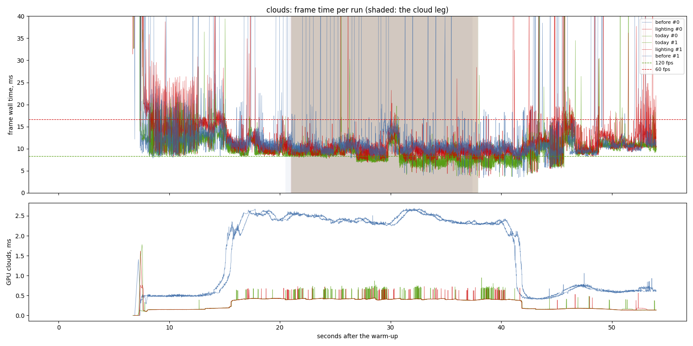
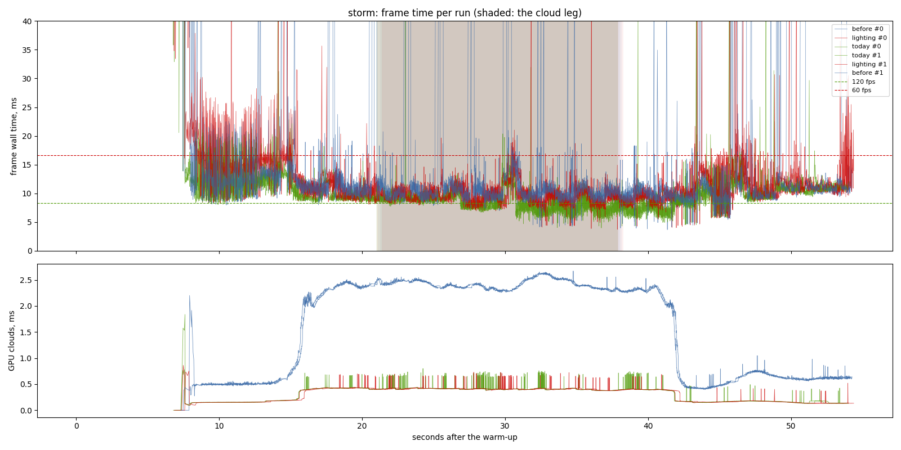
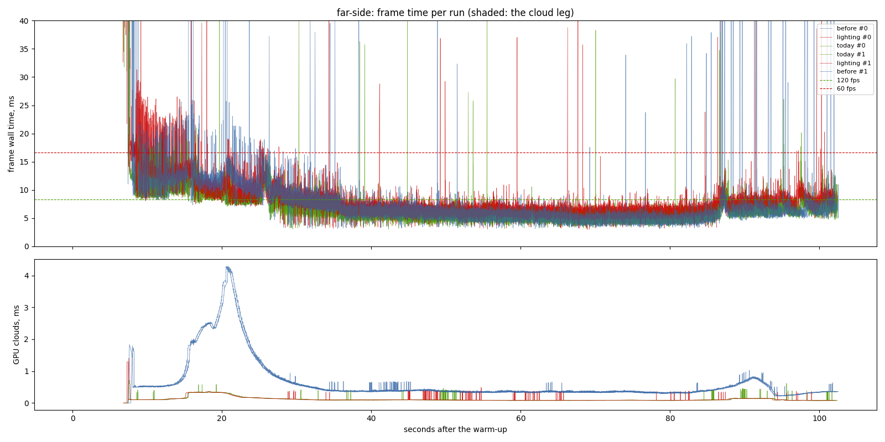
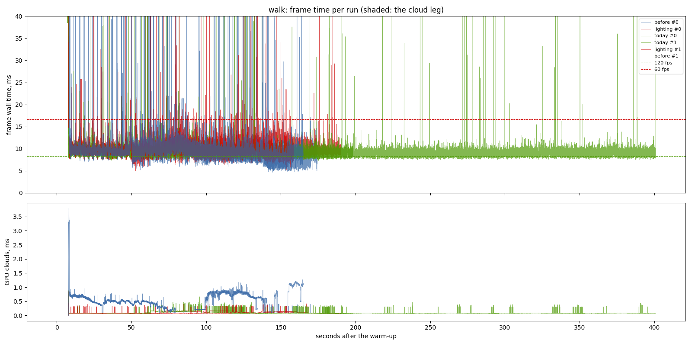
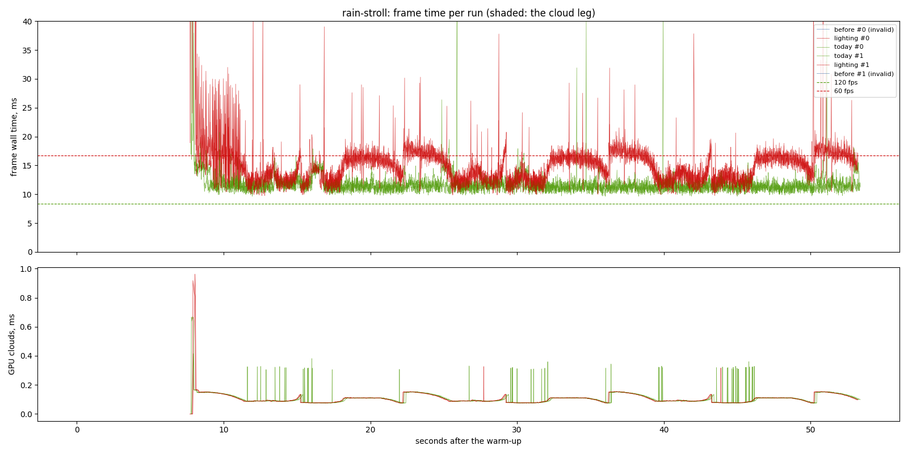
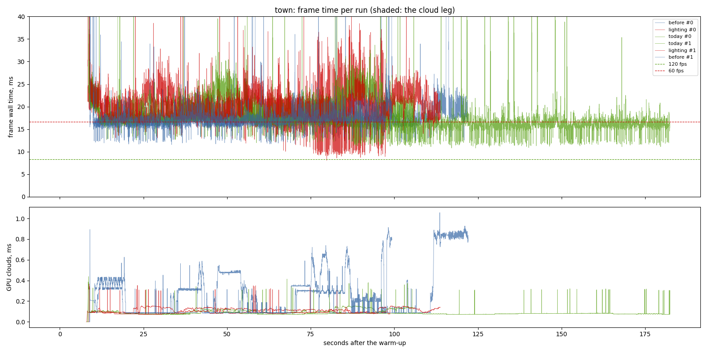
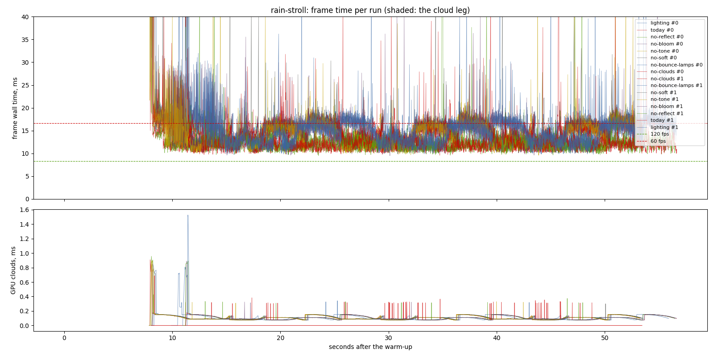
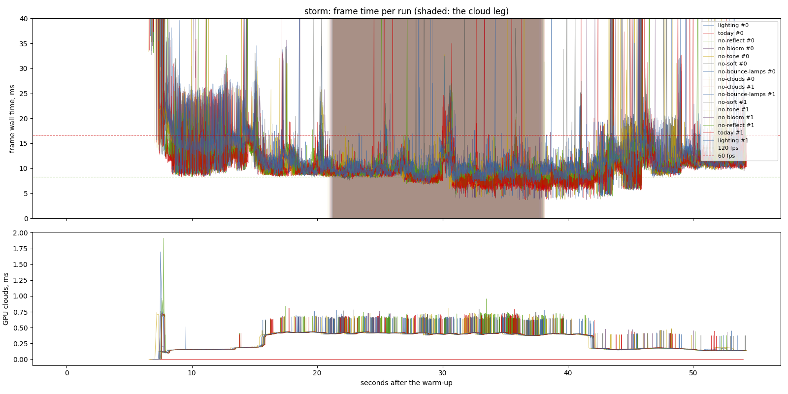
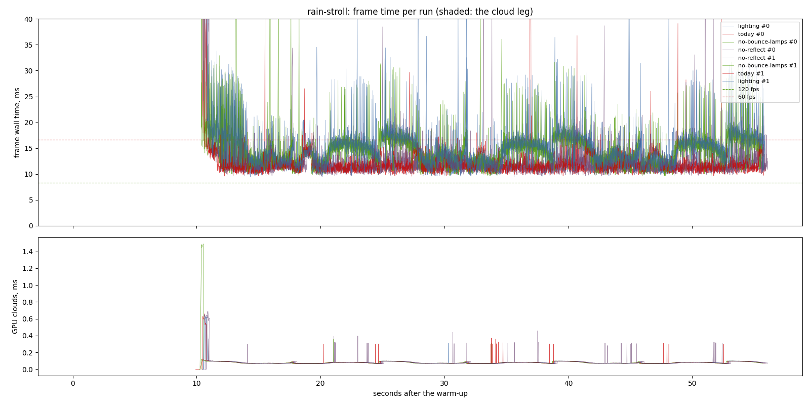

# The lighting model on the owner's desktop, clean re-run (2026-11-12)

This replaces `2026-11-11-lighting-model`. That sitting ran while other agents
rendered mockups in headless Edge on SwiftShader (CPU WebGL) and ran Python
art scripts. This one ran on a quiet machine, with nothing heavy beside it.

It used the same exes, assets revisions and scenarios as 2026-11-11, plus the
`town` walk. Machine: RTX 3070 (driver 617.14, Vulkan), i7-9700F, Windows 10,
window 1440 x 900, uncapped (`--no-vsync`), release builds, 2 repeats per
variant, interleaved. Three sittings:

- **A/B** (03:14): `before` = `db25fe2` (main before the lighting merge, on its own assets), `lighting` = `f15a647`, and `today` = `f15a647` with `PBD_LIGHTING=today` (the old model in the same exe). Clock at 10:00. Scenarios: `clouds`, `storm`, `far-side`, `walk`, `rain-stroll`, `town`. The `town` walk is `town-frame-time`'s Ashenstead walk in rain, run from a copy of the suite that adds it, since main's suite does not have it.
- **By part** (04:21): `f15a647` with one part off at a time, on `rain-stroll` and `storm`.
- **Night** (04:59): `rain-stroll` at 22:00, in Holbrook's lamp-lit lane.

The plan that follows is `openspec/changes/lighting-perf` (written up, not
built).

## Findings

- **On foot in the rain the new model costs 2.7 ms at p50 and 4.2 ms at p95**: `rain-stroll` goes from 11.54 to 14.27 ms p50, 14.30 to 18.48 ms p95 and 16.21 to 28.47 ms p99, old model against new in the same exe. The spread between repeats is 0.12 ms at p50. The new model takes the stroll past the 60 fps floor at p99.
- **Almost all of that is L8, reflections.** With `PBD_REFLECT=0` the stroll reads 12.15 ms p50, against 12.39 for the old model in the same sitting. L8 costs 2.2 ms p50, 3.7 ms p95 and 8.2 ms p99 there. The by-part `today` runs spread 0.8 ms at p50 (11.57 and 12.39), so read the p50 against the A/B's 2.7 ms. GPU total falls 2.5 ms with L8 off: the frame is GPU-bound in it.
- **Night is the day's picture.** The model costs 2.39 ms p50 at 22:00, and L8 is 2.38 ms of it (4.4 ms p95, 9.8 ms p99). Sun bounce and lamp bake together (L4 + L7) cost 0.25 ms p50 at night, about twice their spread: small, but possibly real where the lamps are lit.
- **In the dry and in flight the model costs 0.7-1.1 ms at p50 and 1.8-3.5 ms at p95**, old model against new, p50 then p95: clouds 8.96 to 9.89 and 13.06 to 16.33 (spread 0.04 at most); storm 9.01 to 10.06 and 13.05 to 16.50 (spread 0.17 at most); far-side 5.65 to 6.67 and 9.78 to 12.00 (spread 0.03 at most); walk 9.09 to 9.83 and 10.71 to 12.53 (spread 0.17 at most).
- **In the storm, L8 is most of the tail**: 0.64 of the 0.83 ms at p50, but 2.5 of 3.0 ms at p95 and 4.3 of 6.0 ms at p99.
- **Tone, grade and bloom cost 0.4 ms p50**, and bloom is 0.33-0.36 ms of it. **L3 (soft shadows) costs nothing measurable** (0.0 ms in storm, -0.1 ms on the stroll).
- **In the town walk the model's cost is inside the noise**: 17.69 to 18.11 ms p50, with the old model's two runs 1.3 ms apart. The walk is CPU-bound: wall time is 17-18 ms against 6-12 ms of GPU. Main, with or without the model, is at 16.9-18.1 ms there, against about 9 ms on the `town-frame-time` branch (2026-10-08, not in main yet).
- **Against main before the merge (`before`)**, `f15a647` is 0.25-0.4 ms faster at p50 in clouds and storm, because cloud GPU time falls from 2.3 to 0.4 ms. It is 0.6-1.3 ms slower in far-side, walk and town. `before` cannot run `rain-stroll`: that build has no `--stroll`.
- **A real multi-second stall, on a quiet machine: opening a world builds the planet twice.** On a fresh world the window opens at about 9.3 s, after a 5.2 s planet build. Then come one frame of 2.6-3.0 s, where the towns are surveyed and laid out, and one frame of 6.7-7.5 s, the planet *rebuilt* (5.3 s) so the towns' ground can be installed (`towns.rs` `settle` calls `planet::rebuild_planet` on the main thread, in an exclusive system). That is every row's `max`. A world reopened from its save pays the same rebuild before its first frame: the first frame came at 13.0 s, 5.1 s of planet build plus 5.35 s of rebuild. So every open spends about 5 s generating a planet it then throws away. This is not the lighting model; it is in `before` too. It is written up for `town-frame-time` (task 3.6, "a fresh world freezes for about 18 s"), and the rebuild is now named as the cause (`startup-town_lighting_0.png`).
- **Ranked optimizations**: the costs are measured, the savings are estimates; see `openspec/changes/lighting-perf/design.md`.
  1. Make the L8 terrain trace stop when nothing can be hit. Of 2.2-2.7 ms on foot in rain, an estimated 0.8-1.8 ms.
  2. Run the L8 sea trace only where it shows pixels. Of 0.64 ms p50 and 2.5 ms p95 in the storm, an estimated 0.3-0.6 ms.
  3. Skip the L8 capture when nothing reflects. An estimated 0.1-0.3 ms.
  4. Stop rebuilding the cloud-puff sites every frame. 0.35-0.4 ms of main-thread time, measured from the game's log.
  5. Cache small per-frame CPU work.
  6. Skip the lamp bake when no lamp is in reach: 0.25 ms at night.
  7. Fold bloom's composite into the tone pass. Of 0.33-0.36 ms, an estimated 0.1-0.2 ms.

## Limits

- **Owner's apps were open and idle, as asked.** The 10 s per-process samples (end of this file, and `cpu/`) were taken before and after each sitting, and the whole machine read 9-13% busy. Chrome used 23-50% of one core, The Zachtronics Solitaire Collection (a game, drawing on the GPU) 15-20%, and steamwebhelper 6-11%. Parsec and GOG Galaxy were also running. Nothing else was building or rendering.
- **Clean against contaminated.** p50s moved by 0.1-0.8 ms: the walk read 8.3 and 9.2 ms on 11-11 and 9.1 and 9.8 ms here, and far-side about 0.4 ms higher. That could be the Solitaire game holding the GPU awake, or clocks; it was not isolated. **The model's cost (new minus old, same exe, same sitting) agrees within 0.3 ms between the two days.** The tails changed: the A/B flight tails now agree between repeats within 0.4 ms at p95 and 2.3 ms at p99 (11-11: 10-20 ms at p95). The cold start is gone: the first frame now arrives at 9-11 s (11-11: 50-55 s on the first run of each exe).
- **The 10 s warm-up is counted from launch.** The window's first frame arrives at 9-11 s, so in some runs that first loading frame (9.8-11.3 s long) lands just after the warm-up and becomes `max`. The town-survey and planet-rebuild frames always land after it. They raise p99.9 and `max`, not p50-p99.
- **The `town` walk is noisy**: `today` read 16.40 and 17.69 ms p50, and its runs walked for different times (10,231 against 5,221 frames). Read its p50 differences as not results.
- **Two repeats per variant.** A difference smaller than the spread named beside it is not a result.
- **L8's three parts (terrain trace, sea trace, capture) are still not priced apart**, and there are no per-pass GPU columns. Those are `lighting-perf` tasks 1.1 and 1.2.
- The raw CSVs and logs are local: `output/perf/2026-11-12-lighting-model-clean{,-price,-night}` and `output/perf/2026-11-12-reopen` in the `pbd-perf-main` worktree.

# A/B: before, lighting, today

- revision: `f15a647`
- adapter: NVIDIA GeForce RTX 3070 (Vulkan); window 1440 x 900, uncapped (`--no-vsync`)
- clock pinned at 10.0 h; first 10.0 s of each run thrown away; 2 run(s) per variant, interleaved
- budgets: p95 within 8.3 ms (120 fps), p99 within 16.7 ms (60 fps); **over** marks a miss. Each cell is the median over the valid runs.

## clouds

| variant | valid runs | fps | p50 | p95 | p99 | p99.9 | max | GPU total p50 | GPU clouds p50 / p95 |
| --- | ---: | ---: | ---: | ---: | ---: | ---: | ---: | ---: | ---: |
| before | 2/2 | 71.02 | 10.29 | 15.01 **over** | 27.55 **over** | 237.47 | 6985.62 | 6.88 | 2.29 / 2.60 |
| lighting | 2/2 | 76.28 | 9.89 | 16.33 **over** | 25.65 **over** | 118.89 | 6786.90 | 5.54 | 0.40 / 0.43 |
| today | 2/2 | 89.35 | 8.96 | 13.06 **over** | 18.78 **over** | 69.58 | 6737.10 | 4.31 | 0.40 / 0.43 |

On the cloud leg only (the stretch the plan flies through cloud):

| variant | fps | p50 | p95 | p99 | max | GPU total p50 / p95 | GPU clouds p50 / p95 |
| --- | ---: | ---: | ---: | ---: | ---: | ---: | ---: |
| before | 90.50 | 9.99 | 13.66 **over** | 18.21 **over** | 242.91 | 6.84 / 8.62 | 2.41 / 2.64 |
| lighting | 105.65 | 9.18 | 12.08 **over** | 14.75 | 59.04 | 5.08 / 6.75 | 0.41 / 0.43 |
| today | 121.79 | 8.06 | 11.00 **over** | 13.00 | 44.49 | 3.86 / 5.38 | 0.41 / 0.43 |



## storm

| variant | valid runs | fps | p50 | p95 | p99 | p99.9 | max | GPU total p50 | GPU clouds p50 / p95 |
| --- | ---: | ---: | ---: | ---: | ---: | ---: | ---: | ---: | ---: |
| before | 2/2 | 70.03 | 10.31 | 14.81 **over** | 34.95 **over** | 253.92 | 7082.04 | 6.77 | 2.29 / 2.52 |
| lighting | 2/2 | 75.77 | 10.06 | 16.50 **over** | 25.05 **over** | 82.20 | 6915.12 | 5.51 | 0.40 / 0.43 |
| today | 2/2 | 88.76 | 9.01 | 13.05 **over** | 18.18 **over** | 51.29 | 6831.51 | 4.31 | 0.40 / 0.43 |

On the cloud leg only (the stretch the plan flies through cloud):

| variant | fps | p50 | p95 | p99 | max | GPU total p50 / p95 | GPU clouds p50 / p95 |
| --- | ---: | ---: | ---: | ---: | ---: | ---: | ---: |
| before | 90.33 | 9.98 | 13.56 **over** | 17.95 **over** | 254.85 | 6.80 / 8.62 | 2.40 / 2.60 |
| lighting | 104.73 | 9.30 | 12.24 **over** | 15.31 | 50.79 | 5.09 / 6.72 | 0.41 / 0.43 |
| today | 121.75 | 8.05 | 10.87 **over** | 12.83 | 44.94 | 3.80 / 5.38 | 0.41 / 0.43 |



## far-side

| variant | valid runs | fps | p50 | p95 | p99 | p99.9 | max | GPU total p50 | GPU clouds p50 / p95 |
| --- | ---: | ---: | ---: | ---: | ---: | ---: | ---: | ---: | ---: |
| before | 2/2 | 138.54 | 5.67 | 11.55 **over** | 15.37 | 95.92 | 7170.18 | 2.92 | 0.36 / 1.46 |
| lighting | 2/2 | 123.05 | 6.67 | 12.00 **over** | 16.75 **over** | 38.01 | 6912.83 | 2.84 | 0.09 / 0.24 |
| today | 2/2 | 145.67 | 5.65 | 9.78 **over** | 12.55 | 24.12 | 6874.07 | 2.49 | 0.09 / 0.22 |



## walk

| variant | valid runs | fps | p50 | p95 | p99 | p99.9 | max | GPU total p50 | GPU clouds p50 / p95 |
| --- | ---: | ---: | ---: | ---: | ---: | ---: | ---: | ---: | ---: |
| before | 2/2 | 95.06 | 9.22 | 11.91 **over** | 15.67 | 219.57 | 7321.84 | 5.84 | 0.50 / 1.05 |
| lighting | 2/2 | 93.51 | 9.83 | 12.53 **over** | 15.33 | 44.24 | 7337.33 | 5.34 | 0.09 / 0.16 |
| today | 2/2 | 102.60 | 9.09 | 10.71 **over** | 12.10 | 46.28 | 7219.89 | 4.57 | 0.08 / 0.15 |



## rain-stroll

| variant | valid runs | fps | p50 | p95 | p99 | p99.9 | max | GPU total p50 | GPU clouds p50 / p95 |
| --- | ---: | ---: | ---: | ---: | ---: | ---: | ---: | ---: | ---: |
| before | 0/2 | - | - | - | - | - | - | - | - / - |
| lighting | 2/2 | 55.14 | 14.27 | 18.48 **over** | 28.47 **over** | 150.81 | 7186.93 | 9.57 | 0.09 / 0.15 |
| today | 2/2 | 68.63 | 11.54 | 14.30 **over** | 16.21 | 63.55 | 7358.35 | 6.16 | 0.10 / 0.15 |
- invalid: before run 0: exit code 101; no STROLL_DONE line; only 0 frames after the warm-up
- invalid: before run 1: exit code 101; no STROLL_DONE line; only 0 frames after the warm-up



## town

| variant | valid runs | fps | p50 | p95 | p99 | p99.9 | max | GPU total p50 | GPU clouds p50 / p95 |
| --- | ---: | ---: | ---: | ---: | ---: | ---: | ---: | ---: | ---: |
| before | 2/2 | 51.14 | 16.85 | 20.36 **over** | 24.17 **over** | 339.59 | 7516.45 | 6.80 | 0.20 / 0.83 |
| lighting | 2/2 | 47.06 | 18.11 | 26.09 **over** | 32.61 **over** | 170.73 | 7676.31 | 11.84 | 0.11 / 0.14 |
| today | 2/2 | 47.98 | 17.69 | 24.45 **over** | 28.02 **over** | 85.72 | 7545.53 | 6.15 | 0.09 / 0.14 |




# By part: one part off at a time (f15a647)

- revision: `f15a647`
- adapter: NVIDIA GeForce RTX 3070 (Vulkan); window 1440 x 900, uncapped (`--no-vsync`)
- clock pinned at 10.0 h; first 10.0 s of each run thrown away; 2 run(s) per variant, interleaved
- budgets: p95 within 8.3 ms (120 fps), p99 within 16.7 ms (60 fps); **over** marks a miss. Each cell is the median over the valid runs.

## rain-stroll

| variant | valid runs | fps | p50 | p95 | p99 | p99.9 | max | GPU total p50 | GPU clouds p50 / p95 |
| --- | ---: | ---: | ---: | ---: | ---: | ---: | ---: | ---: | ---: |
| lighting | 2/2 | 46.52 | 14.33 | 18.69 **over** | 26.86 **over** | 81.37 | 10008.12 | 9.53 | 0.09 / 0.15 |
| today | 2/2 | 53.46 | 12.39 | 15.55 **over** | 18.36 **over** | 122.36 | 10113.99 | 6.21 | 0.10 / 0.15 |
| no-reflect | 2/2 | 54.90 | 12.15 | 15.01 **over** | 18.62 **over** | 119.40 | 10081.24 | 7.06 | 0.10 / 0.15 |
| no-bloom | 2/2 | 47.30 | 13.97 | 18.37 **over** | 26.61 **over** | 87.40 | 10109.69 | 9.51 | 0.09 / 0.15 |
| no-tone | 2/2 | 56.82 | 13.90 | 18.22 **over** | 25.68 **over** | 65.76 | 7291.74 | 9.28 | 0.09 / 0.15 |
| no-soft | 2/2 | 54.45 | 14.46 | 18.83 **over** | 27.47 **over** | 79.29 | 7435.60 | 9.60 | 0.09 / 0.15 |
| no-bounce-lamps | 2/2 | 46.50 | 14.49 | 18.46 **over** | 27.79 **over** | 213.41 | 10035.32 | 9.56 | 0.09 / 0.15 |
| no-clouds | 2/2 | 55.21 | 14.18 | 18.17 **over** | 24.86 **over** | 82.86 | 7418.44 | 9.61 | -0.00 / -0.00 |



## storm

| variant | valid runs | fps | p50 | p95 | p99 | p99.9 | max | GPU total p50 | GPU clouds p50 / p95 |
| --- | ---: | ---: | ---: | ---: | ---: | ---: | ---: | ---: | ---: |
| lighting | 2/2 | 75.19 | 10.05 | 16.60 **over** | 25.74 **over** | 93.92 | 6890.95 | 5.41 | 0.40 / 0.43 |
| today | 2/2 | 85.93 | 9.22 | 13.63 **over** | 19.75 **over** | 53.85 | 6885.52 | 4.21 | 0.40 / 0.43 |
| no-reflect | 2/2 | 82.28 | 9.41 | 14.11 **over** | 21.44 **over** | 91.87 | 6922.51 | 4.37 | 0.40 / 0.43 |
| no-bloom | 2/2 | 77.59 | 9.72 | 16.39 **over** | 24.48 **over** | 95.42 | 6925.13 | 5.43 | 0.40 / 0.43 |
| no-tone | 2/2 | 78.63 | 9.65 | 16.24 **over** | 23.91 **over** | 79.87 | 6745.52 | 5.51 | 0.40 / 0.43 |
| no-soft | 2/2 | 74.75 | 10.05 | 17.79 **over** | 25.18 **over** | 57.11 | 6849.95 | 5.60 | 0.40 / 0.43 |
| no-bounce-lamps | 2/2 | 75.65 | 10.07 | 16.62 **over** | 24.53 **over** | 69.88 | 6760.30 | 5.60 | 0.40 / 0.43 |
| no-clouds | 2/2 | 81.58 | 9.34 | 15.47 **over** | 23.99 **over** | 65.01 | 6641.97 | 5.13 | -0.00 / -0.00 |

On the cloud leg only (the stretch the plan flies through cloud):

| variant | fps | p50 | p95 | p99 | max | GPU total p50 / p95 | GPU clouds p50 / p95 |
| --- | ---: | ---: | ---: | ---: | ---: | ---: | ---: |
| lighting | 104.51 | 9.35 | 12.66 **over** | 16.66 | 51.64 | 5.00 / 6.70 | 0.41 / 0.43 |
| today | 118.36 | 8.13 | 11.25 **over** | 16.62 | 53.71 | 3.81 / 5.40 | 0.41 / 0.43 |
| no-reflect | 112.58 | 8.68 | 11.93 **over** | 15.32 | 54.69 | 3.90 / 5.51 | 0.41 / 0.43 |
| no-bloom | 108.40 | 9.03 | 12.29 **over** | 15.34 | 53.96 | 4.99 / 6.65 | 0.41 / 0.43 |
| no-tone | 109.94 | 8.89 | 12.01 **over** | 14.46 | 61.32 | 4.96 / 6.64 | 0.41 / 0.43 |
| no-soft | 103.93 | 9.22 | 12.70 **over** | 19.47 **over** | 48.52 | 5.03 / 6.70 | 0.41 / 0.43 |
| no-bounce-lamps | 104.33 | 9.28 | 12.27 **over** | 15.44 | 92.72 | 5.03 / 6.68 | 0.41 / 0.43 |
| no-clouds | 113.76 | 8.68 | 11.49 **over** | 14.31 | 54.05 | 4.51 / 6.24 | -0.00 / -0.00 |




# Night: rain-stroll at 22:00 (f15a647)

- revision: `f15a647`
- adapter: NVIDIA GeForce RTX 3070 (Vulkan); window 1440 x 900, uncapped (`--no-vsync`)
- clock pinned at 22.0 h; first 10.0 s of each run thrown away; 2 run(s) per variant, interleaved
- budgets: p95 within 8.3 ms (120 fps), p99 within 16.7 ms (60 fps); **over** marks a miss. Each cell is the median over the valid runs.

## rain-stroll

| variant | valid runs | fps | p50 | p95 | p99 | p99.9 | max | GPU total p50 | GPU clouds p50 / p95 |
| --- | ---: | ---: | ---: | ---: | ---: | ---: | ---: | ---: | ---: |
| lighting | 2/2 | 46.16 | 14.03 | 19.69 **over** | 29.84 **over** | 89.19 | 11321.76 | 9.46 | 0.07 / 0.10 |
| today | 2/2 | 56.51 | 11.64 | 14.68 **over** | 16.32 | 296.54 | 11289.79 | 6.57 | 0.08 / 0.10 |
| no-bounce-lamps | 2/2 | 47.43 | 13.78 | 19.04 **over** | 28.79 **over** | 124.41 | 11172.10 | 9.31 | 0.07 / 0.10 |
| no-reflect | 2/2 | 55.53 | 11.65 | 15.30 **over** | 20.06 **over** | 90.01 | 11368.77 | 7.03 | 0.07 / 0.10 |




# CPU samples (10 s, per process, % of one core)

## ab-before

```
sample 2026-11-12T03:14:38, 8 logical cores, all processes together: 9% of the machine
Name                                 CorePct
----                                 -------
chrome                                  22.6
The Zachtronics Solitaire Collection    16.1
powershell                              10.6
steamwebhelper                           7.7
claude                                   5.5
procexp64                                5.5
Discord                                  1.8
SourceTree                               0.9
audiodg                                  0.8
AdobeCollabSync                          0.2
gameoverlayui64                          0.2
BlueStacksServices                       0.2
```

## ab-after

```
sample 2026-11-12T04:20:37, 8 logical cores, all processes together: 13.1% of the machine
Name                                 CorePct
----                                 -------
chrome                                  49.5
The Zachtronics Solitaire Collection    17.8
powershell                              11.6
steamwebhelper                          11.2
procexp64                                5.3
claude                                   4.8
Discord                                  2.8
AdobeCollabSync                          0.4
audiodg                                  0.3
GOG Galaxy Notifications Renderer        0.2
steam                                    0.2
qbittorrent                              0.2
```

## price-before

```
sample 2026-11-12T04:20:50, 8 logical cores, all processes together: 12.3% of the machine
Name                                 CorePct
----                                 -------
chrome                                  45.9
The Zachtronics Solitaire Collection    20.3
powershell                              11.4
steamwebhelper                           6.9
claude                                     5
procexp64                                4.4
Discord                                  1.9
conhost                                  0.5
explorer                                 0.5
GOG Galaxy Notifications Renderer        0.3
qbittorrent                              0.2
BlueStacksServices                       0.2
```

## price-after

```
sample 2026-11-12T04:57:02, 8 logical cores, all processes together: 10.9% of the machine
Name                                 CorePct
----                                 -------
chrome                                  37.3
The Zachtronics Solitaire Collection    15.3
powershell                              10.2
steamwebhelper                           8.6
procexp64                                  5
claude                                     4
Discord                                  2.1
SourceTree                               1.9
Spotify                                  0.7
audiodg                                  0.6
explorer                                 0.6
GoogleDriveFS                            0.3
```

## night-before

```
sample 2026-11-12T04:57:15, 8 logical cores, all processes together: 9.7% of the machine
Name                                 CorePct
----                                 -------
chrome                                  29.3
The Zachtronics Solitaire Collection    15.5
powershell                              10.2
steamwebhelper                           6.8
procexp64                                5.8
claude                                   3.3
Discord                                  1.9
SourceTree                               1.6
audiodg                                  1.4
conhost                                  0.3
BlueStacksServices                       0.3
parsecd                                  0.3
```

## night-after

```
sample 2026-11-12T05:06:35, 8 logical cores, all processes together: 10.4% of the machine
Name                                 CorePct
----                                 -------
chrome                                  33.8
The Zachtronics Solitaire Collection    17.2
powershell                              11.2
steamwebhelper                           6.7
procexp64                                  5
claude                                   3.8
Discord                                  1.9
audiodg                                  1.6
conhost                                  0.3
parsecd                                  0.3
bash                                     0.3
AdobeCollabSync                          0.2
```

