# lighting-perf: the checkpoint sitting (2026-11-12)

`lighting-perf` task 3.1, as a checkpoint toward the owner's "get worst case
to 60" (p99 within 16.7 ms in every scenario). Three builds, interleaved, 2
repeats, on the owner's desktop: RTX 3070 (Vulkan), i7-9700F, Windows 10,
1440 x 900, release builds, clock at 10:00 unless named.

- `f15a647`: the lighting model as merged to main, on its own assets, with
  its own frame latency (1).
- `before`: this branch before `lighting-perf` (`86361b1`, the
  `town-frame-time` work on top of the lighting model), latency 1.
- `final`: this branch now (`cdf0317`, the exe built from it): frame latency
  2 (`crab-breeze-lessons`), the L8 fixes 2.1 and 2.2, the puffs' and the
  switches' CPU fixes 2.4 and 2.5, the rain volume's cuts 2.10, and the
  loading screen (cherry-picked from its own worktree).

Five sittings, 11:40-13:20: every scenario uncapped; `rain-stroll` at
22:00; `final` against `PBD_LIGHTING=today` in the same exe; `final` with
vsync on; and the `walk` again with the Solitaire game closed.

## Findings

- **Every scenario is faster at every percentile it can be compared at**,
  p50 / p95 / p99 ms, `f15a647` then `final`:
  - `clouds`: 9.89 / 15.85 / 24.05 to **6.27 / 10.55 / 13.62**
  - `storm`: 9.93 / 16.20 / 24.74 to **6.17 / 10.77 / 13.74**
  - `far-side`: 6.57 / 11.95 / 15.94 to **4.08 / 6.98 / 9.04**
  - `rain-stroll`: 14.03 / 18.30 / 27.93 to **9.98 / 15.63 / 20.37**
  - `rain-stroll` at 22:00: 14.13 / 21.65 / 29.42 to **9.84 / 16.20 / 21.12**
  - `town` (rain): 17.33 / 24.87 / 29.99 to **9.90 / 16.54 / 22.01**
- **The 60 fps floor at p99 is met in flight** (`clouds`, `storm`,
  `far-side`: 13.6, 13.7, 9.0 ms) **and not yet on foot in the rain**
  (`rain-stroll` 20.4 by day, 21.1 at night; `town` 22.0). With vsync on,
  3.9% of the stroll's frames, 1.0% of the town's and 0.5% of the storm's
  are over 16.7 ms.
- **Most of the gain is frame latency 2**: 3.2-4.3 ms at p50 in every
  scenario on its own (`2026-11-12-frame-latency`). The fixes add 0.5 ms
  p50 and 2.7 ms p99 on the stroll (2.1), 0.26 ms p50 in the storm (2.2),
  and a third off the puffs' build (2.4); the loading screen took the
  storm's p99 from 18.0 to 14.9 ms (`2026-11-12-fixes`).
- **On foot in the rain the frame is the GPU's**: GPU total p50 is 9.5 ms
  against a wall p50 of 10.0 ms. The GPU by pass on the stroll: terrain
  (with L8) 4.43 ms, the sun's cascades 2.08, the rain volume 1.50, the
  opaque pass 0.51, the lens 0.29. The tail is GPU-bound frames the queue
  paces unevenly (`tools/tail_classes.py`).
- **The lighting model still costs 2.8 ms there**: `final` against
  `PBD_LIGHTING=today` in the same exe, 9.95 against 7.18 ms p50 (GPU 9.42
  against 6.60). The spec's 1.0 ms is not met yet.
- **The rain volume's cuts (2.10) saved nothing measurable**: 1.50 ms of
  GPU against 1.44 before. They are exact and stay in; the pass's cost is
  elsewhere (the shells' streaks and haze), which is the half-resolution
  task.
- **Spikes over 30 ms are mostly not the game's repeatable work.** In the
  storm, 4 a run recur at the same route metres in every run of every
  build (3544, 3808, 4122 m and touchdown, on the descent; one is a
  fine-set landing with an 11.6 ms upload). The rest, and nearly all of
  the walk's, fall at different places in each repeat. Closing the
  Solitaire game (12:20) changed nothing: 14-30 a run closed, 23 open,
  same exe, p99 20.2-20.7 against 20.3.
- **The town's own work**: `final`'s town walk recurs at 33 of 47 spikes
  in its two runs (the town bake), which the town agent's batching takes.

## Limits

- **`walk` and `town` cannot be compared across the loading screen.**
  With it, the `walk`'s world opens in a full storm (cover 1.00, rain
  1.00; before, 0.69 and 0.00), so `final`'s walk is a walk in the rain
  (9.89 / 15.48 / 20.69 against a dry 9.47 / 11.86 / 14.88). This is a
  loading-screen bug being fixed in its own worktree. The `town` forces
  rain in every build and is comparable.
- **`cloud-hop` is invalid in every build**: its route found no cloud at
  10:00 on this seed.
- **Warm-up**: `f15a647` and `before` start their warm-up at the first
  frame and then freeze about 6 s for the towns' ground; `final` starts at
  `READY`. The scripted routes are the same, but the stretch measured
  differs by a few seconds.
- **The machine**: Chrome, Steam, Discord and Spotify were open in every
  sitting (6-11% of the machine; Spotify used 49-56% of one core from
  about 13:00). The Solitaire game was open until 12:20.
- **Two repeats**; the quiet walk three. A difference under the spread is
  not a result.
- The raw CSVs and logs are local: `output/perf/2026-11-12-lighting-perf*`
  and `output/perf/2026-11-12-walk-quiet`.

# Performance suite, 2026-11-12 11:40

- revision: `cdf0317`
- adapter: NVIDIA GeForce RTX 3070 (Vulkan); window 1440 x 900, uncapped (`--no-vsync`)
- clock pinned at 10.0 h; first 10.0 s after loading (the ready line, else the first frame) thrown away; 2 run(s) per variant, interleaved
- budgets: p95 within 8.3 ms (120 fps), p99 within 16.7 ms (60 fps); **over** marks a miss. Each cell is the median over the valid runs.

## clouds

| variant | valid runs | fps | p50 | p95 | p99 | p99.9 | max | GPU total p50 | GPU clouds p50 / p95 |
| --- | ---: | ---: | ---: | ---: | ---: | ---: | ---: | ---: | ---: |
| f15a647 | 2/2 | 93.47 | 9.89 | 15.85 **over** | 24.05 **over** | 44.28 | 63.67 | 5.62 | 0.40 / 0.43 |
| before | 2/2 | 92.18 | 10.14 | 16.63 **over** | 24.48 **over** | 47.67 | 104.57 | 5.90 | 0.40 / 0.43 |
| final | 2/2 | 150.06 | 6.27 | 10.55 **over** | 13.62 | 42.64 | 70.64 | 5.65 | 0.08 / 0.09 |

On the cloud leg only (the stretch the plan flies through cloud):

| variant | fps | p50 | p95 | p99 | max | GPU total p50 / p95 | GPU clouds p50 / p95 |
| --- | ---: | ---: | ---: | ---: | ---: | ---: | ---: |
| f15a647 | 106.54 | 9.11 | 12.09 **over** | 14.19 | 47.23 | 5.14 / 6.78 | 0.41 / 0.43 |
| before | 104.56 | 9.23 | 12.81 **over** | 15.96 | 104.57 | 5.21 / 7.33 | 0.41 / 0.43 |
| final | 164.53 | 5.74 | 8.55 **over** | 12.47 | 52.64 | 5.07 / 7.26 | 0.08 / 0.09 |

GPU time per pass, p50 (ms; median over the valid runs):

| variant | cloud_march | cloud_puffs | cloud_resolve | lens_mist | lite_bloom | main_opaque_pass_3d | main_transparent_pass_3d | other | planet_cull | planet_shadow | rain | ssr_capture | tonemapping | upscaling | water_compose | water_lens | weather_overlay |
| --- | ---: | ---: | ---: | ---: | ---: | ---: | ---: | ---: | ---: | ---: | ---: | ---: | ---: | ---: | ---: | ---: | ---: |
| f15a647 | - | - | - | - | - | - | - | - | - | - | - | - | - | - | - | - | - |
| before | - | - | - | - | - | - | - | - | - | - | - | - | - | - | - | - | - |
| final | 0.17 | 0.15 | 0.00 | 0.01 | 0.08 | 0.00 | 2.65 | 0.04 | 0.17 | 0.88 | 0.00 | 0.03 | 0.00 | 0.02 | 0.52 | 0.11 | 0.00 |

Frames over 30 ms per run, and how many recur at the same place (25 m of route, 5 m of walk, or 1 s) in at least half of the scenario's other runs, of any variant. Those that recur are the game's own work at that place; the rest come and go between repeats (async work landing at another moment, or the machine):

| variant | spikes per run | recurring | not recurring |
| --- | --- | ---: | ---: |
| f15a647 | 11, 13 | 14 | 10 |
| before | 15, 18 | 11 | 22 |
| final | 6, 11 | 9 | 8 |

Left out: the fresh world's planet rebuild, 4 frame(s) of 6271-6757 ms.

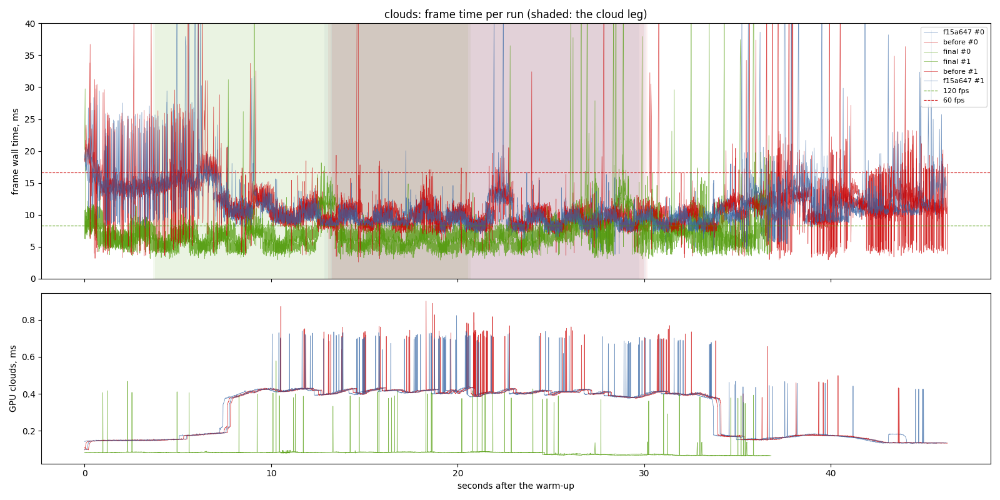

## storm

| variant | valid runs | fps | p50 | p95 | p99 | p99.9 | max | GPU total p50 | GPU clouds p50 / p95 |
| --- | ---: | ---: | ---: | ---: | ---: | ---: | ---: | ---: | ---: |
| f15a647 | 2/2 | 92.57 | 9.93 | 16.20 **over** | 24.74 **over** | 49.27 | 83.03 | 5.59 | 0.40 / 0.43 |
| before | 2/2 | 91.88 | 10.28 | 16.52 **over** | 24.92 **over** | 43.28 | 74.43 | 5.93 | 0.40 / 0.43 |
| final | 2/2 | 150.45 | 6.17 | 10.77 **over** | 13.74 | 47.47 | 78.52 | 5.53 | 0.08 / 0.09 |

On the cloud leg only (the stretch the plan flies through cloud):

| variant | fps | p50 | p95 | p99 | max | GPU total p50 / p95 | GPU clouds p50 / p95 |
| --- | ---: | ---: | ---: | ---: | ---: | ---: | ---: |
| f15a647 | 105.46 | 9.16 | 12.23 **over** | 16.13 | 75.22 | 5.11 / 6.81 | 0.41 / 0.43 |
| before | 104.37 | 9.28 | 12.79 **over** | 16.02 | 58.88 | 5.29 / 7.33 | 0.41 / 0.43 |
| final | 163.87 | 5.76 | 8.63 **over** | 12.47 | 78.52 | 4.99 / 7.21 | 0.08 / 0.09 |

GPU time per pass, p50 (ms; median over the valid runs):

| variant | cloud_march | cloud_puffs | cloud_resolve | lens_mist | lite_bloom | main_opaque_pass_3d | main_transparent_pass_3d | other | planet_cull | planet_shadow | rain | ssr_capture | tonemapping | upscaling | water_compose | water_lens | weather_overlay |
| --- | ---: | ---: | ---: | ---: | ---: | ---: | ---: | ---: | ---: | ---: | ---: | ---: | ---: | ---: | ---: | ---: | ---: |
| f15a647 | - | - | - | - | - | - | - | - | - | - | - | - | - | - | - | - | - |
| before | - | - | - | - | - | - | - | - | - | - | - | - | - | - | - | - | - |
| final | 0.17 | 0.15 | 0.00 | 0.01 | 0.08 | 0.00 | 2.57 | 0.04 | 0.17 | 0.90 | 0.00 | 0.03 | 0.00 | 0.02 | 0.53 | 0.10 | 0.00 |

Frames over 30 ms per run, and how many recur at the same place (25 m of route, 5 m of walk, or 1 s) in at least half of the scenario's other runs, of any variant. Those that recur are the game's own work at that place; the rest come and go between repeats (async work landing at another moment, or the machine):

| variant | spikes per run | recurring | not recurring |
| --- | --- | ---: | ---: |
| f15a647 | 18, 12 | 17 | 13 |
| before | 15, 14 | 14 | 15 |
| final | 12, 11 | 11 | 12 |

Left out: the fresh world's planet rebuild, 4 frame(s) of 6503-6588 ms.

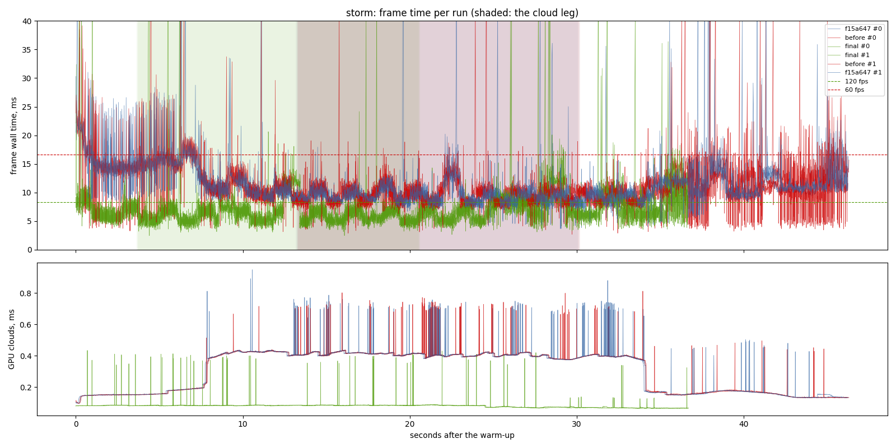

## cloud-hop

| variant | valid runs | fps | p50 | p95 | p99 | p99.9 | max | GPU total p50 | GPU clouds p50 / p95 |
| --- | ---: | ---: | ---: | ---: | ---: | ---: | ---: | ---: | ---: |
| f15a647 | 0/2 | - | - | - | - | - | - | - | - / - |
| before | 0/2 | - | - | - | - | - | - | - | - / - |
| final | 0/2 | - | - | - | - | - | - | - | - / - |

On the cloud leg only (the stretch the plan flies through cloud):

| variant | fps | p50 | p95 | p99 | max | GPU total p50 / p95 | GPU clouds p50 / p95 |
| --- | ---: | ---: | ---: | ---: | ---: | ---: | ---: |
| f15a647 | - | - | - | - | - | - / - | - / - |
| before | - | - | - | - | - | - / - | - / - |
| final | - | - | - | - | - | - / - | - / - |

Left out: the fresh world's planet rebuild, 4 frame(s) of 6470-6646 ms.
- invalid: f15a647 run 0: the scenic route found no cloud
- invalid: before run 0: the scenic route found no cloud
- invalid: final run 0: the scenic route found no cloud
- invalid: final run 1: the scenic route found no cloud
- invalid: before run 1: the scenic route found no cloud
- invalid: f15a647 run 1: the scenic route found no cloud

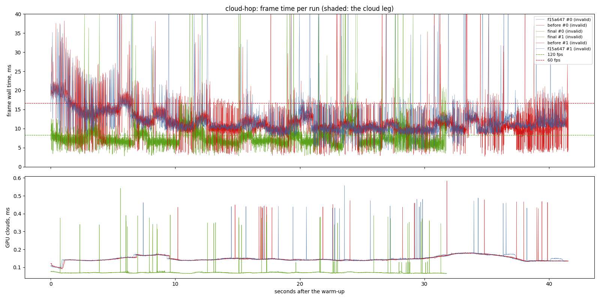

## far-side

| variant | valid runs | fps | p50 | p95 | p99 | p99.9 | max | GPU total p50 | GPU clouds p50 / p95 |
| --- | ---: | ---: | ---: | ---: | ---: | ---: | ---: | ---: | ---: |
| f15a647 | 2/2 | 137.95 | 6.57 | 11.95 **over** | 15.94 | 29.98 | 82.74 | 2.84 | 0.09 / 0.25 |
| before | 2/2 | 136.56 | 6.54 | 12.29 **over** | 16.64 | 39.24 | 165.64 | 2.85 | 0.09 / 0.24 |
| final | 2/2 | 225.22 | 4.08 | 6.98 | 9.04 | 14.99 | 87.36 | 2.76 | 0.07 / 0.08 |

GPU time per pass, p50 (ms; median over the valid runs):

| variant | cloud_march | cloud_puffs | cloud_resolve | lens_mist | lite_bloom | main_opaque_pass_3d | main_transparent_pass_3d | other | planet_cull | planet_shadow | rain | ssr_capture | tonemapping | upscaling | water_compose | water_lens | weather_overlay |
| --- | ---: | ---: | ---: | ---: | ---: | ---: | ---: | ---: | ---: | ---: | ---: | ---: | ---: | ---: | ---: | ---: | ---: |
| f15a647 | - | - | - | - | - | - | - | - | - | - | - | - | - | - | - | - | - |
| before | - | - | - | - | - | - | - | - | - | - | - | - | - | - | - | - | - |
| final | 0.00 | 0.02 | 0.00 | 0.00 | 0.08 | 0.00 | 1.00 | 0.04 | 0.10 | 0.34 | 0.00 | 0.03 | 0.00 | 0.03 | 0.64 | 0.02 | 0.00 |

Frames over 30 ms per run, and how many recur at the same place (25 m of route, 5 m of walk, or 1 s) in at least half of the scenario's other runs, of any variant. Those that recur are the game's own work at that place; the rest come and go between repeats (async work landing at another moment, or the machine):

| variant | spikes per run | recurring | not recurring |
| --- | --- | ---: | ---: |
| f15a647 | 10, 13 | 4 | 19 |
| before | 13, 17 | 6 | 24 |
| final | 11, 8 | 2 | 17 |

Left out: the fresh world's planet rebuild, 4 frame(s) of 6424-6871 ms.

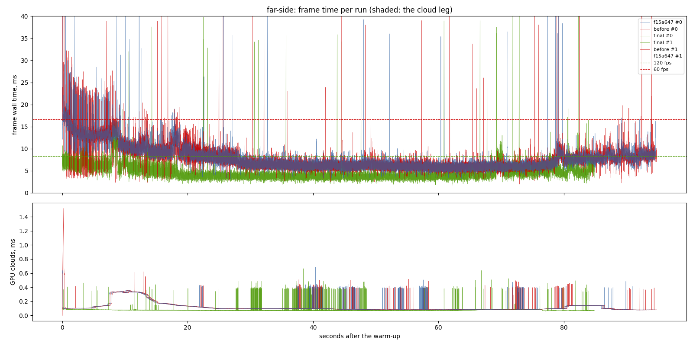

## walk

| variant | valid runs | fps | p50 | p95 | p99 | p99.9 | max | GPU total p50 | GPU clouds p50 / p95 |
| --- | ---: | ---: | ---: | ---: | ---: | ---: | ---: | ---: | ---: |
| f15a647 | 2/2 | 103.07 | 9.47 | 11.86 **over** | 14.88 | 43.50 | 555.85 | 5.41 | 0.08 / 0.16 |
| before | 2/2 | 103.70 | 9.41 | 12.35 **over** | 16.30 | 40.30 | 547.76 | 5.54 | 0.08 / 0.13 |
| final | 2/2 | 98.16 | 9.89 | 15.48 **over** | 20.69 **over** | 43.52 | 74.52 | 9.43 | 0.06 / 0.07 |

GPU time per pass, p50 (ms; median over the valid runs):

| variant | cloud_march | cloud_puffs | cloud_resolve | lens_mist | lite_bloom | main_opaque_pass_3d | main_transparent_pass_3d | other | planet_cull | planet_shadow | rain | ssr_capture | tonemapping | upscaling | water_compose | water_lens | weather_overlay |
| --- | ---: | ---: | ---: | ---: | ---: | ---: | ---: | ---: | ---: | ---: | ---: | ---: | ---: | ---: | ---: | ---: | ---: |
| f15a647 | - | - | - | - | - | - | - | - | - | - | - | - | - | - | - | - | - |
| before | - | - | - | - | - | - | - | - | - | - | - | - | - | - | - | - | - |
| final | 0.00 | 0.02 | 0.00 | 0.00 | 0.08 | 0.02 | 5.66 | 0.04 | 0.18 | 2.04 | 1.07 | 0.03 | 0.02 | 0.02 | 0.08 | 0.29 | 0.00 |

Frames over 30 ms per run, and how many recur at the same place (25 m of route, 5 m of walk, or 1 s) in at least half of the scenario's other runs, of any variant. Those that recur are the game's own work at that place; the rest come and go between repeats (async work landing at another moment, or the machine):

| variant | spikes per run | recurring | not recurring |
| --- | --- | ---: | ---: |
| f15a647 | 25, 33 | 8 | 50 |
| before | 21, 33 | 7 | 47 |
| final | 23, 30 | 3 | 50 |

Left out: the fresh world's planet rebuild, 4 frame(s) of 6656-6840 ms.

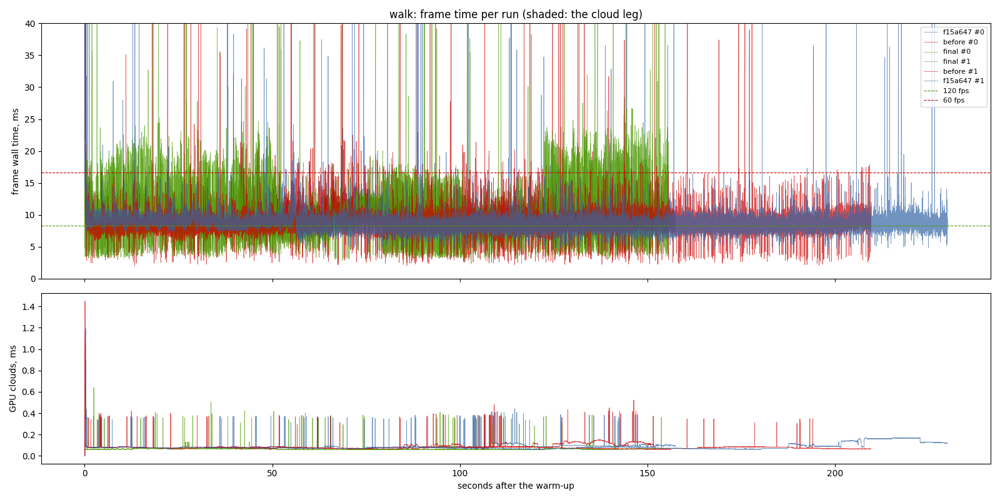

## rain-stroll

| variant | valid runs | fps | p50 | p95 | p99 | p99.9 | max | GPU total p50 | GPU clouds p50 / p95 |
| --- | ---: | ---: | ---: | ---: | ---: | ---: | ---: | ---: | ---: |
| f15a647 | 2/2 | 68.11 | 14.03 | 18.30 **over** | 27.93 **over** | 64.78 | 619.05 | 9.44 | 0.09 / 0.15 |
| before | 2/2 | 68.86 | 14.00 | 21.56 **over** | 30.03 **over** | 69.16 | 513.96 | 9.52 | 0.09 / 0.15 |
| final | 2/2 | 98.28 | 9.98 | 15.63 **over** | 20.37 **over** | 28.01 | 85.57 | 9.48 | 0.06 / 0.07 |

GPU time per pass, p50 (ms; median over the valid runs):

| variant | cloud_march | cloud_puffs | cloud_resolve | lens_mist | lite_bloom | main_opaque_pass_3d | main_transparent_pass_3d | other | planet_cull | planet_shadow | rain | ssr_capture | tonemapping | upscaling | water_compose | water_lens | weather_overlay |
| --- | ---: | ---: | ---: | ---: | ---: | ---: | ---: | ---: | ---: | ---: | ---: | ---: | ---: | ---: | ---: | ---: | ---: |
| f15a647 | - | - | - | - | - | - | - | - | - | - | - | - | - | - | - | - | - |
| before | - | - | - | - | - | - | - | - | - | - | - | - | - | - | - | - | - |
| final | 0.00 | 0.04 | 0.00 | 0.00 | 0.09 | 0.51 | 4.43 | 0.04 | 0.18 | 2.08 | 1.50 | 0.03 | 0.03 | 0.02 | 0.07 | 0.29 | 0.00 |

Frames over 30 ms per run, and how many recur at the same place (25 m of route, 5 m of walk, or 1 s) in at least half of the scenario's other runs, of any variant. Those that recur are the game's own work at that place; the rest come and go between repeats (async work landing at another moment, or the machine):

| variant | spikes per run | recurring | not recurring |
| --- | --- | ---: | ---: |
| f15a647 | 18, 13 | 14 | 17 |
| before | 34, 29 | 30 | 33 |
| final | 4, 4 | 1 | 7 |

Left out: the fresh world's planet rebuild, 4 frame(s) of 6690-6969 ms.

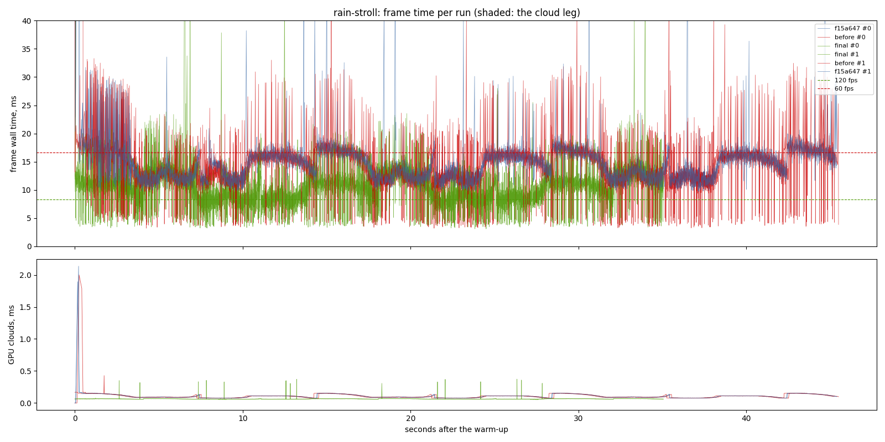

## town

| variant | valid runs | fps | p50 | p95 | p99 | p99.9 | max | GPU total p50 | GPU clouds p50 / p95 |
| --- | ---: | ---: | ---: | ---: | ---: | ---: | ---: | ---: | ---: |
| f15a647 | 2/2 | 54.93 | 17.33 | 24.87 **over** | 29.99 **over** | 70.68 | 593.46 | 11.63 | 0.12 / 0.15 |
| before | 2/2 | 64.24 | 16.12 | 28.03 **over** | 34.35 **over** | 57.55 | 576.49 | 11.72 | 0.12 / 0.14 |
| final | 2/2 | 99.17 | 9.90 | 16.54 **over** | 22.01 **over** | 48.17 | 128.58 | 9.53 | 0.06 / 0.07 |

GPU time per pass, p50 (ms; median over the valid runs):

| variant | cloud_march | cloud_puffs | cloud_resolve | lens_mist | lite_bloom | main_opaque_pass_3d | main_transparent_pass_3d | other | planet_cull | planet_shadow | rain | ssr_capture | tonemapping | upscaling | water_compose | water_lens | weather_overlay |
| --- | ---: | ---: | ---: | ---: | ---: | ---: | ---: | ---: | ---: | ---: | ---: | ---: | ---: | ---: | ---: | ---: | ---: |
| f15a647 | - | - | - | - | - | - | - | - | - | - | - | - | - | - | - | - | - |
| before | - | - | - | - | - | - | - | - | - | - | - | - | - | - | - | - | - |
| final | 0.00 | 0.03 | 0.00 | 0.00 | 0.09 | 0.04 | 4.64 | 0.04 | 0.19 | 2.22 | 1.42 | 0.03 | 0.03 | 0.02 | 0.37 | 0.29 | 0.00 |

Frames over 30 ms per run, and how many recur at the same place (25 m of route, 5 m of walk, or 1 s) in at least half of the scenario's other runs, of any variant. Those that recur are the game's own work at that place; the rest come and go between repeats (async work landing at another moment, or the machine):

| variant | spikes per run | recurring | not recurring |
| --- | --- | ---: | ---: |
| f15a647 | 40, 44 | 48 | 36 |
| before | 201, 59 | 153 | 107 |
| final | 35, 12 | 33 | 14 |

Left out: the fresh world's planet rebuild, 4 frame(s) of 6730-7355 ms.

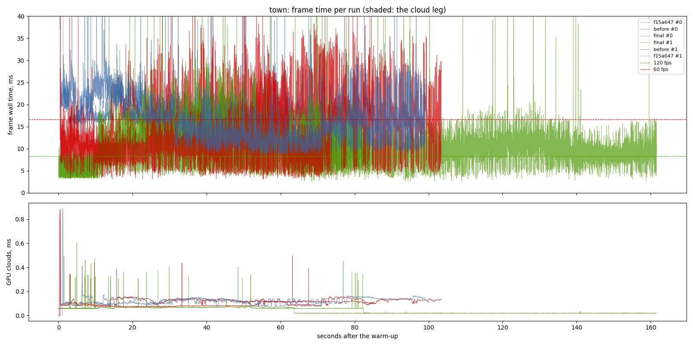

# At 22:00

- revision: `cdf0317` (uncommitted changes)
- adapter: NVIDIA GeForce RTX 3070 (Vulkan); window 1440 x 900, uncapped (`--no-vsync`)
- clock pinned at 10.0 h; first 10.0 s after loading (the ready line, else the first frame) thrown away; 2 run(s) per variant, interleaved
- budgets: p95 within 8.3 ms (120 fps), p99 within 16.7 ms (60 fps); **over** marks a miss. Each cell is the median over the valid runs.

## rain-stroll

| variant | valid runs | fps | p50 | p95 | p99 | p99.9 | max | GPU total p50 | GPU clouds p50 / p95 |
| --- | ---: | ---: | ---: | ---: | ---: | ---: | ---: | ---: | ---: |
| f15a647 | 2/2 | 67.18 | 14.13 | 21.65 **over** | 29.42 **over** | 69.79 | 545.40 | 9.52 | 0.07 / 0.10 |
| before | 2/2 | 68.31 | 14.37 | 24.05 **over** | 30.89 **over** | 119.29 | 333.75 | 10.15 | 0.07 / 0.10 |
| final | 2/2 | 97.55 | 9.84 | 16.20 **over** | 21.12 **over** | 45.82 | 78.75 | 9.27 | 0.06 / 0.07 |

GPU time per pass, p50 (ms; median over the valid runs):

| variant | cloud_march | cloud_puffs | cloud_resolve | lens_mist | lite_bloom | main_opaque_pass_3d | main_transparent_pass_3d | other | planet_cull | planet_shadow | rain | ssr_capture | tonemapping | upscaling | water_compose | water_lens | weather_overlay |
| --- | ---: | ---: | ---: | ---: | ---: | ---: | ---: | ---: | ---: | ---: | ---: | ---: | ---: | ---: | ---: | ---: | ---: |
| f15a647 | - | - | - | - | - | - | - | - | - | - | - | - | - | - | - | - | - |
| before | - | - | - | - | - | - | - | - | - | - | - | - | - | - | - | - | - |
| final | 0.00 | 0.01 | 0.00 | 0.00 | 0.09 | 0.38 | 4.10 | 0.04 | 0.19 | 2.41 | 1.49 | 0.03 | 0.03 | 0.03 | 0.07 | 0.29 | 0.00 |

Frames over 30 ms per run, and how many recur at the same place (25 m of route, 5 m of walk, or 1 s) in at least half of the scenario's other runs, of any variant. Those that recur are the game's own work at that place; the rest come and go between repeats (async work landing at another moment, or the machine):

| variant | spikes per run | recurring | not recurring |
| --- | --- | ---: | ---: |
| f15a647 | 28, 25 | 36 | 17 |
| before | 44, 25 | 41 | 28 |
| final | 10, 3 | 4 | 9 |

Left out: the fresh world's planet rebuild, 4 frame(s) of 6788-7242 ms.

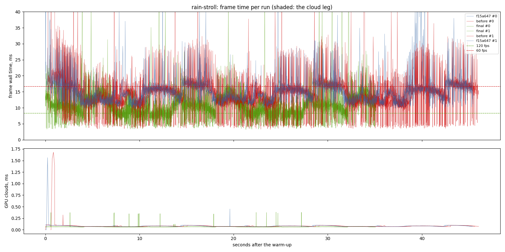

# The model against today's, same exe

- revision: `cdf0317` (uncommitted changes)
- adapter: NVIDIA GeForce RTX 3070 (Vulkan); window 1440 x 900, uncapped (`--no-vsync`)
- clock pinned at 10.0 h; first 10.0 s after loading (the ready line, else the first frame) thrown away; 2 run(s) per variant, interleaved
- budgets: p95 within 8.3 ms (120 fps), p99 within 16.7 ms (60 fps); **over** marks a miss. Each cell is the median over the valid runs.

## rain-stroll

| variant | valid runs | fps | p50 | p95 | p99 | p99.9 | max | GPU total p50 | GPU clouds p50 / p95 |
| --- | ---: | ---: | ---: | ---: | ---: | ---: | ---: | ---: | ---: |
| final | 2/2 | 97.87 | 9.95 | 15.30 **over** | 20.32 **over** | 48.54 | 84.10 | 9.42 | 0.06 / 0.07 |
| today | 2/2 | 135.66 | 7.18 | 10.61 **over** | 13.51 | 33.97 | 65.49 | 6.60 | 0.06 / 0.07 |

GPU time per pass, p50 (ms; median over the valid runs):

| variant | cloud_march | cloud_puffs | cloud_resolve | lens_mist | lite_bloom | main_opaque_pass_3d | main_transparent_pass_3d | other | planet_cull | planet_shadow | rain | ssr_capture | tonemapping | upscaling | water_compose | water_lens | weather_overlay |
| --- | ---: | ---: | ---: | ---: | ---: | ---: | ---: | ---: | ---: | ---: | ---: | ---: | ---: | ---: | ---: | ---: | ---: |
| final | 0.00 | 0.04 | 0.00 | 0.00 | 0.09 | 0.51 | 4.34 | 0.04 | 0.18 | 2.10 | 1.50 | 0.03 | 0.03 | 0.02 | 0.07 | 0.29 | 0.00 |
| today | 0.00 | 0.04 | 0.00 | 0.00 | 0.00 | 0.32 | 1.83 | 0.04 | 0.18 | 2.08 | 1.52 | 0.00 | 0.03 | 0.02 | 0.06 | 0.30 | 0.00 |

Frames over 30 ms per run, and how many recur at the same place (25 m of route, 5 m of walk, or 1 s) in at least half of the scenario's other runs, of any variant. Those that recur are the game's own work at that place; the rest come and go between repeats (async work landing at another moment, or the machine):

| variant | spikes per run | recurring | not recurring |
| --- | --- | ---: | ---: |
| final | 7, 6 | 2 | 11 |
| today | 3, 6 | 1 | 8 |

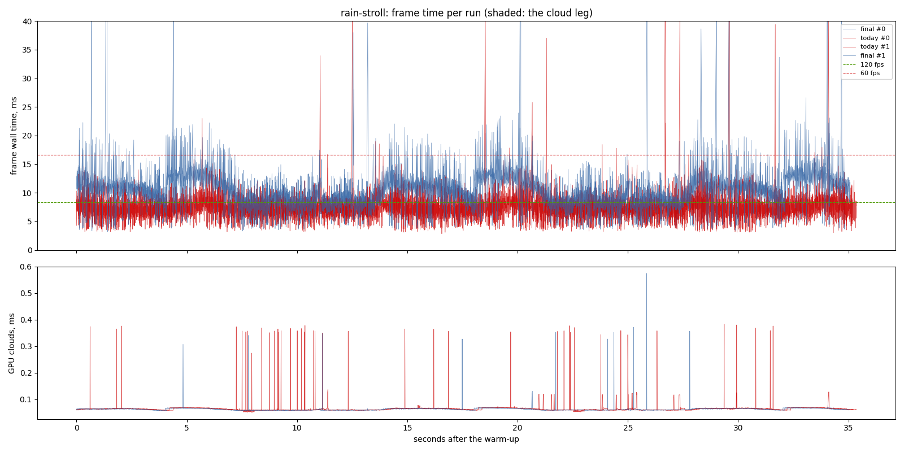

# Vsync on

- revision: `fbabebc` (uncommitted changes)
- adapter: NVIDIA GeForce RTX 3070 (Vulkan); window 1440 x 900, vsync on (`--vsync`)
- clock pinned at 10.0 h; first 10.0 s after loading (the ready line, else the first frame) thrown away; 2 run(s) per variant, interleaved
- budgets: p95 within 8.3 ms (120 fps), p99 within 16.7 ms (60 fps); **over** marks a miss. Each cell is the median over the valid runs.

## rain-stroll

| variant | valid runs | fps | p50 | p95 | p99 | p99.9 | max | GPU total p50 | GPU clouds p50 / p95 |
| --- | ---: | ---: | ---: | ---: | ---: | ---: | ---: | ---: | ---: |
| final | 2/2 | 94.72 | 10.43 | 15.80 **over** | 20.67 **over** | 32.02 | 67.05 | 9.83 | 0.06 / 0.07 |

With vsync on: frames over the 60 fps floor (16.7 ms) and over two of it:

| variant | over the floor | share | over twice it |
| --- | ---: | ---: | ---: |
| final | 259 of 6688 | 3.87% | 7 |

GPU time per pass, p50 (ms; median over the valid runs):

| variant | cloud_march | cloud_puffs | cloud_resolve | lens_mist | lite_bloom | main_opaque_pass_3d | main_transparent_pass_3d | other | planet_cull | planet_shadow | rain | ssr_capture | tonemapping | upscaling | water_compose | water_lens | weather_overlay |
| --- | ---: | ---: | ---: | ---: | ---: | ---: | ---: | ---: | ---: | ---: | ---: | ---: | ---: | ---: | ---: | ---: | ---: |
| final | 0.00 | 0.04 | 0.00 | 0.00 | 0.09 | 0.51 | 4.32 | 0.04 | 0.19 | 2.48 | 1.49 | 0.03 | 0.03 | 0.02 | 0.07 | 0.29 | 0.00 |

Frames over 30 ms per run, and how many recur at the same place (25 m of route, 5 m of walk, or 1 s) in at least half of the scenario's other runs, of any variant. Those that recur are the game's own work at that place; the rest come and go between repeats (async work landing at another moment, or the machine):

| variant | spikes per run | recurring | not recurring |
| --- | --- | ---: | ---: |
| final | 4, 5 | 2 | 7 |

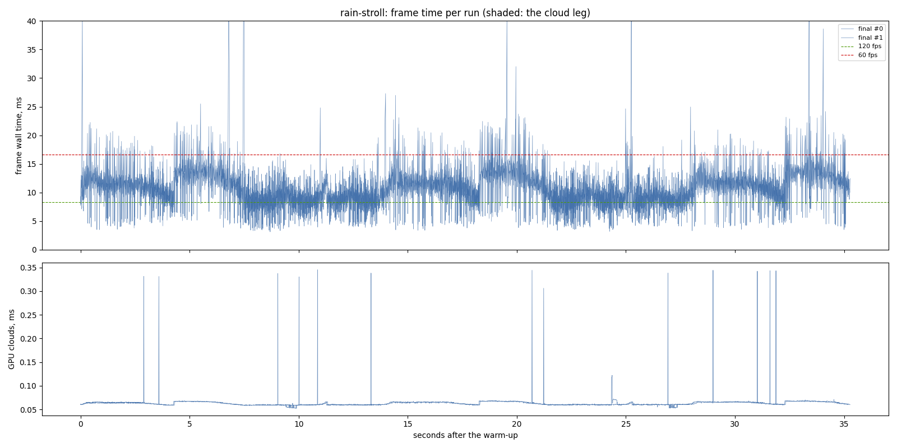

## storm

| variant | valid runs | fps | p50 | p95 | p99 | p99.9 | max | GPU total p50 | GPU clouds p50 / p95 |
| --- | ---: | ---: | ---: | ---: | ---: | ---: | ---: | ---: | ---: |
| final | 2/2 | 138.18 | 6.83 | 11.18 **over** | 14.83 | 45.39 | 63.70 | 5.86 | 0.08 / 0.09 |

On the cloud leg only (the stretch the plan flies through cloud):

| variant | fps | p50 | p95 | p99 | max | GPU total p50 / p95 | GPU clouds p50 / p95 |
| --- | ---: | ---: | ---: | ---: | ---: | ---: | ---: |
| final | 148.26 | 6.58 | 9.42 **over** | 12.95 | 47.38 | 5.46 / 7.61 | 0.08 / 0.09 |

With vsync on: frames over the 60 fps floor (16.7 ms) and over two of it:

| variant | over the floor | share | over twice it |
| --- | ---: | ---: | ---: |
| final | 52 of 10182 | 0.51% | 19 |

GPU time per pass, p50 (ms; median over the valid runs):

| variant | cloud_march | cloud_puffs | cloud_resolve | lens_mist | lite_bloom | main_opaque_pass_3d | main_transparent_pass_3d | other | planet_cull | planet_shadow | rain | ssr_capture | tonemapping | upscaling | water_compose | water_lens | weather_overlay |
| --- | ---: | ---: | ---: | ---: | ---: | ---: | ---: | ---: | ---: | ---: | ---: | ---: | ---: | ---: | ---: | ---: | ---: |
| final | 0.17 | 0.15 | 0.00 | 0.01 | 0.08 | 0.00 | 2.81 | 0.04 | 0.17 | 1.00 | 0.00 | 0.04 | 0.00 | 0.02 | 0.50 | 0.09 | 0.00 |

Frames over 30 ms per run, and how many recur at the same place (25 m of route, 5 m of walk, or 1 s) in at least half of the scenario's other runs, of any variant. Those that recur are the game's own work at that place; the rest come and go between repeats (async work landing at another moment, or the machine):

| variant | spikes per run | recurring | not recurring |
| --- | --- | ---: | ---: |
| final | 8, 13 | 6 | 15 |

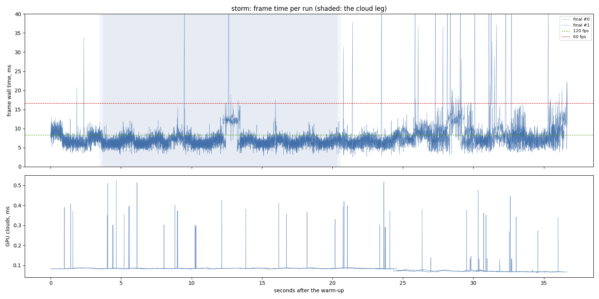

## town

| variant | valid runs | fps | p50 | p95 | p99 | p99.9 | max | GPU total p50 | GPU clouds p50 / p95 |
| --- | ---: | ---: | ---: | ---: | ---: | ---: | ---: | ---: | ---: |
| final | 2/2 | 130.68 | 6.95 | 13.70 **over** | 17.72 **over** | 27.30 | 57.68 | 6.33 | 0.06 / 0.07 |

With vsync on: frames over the 60 fps floor (16.7 ms) and over two of it:

| variant | over the floor | share | over twice it |
| --- | ---: | ---: | ---: |
| final | 270 of 27664 | 0.98% | 24 |

GPU time per pass, p50 (ms; median over the valid runs):

| variant | cloud_march | cloud_puffs | cloud_resolve | lens_mist | lite_bloom | main_opaque_pass_3d | main_transparent_pass_3d | other | planet_cull | planet_shadow | rain | ssr_capture | tonemapping | upscaling | water_compose | water_lens | weather_overlay |
| --- | ---: | ---: | ---: | ---: | ---: | ---: | ---: | ---: | ---: | ---: | ---: | ---: | ---: | ---: | ---: | ---: | ---: |
| final | 0.00 | 0.02 | 0.00 | 0.00 | 0.07 | 0.67 | 1.75 | 0.04 | 0.19 | 2.53 | 0.47 | 0.02 | 0.02 | 0.02 | 0.17 | 0.28 | 0.00 |

Frames over 30 ms per run, and how many recur at the same place (25 m of route, 5 m of walk, or 1 s) in at least half of the scenario's other runs, of any variant. Those that recur are the game's own work at that place; the rest come and go between repeats (async work landing at another moment, or the machine):

| variant | spikes per run | recurring | not recurring |
| --- | --- | ---: | ---: |
| final | 15, 11 | 0 | 26 |

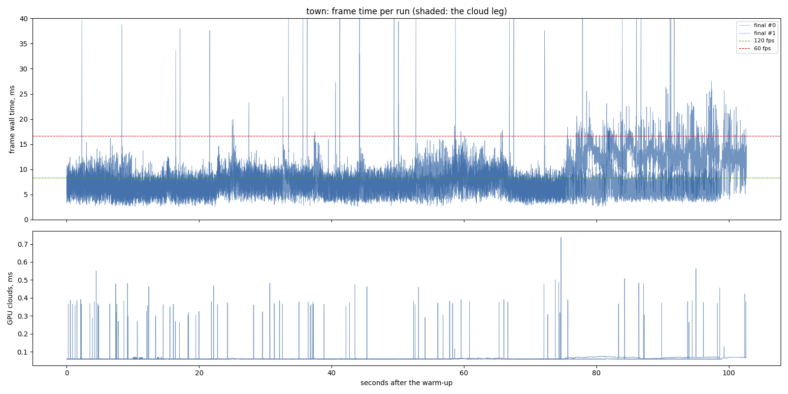

# The walk, Solitaire closed

- revision: `fbabebc` (uncommitted changes)
- adapter: NVIDIA GeForce RTX 3070 (Vulkan); window 1440 x 900, uncapped (`--no-vsync`)
- clock pinned at 10.0 h; first 10.0 s after loading (the ready line, else the first frame) thrown away; 3 run(s) per variant, interleaved
- budgets: p95 within 8.3 ms (120 fps), p99 within 16.7 ms (60 fps); **over** marks a miss. Each cell is the median over the valid runs.

## walk

| variant | valid runs | fps | p50 | p95 | p99 | p99.9 | max | GPU total p50 | GPU clouds p50 / p95 |
| --- | ---: | ---: | ---: | ---: | ---: | ---: | ---: | ---: | ---: |
| final | 3/3 | 98.43 | 9.85 | 15.43 **over** | 20.39 **over** | 36.49 | 69.29 | 9.42 | 0.06 / 0.07 |

GPU time per pass, p50 (ms; median over the valid runs):

| variant | cloud_march | cloud_puffs | cloud_resolve | lens_mist | lite_bloom | main_opaque_pass_3d | main_transparent_pass_3d | other | planet_cull | planet_shadow | rain | ssr_capture | tonemapping | upscaling | water_compose | water_lens | weather_overlay |
| --- | ---: | ---: | ---: | ---: | ---: | ---: | ---: | ---: | ---: | ---: | ---: | ---: | ---: | ---: | ---: | ---: | ---: |
| final | 0.00 | 0.02 | 0.00 | 0.00 | 0.08 | 0.02 | 5.64 | 0.04 | 0.18 | 2.04 | 1.02 | 0.03 | 0.02 | 0.02 | 0.08 | 0.29 | 0.00 |

Frames over 30 ms per run, and how many recur at the same place (25 m of route, 5 m of walk, or 1 s) in at least half of the scenario's other runs, of any variant. Those that recur are the game's own work at that place; the rest come and go between repeats (async work landing at another moment, or the machine):

| variant | spikes per run | recurring | not recurring |
| --- | --- | ---: | ---: |
| final | 20, 21, 14 | 9 | 46 |

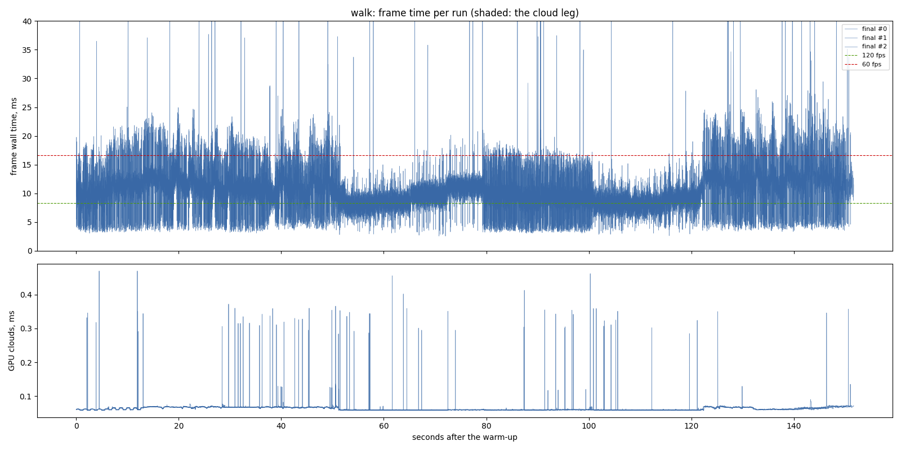

