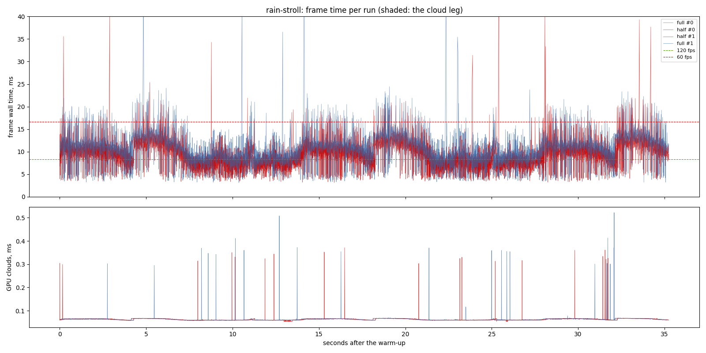
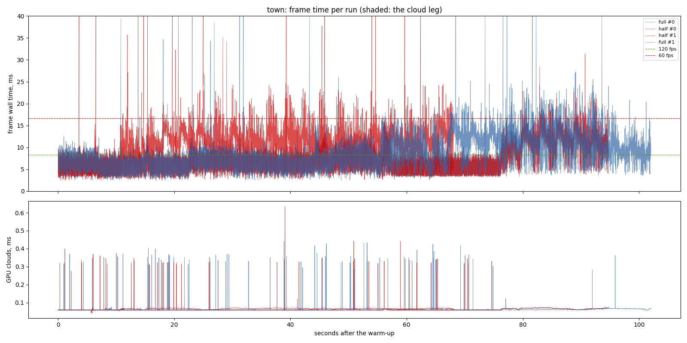
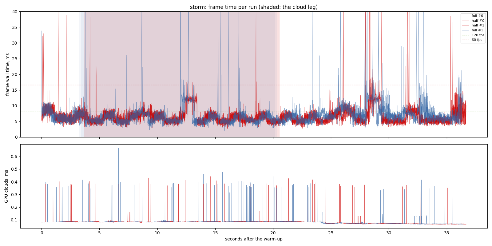

# The rain volume at half size (2026-11-12)

`lighting-perf` 2.9. One exe (the branch with the half-size pass built in),
`rain_render_scale` 1.0 (the full-size pass, today's picture) against 0.5,
the only difference between the arms being that line of
`assets/config/weather.ron`. RTX 3070 (Vulkan), 1440 x 900, uncapped,
frame latency 2, 2 repeats interleaved, clock 10:00.

## Findings

- **On foot in the rain it takes 1.3 ms off p50 and 2.2 ms off p99**:
  `rain-stroll` 10.03 / 15.73 / 20.74 to **8.69 / 14.02 / 18.56** ms (p50 /
  p95 / p99). The rain's GPU time goes from 1.49 ms to 0.45 (0.38 gathering
  at half size, 0.07 laying it over at full size).
- **In the storm**, 6.03 / 10.40 / 13.88 to 5.73 / 9.57 / 12.90 ms.
- **The town walk is too noisy to read here**: one of its runs walked 7,030
  frames where the other three walked 13-14 thousand (9.77 ms p50 against
  6.17-7.18). Its other half-size run read 6.17 ms against 6.41 and 7.18 at
  full size.
- **The picture**: the default `rain_renderer` is the volume (sixteen
  jittered steps of streak noise), not the shells, so this halves the
  volume's march as well as the shells'. Shots at full and half size from
  one exe (`docs/screenshots/lighting-perf/2.9-rain-half/`): the lane by day
  both ways, at night, a puddle under a wall, the walled town, and the shore
  from 300 m. Side by side the two are hard to tell apart and no edge takes
  a halo. By pixels, 3-43% of each shot moves, almost all by 2/255 or less;
  at night 17% of the pixels move by more than 2/255 (the volume's grain is
  now drawn per 2 x 2 pixels). The owner's look decides
  (`rain_render_scale: 1.0` puts the full-size pass back).

## Limits

- Two repeats; the town as above.
- The raw CSVs and logs are local: `output/perf/2026-11-12-rain-half`.

# Performance suite, 2026-11-12 15:39

- revision: `78a19f3` (uncommitted changes)
- adapter: NVIDIA GeForce RTX 3070 (Vulkan); window 1440 x 900, uncapped (`--no-vsync`)
- clock pinned at 10.0 h; first 10.0 s after loading (the ready line, else the first frame) thrown away; 2 run(s) per variant, interleaved
- budgets: p95 within 8.3 ms (120 fps), p99 within 16.7 ms (60 fps); **over** marks a miss. Each cell is the median over the valid runs.

## rain-stroll

| variant | valid runs | fps | p50 | p95 | p99 | p99.9 | max | GPU total p50 | GPU clouds p50 / p95 |
| --- | ---: | ---: | ---: | ---: | ---: | ---: | ---: | ---: | ---: |
| full | 2/2 | 97.04 | 10.03 | 15.73 **over** | 20.74 **over** | 32.01 | 67.20 | 9.53 | 0.06 / 0.07 |
| half | 2/2 | 110.62 | 8.69 | 14.02 **over** | 18.56 **over** | 33.33 | 54.52 | 8.24 | 0.06 / 0.07 |

GPU time per pass, p50 (ms; median over the valid runs):

| variant | cloud_march | cloud_puffs | cloud_resolve | lens_mist | lite_bloom | main_opaque_pass_3d | main_transparent_pass_3d | other | planet_cull | planet_shadow | rain | rain_half | ssr_capture | tonemapping | upscaling | water_compose | water_lens | weather_overlay |
| --- | ---: | ---: | ---: | ---: | ---: | ---: | ---: | ---: | ---: | ---: | ---: | ---: | ---: | ---: | ---: | ---: | ---: | ---: |
| full | 0.00 | 0.04 | 0.00 | 0.00 | 0.09 | 0.52 | 4.48 | 0.04 | 0.18 | 2.04 | 1.49 | 0.00 | 0.03 | 0.03 | 0.02 | 0.07 | 0.29 | 0.00 |
| half | 0.00 | 0.04 | 0.00 | 0.00 | 0.09 | 0.51 | 4.14 | 0.04 | 0.18 | 2.04 | 0.07 | 0.38 | 0.03 | 0.03 | 0.02 | 0.07 | 0.29 | 0.00 |

Frames over 30 ms per run, and how many recur at the same place (25 m of route, 5 m of walk, or 1 s) in at least half of the scenario's other runs, of any variant. Those that recur are the game's own work at that place; the rest come and go between repeats (async work landing at another moment, or the machine):

| variant | spikes per run | recurring | not recurring |
| --- | --- | ---: | ---: |
| full | 2, 5 | 0 | 7 |
| half | 6, 3 | 0 | 9 |

## town

| variant | valid runs | fps | p50 | p95 | p99 | p99.9 | max | GPU total p50 | GPU clouds p50 / p95 |
| --- | ---: | ---: | ---: | ---: | ---: | ---: | ---: | ---: | ---: |
| full | 2/2 | 128.15 | 7.18 | 13.34 **over** | 17.45 **over** | 24.17 | 46.82 | 6.52 | 0.06 / 0.07 |
| half | 2/2 | 103.28 | 9.77 | 16.01 **over** | 20.87 **over** | 40.30 | 79.32 | 9.62 | 0.07 / 0.07 |

GPU time per pass, p50 (ms; median over the valid runs):

| variant | cloud_march | cloud_puffs | cloud_resolve | lens_mist | lite_bloom | main_opaque_pass_3d | main_transparent_pass_3d | other | planet_cull | planet_shadow | rain | rain_half | ssr_capture | tonemapping | upscaling | water_compose | water_lens | weather_overlay |
| --- | ---: | ---: | ---: | ---: | ---: | ---: | ---: | ---: | ---: | ---: | ---: | ---: | ---: | ---: | ---: | ---: | ---: | ---: |
| full | 0.00 | 0.02 | 0.00 | 0.00 | 0.08 | 0.67 | 1.78 | 0.04 | 0.18 | 2.08 | 1.04 | 0.00 | 0.02 | 0.02 | 0.02 | 0.12 | 0.00 | 0.00 |
| half | 0.00 | 0.05 | 0.00 | 0.00 | 0.08 | 0.66 | 6.14 | 0.04 | 0.19 | 2.09 | 0.07 | 0.37 | 0.03 | 0.03 | 0.02 | 0.18 | 0.29 | 0.00 |

Frames over 30 ms per run, and how many recur at the same place (25 m of route, 5 m of walk, or 1 s) in at least half of the scenario's other runs, of any variant. Those that recur are the game's own work at that place; the rest come and go between repeats (async work landing at another moment, or the machine):

| variant | spikes per run | recurring | not recurring |
| --- | --- | ---: | ---: |
| full | 6, 9 | 4 | 11 |
| half | 11, 10 | 5 | 16 |

## storm

| variant | valid runs | fps | p50 | p95 | p99 | p99.9 | max | GPU total p50 | GPU clouds p50 / p95 |
| --- | ---: | ---: | ---: | ---: | ---: | ---: | ---: | ---: | ---: |
| full | 2/2 | 154.07 | 6.03 | 10.40 **over** | 13.88 | 48.26 | 67.99 | 5.33 | 0.08 / 0.09 |
| half | 2/2 | 159.98 | 5.73 | 9.57 **over** | 12.90 | 38.78 | 69.96 | 4.94 | 0.08 / 0.09 |

On the cloud leg only (the stretch the plan flies through cloud):

| variant | fps | p50 | p95 | p99 | max | GPU total p50 / p95 | GPU clouds p50 / p95 |
| --- | ---: | ---: | ---: | ---: | ---: | ---: | ---: |
| full | 165.91 | 5.61 | 8.62 **over** | 12.61 | 66.91 | 4.92 / 7.19 | 0.09 / 0.09 |
| half | 164.43 | 5.73 | 8.83 **over** | 12.49 | 46.11 | 5.02 / 7.26 | 0.08 / 0.09 |

GPU time per pass, p50 (ms; median over the valid runs):

| variant | cloud_march | cloud_puffs | cloud_resolve | lens_mist | lite_bloom | main_opaque_pass_3d | main_transparent_pass_3d | other | planet_cull | planet_shadow | rain | rain_half | ssr_capture | tonemapping | upscaling | water_compose | water_lens | weather_overlay |
| --- | ---: | ---: | ---: | ---: | ---: | ---: | ---: | ---: | ---: | ---: | ---: | ---: | ---: | ---: | ---: | ---: | ---: | ---: |
| full | 0.17 | 0.15 | 0.00 | 0.01 | 0.08 | 0.00 | 2.42 | 0.04 | 0.17 | 0.85 | 0.00 | 0.00 | 0.03 | 0.00 | 0.02 | 0.51 | 0.10 | 0.00 |
| half | 0.17 | 0.15 | 0.00 | 0.01 | 0.08 | 0.00 | 2.44 | 0.04 | 0.17 | 0.90 | 0.00 | 0.00 | 0.03 | 0.00 | 0.02 | 0.50 | 0.10 | 0.00 |

Frames over 30 ms per run, and how many recur at the same place (25 m of route, 5 m of walk, or 1 s) in at least half of the scenario's other runs, of any variant. Those that recur are the game's own work at that place; the rest come and go between repeats (async work landing at another moment, or the machine):

| variant | spikes per run | recurring | not recurring |
| --- | --- | ---: | ---: |
| full | 7, 11 | 6 | 12 |
| half | 9, 8 | 8 | 9 |

