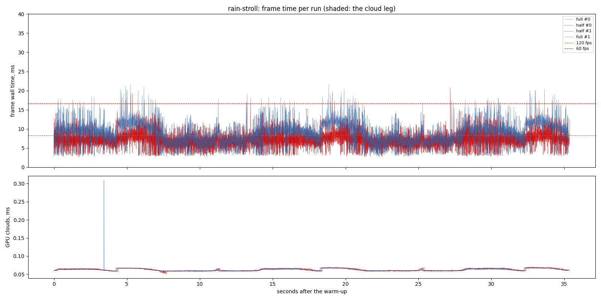
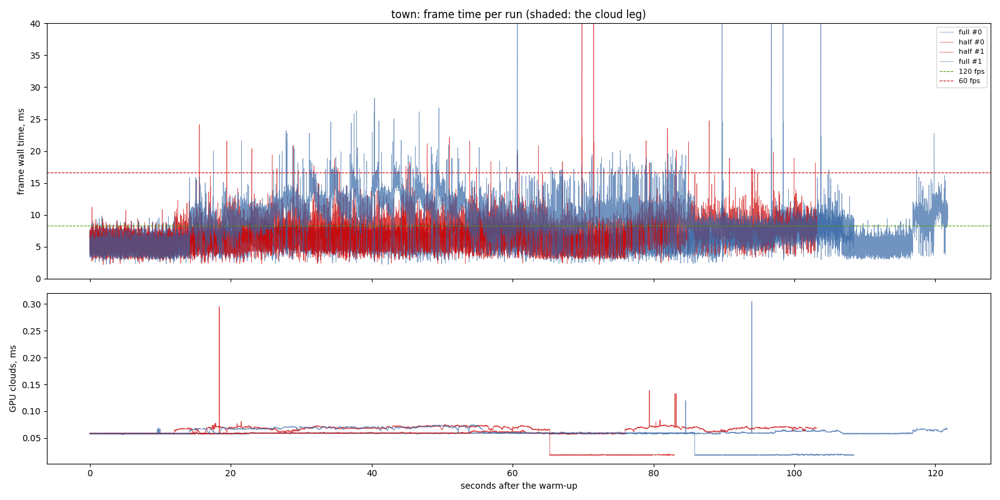
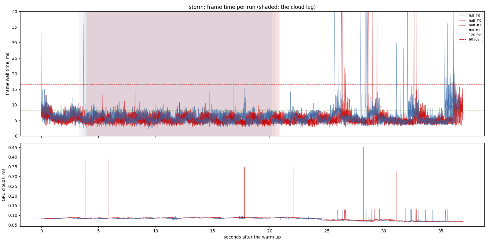
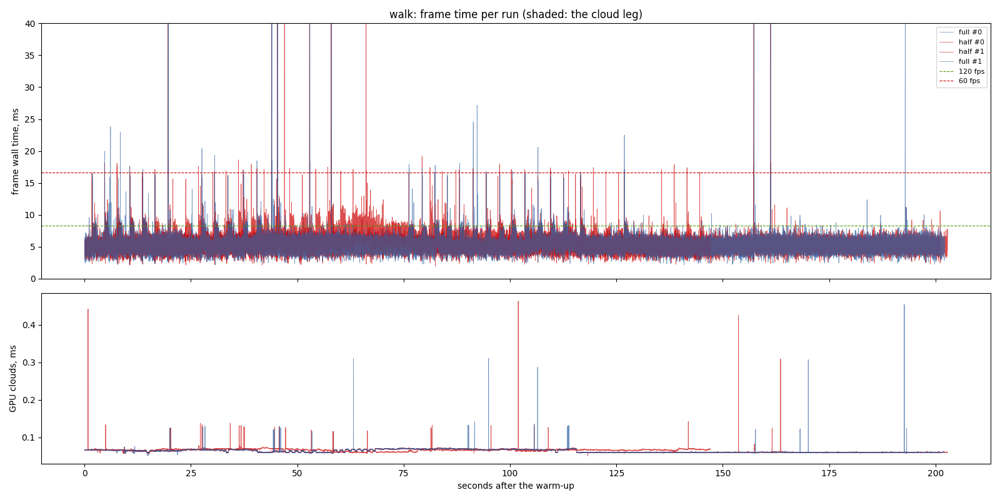
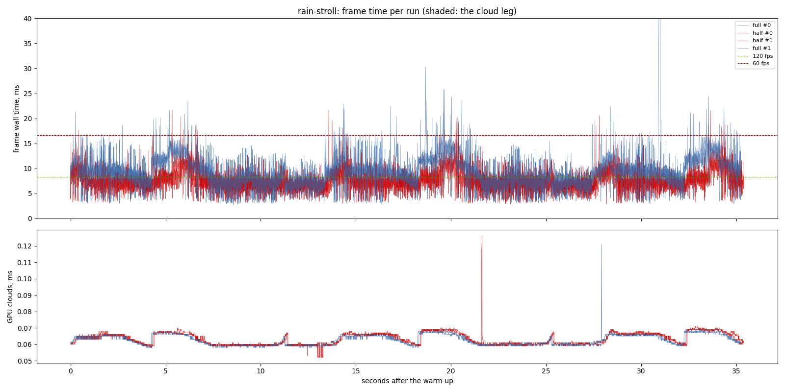

# L8's traces at half size (2026-11-12)

`lighting-perf` 2.8. One exe (the branch with the terrain's own pass and the
half-size traces built in), `PBD_REFLECT_SCALE=1` (the inline traces, today's
picture; same as `reflect_render_scale: 1.0`) against the default 0.5, the
only difference between the arms. RTX 3070 (Vulkan), i7-9700F, 1440 x 900,
uncapped, frame latency 2, release, 2 repeats interleaved (A B B A), clock
10:00, then `rain-stroll` again at 22:00. Nothing else ran (the other
agent's lock was released first).

## Findings

- **Every scenario is now inside the 60 fps floor at p99** (16.7 ms), the
  owner's "worst case 60":

  | scenario | full (inline) p50 / p95 / p99 | half p50 / p95 / p99 | terrain GPU p50, full -> half (+ half-size passes) |
  | --- | ---: | ---: | --- |
  | rain-stroll, 10:00 | 8.27 / 12.94 / 16.79 | **7.03 / 10.46 / 12.68** | 3.75 -> 2.13 (+0.35 trace, +0.05 compose) |
  | rain-stroll, 22:00 | 8.52 / 14.34 / 17.28 | **7.14 / 11.04 / 13.26** | 3.77 -> 2.03 (+0.33, +0.05) |
  | town (rain) | 8.19 / 14.04 / 17.23 | **7.29 / 10.65 / 12.73** | 3.98 -> 2.85 (+0.26, +0.03) |
  | storm | 5.53 / 8.44 / 11.73 | **5.01 / 7.57 / 9.86** | 2.38 -> 1.44 (+0.09, +0.04) |
  | walk | 5.18 / 6.94 / 8.25 | 5.50 / 8.05 / 9.69 | 2.25 -> 2.13 (+0.02, +0.01) |

  (Each cell is the suite's median of the two runs.)
- **On foot in the rain it takes 1.2-1.4 ms off p50 and 4.0-4.1 ms off
  p99.** The terrain's pass falls 1.6-1.7 ms of GPU, of which the half-size
  trace gives back 0.33-0.35 ms and the compose 0.05: about 1.3 ms net, near
  the top of the 1.0-1.4 ms estimate. A quarter of the rays, and none traced
  for a fragment that is drawn over later.
- **The town walk has two modes in both arms.** One run of each arm walks
  with little wet ground in view (terrain 1.52 ms in both: 5.87 / 11.04 full,
  6.17 / 11.22 half), the other with the lane's puddles (3.98 against 2.85
  ms: 8.19 / 17.23 full, 7.29 / 12.73 half). Read like for like, the wet
  mode gains 0.9 ms p50 and 4.5 ms p99; the dry mode is within its spread.
- **The walk does not move beyond its spread.** Its two half runs read 5.21
  and 5.50 ms p50 against 5.18 and 5.18 full. The slower half run's extra
  GPU time is the sun's cascades (+0.21 ms) and the transparent pass
  (+0.10), which this change does not touch; its terrain pass is 0.11 ms
  faster. Where little reflects, the split costs ~0.03 ms in its own passes;
  the extra targets' writes do not show in the terrain pass.
- **The storm gains 0.5 ms p50 and 1.9 ms p99** (wet ground seen from the
  air: the screen trace now runs on a quarter of the pixels).
- **The move itself changes nothing**: at `reflect_render_scale: 1.0` the
  terrain draws in its own pass, inline, and its shots match the build
  before the move (`34755cf`'s exe with its assets) to the pixel on the
  lane by day and night and the harbour; 186 pixels of the puddle shot by
  2/255 or less (the towns' material change between the two builds).

## The picture

`docs/screenshots/lighting-perf/2.8-reflect-half/full-res/`: eight scenes,
full against half, each with the difference x8 and a second full-size run
(run-to-run noise). Moved pixels (full against half; the noise pair in
brackets):

| scene | pixels moved | by more than 2/255 | noise |
| --- | ---: | ---: | --- |
| lane 10:00 south | 23.9% | 15.6% | 0 |
| lane 10:00 north | 15.2% | 8.0% | 0 |
| lane 22:00 south | 21.6% | 9.0% | 13 px by 1/255 |
| lane 22:00 north | 11.6% | 2.7% | 0 |
| puddle under a wall | 25.8% | 14.5% | 0 |
| harbour from 30 m | 6.5% | 2.3% | 79 px |
| harbour from 300 m | 46.3% | 40.6% | 45.2% / 40.1% (the noise: the 300 m capture is not repeatable) |
| Holbrook from 25 m | 5.8% | 2.8% | 0 |

The changes are the wet film's fine detail: what a reflection shows is now
per 2 x 2 pixels while the rings still bend the sky and the fresnel at full
size, so the reflected houses read the same and the ripple-scale grain
differs. Side by side and zoomed at the wall's foot and the houses'
silhouettes there is no halo: the depth and ray weights keep a wall's hit
off the floor. Kept as a recommendation taken (ask only with screenshots);
survey T16 shows the owner the frames.

## Limits

- One exe, two repeats; the town walk is bimodal (above).
- The sea's own trace stays inline in `water_compose` (0.14 ms in the storm).
- Rendered on the desktop's GPU; nothing else ran.

## The sitting, 10:00

- revision: `3108b52` (uncommitted changes)
- adapter: NVIDIA GeForce RTX 3070 (Vulkan); window 1440 x 900, uncapped (`--no-vsync`)
- clock pinned at 10.0 h; first 10.0 s after loading (the ready line, else the first frame) thrown away; 2 run(s) per variant, interleaved
- budgets: p95 within 8.3 ms (120 fps), p99 within 16.7 ms (60 fps); **over** marks a miss. Each cell is the median over the valid runs.

## rain-stroll

| variant | valid runs | fps | p50 | p95 | p99 | p99.9 | max | GPU total p50 | GPU clouds p50 / p95 |
| --- | ---: | ---: | ---: | ---: | ---: | ---: | ---: | ---: | ---: |
| full | 2/2 | 117.83 | 8.27 | 12.94 **over** | 16.79 **over** | 20.02 | 21.66 | 7.80 | 0.06 / 0.07 |
| half | 2/2 | 139.51 | 7.03 | 10.46 **over** | 12.68 | 15.47 | 20.77 | 6.45 | 0.06 / 0.07 |

GPU time per pass, p50 (ms; median over the valid runs):

| variant | cloud_march | cloud_puffs | cloud_resolve | lens_mist | lite_bloom | main_opaque_pass_3d | main_transparent_pass_3d | other | planet_cull | planet_shadow | planet_terrain | rain | rain_half | reflect_compose | reflect_half | ssr_capture | tonemapping | upscaling | water_compose | water_lens | weather_overlay |
| --- | ---: | ---: | ---: | ---: | ---: | ---: | ---: | ---: | ---: | ---: | ---: | ---: | ---: | ---: | ---: | ---: | ---: | ---: | ---: | ---: | ---: |
| full | 0.00 | 0.03 | 0.00 | 0.00 | 0.09 | 0.33 | 0.04 | 0.04 | 0.18 | 2.05 | 3.75 | 0.07 | 0.38 | 0.00 | 0.00 | 0.03 | 0.03 | 0.02 | 0.07 | 0.29 | 0.00 |
| half | 0.00 | 0.04 | 0.00 | 0.00 | 0.09 | 0.50 | 0.06 | 0.04 | 0.18 | 2.05 | 2.13 | 0.07 | 0.39 | 0.05 | 0.35 | 0.03 | 0.03 | 0.02 | 0.07 | 0.29 | 0.00 |

Frames over 30 ms per run, and how many recur at the same place (25 m of route, 5 m of walk, or 1 s) in at least half of the scenario's other runs, of any variant. Those that recur are the game's own work at that place; the rest come and go between repeats (async work landing at another moment, or the machine):

| variant | spikes per run | recurring | not recurring |
| --- | --- | ---: | ---: |
| full | 0, 0 | 0 | 0 |
| half | 0, 0 | 0 | 0 |

## town

| variant | valid runs | fps | p50 | p95 | p99 | p99.9 | max | GPU total p50 | GPU clouds p50 / p95 |
| --- | ---: | ---: | ---: | ---: | ---: | ---: | ---: | ---: | ---: |
| full | 2/2 | 117.45 | 8.19 | 14.04 **over** | 17.23 **over** | 24.73 | 87.46 | 7.77 | 0.06 / 0.07 |
| half | 2/2 | 135.98 | 7.29 | 10.65 **over** | 12.73 | 19.59 | 81.56 | 6.84 | 0.07 / 0.07 |

GPU time per pass, p50 (ms; median over the valid runs):

| variant | cloud_march | cloud_puffs | cloud_resolve | lens_mist | lite_bloom | main_opaque_pass_3d | main_transparent_pass_3d | other | planet_cull | planet_shadow | planet_terrain | rain | rain_half | reflect_compose | reflect_half | ssr_capture | tonemapping | upscaling | water_compose | water_lens | weather_overlay |
| --- | ---: | ---: | ---: | ---: | ---: | ---: | ---: | ---: | ---: | ---: | ---: | ---: | ---: | ---: | ---: | ---: | ---: | ---: | ---: | ---: | ---: |
| full | 0.00 | 0.03 | 0.00 | 0.00 | 0.08 | 0.72 | 0.01 | 0.04 | 0.18 | 2.09 | 3.98 | 0.07 | 0.37 | 0.00 | 0.00 | 0.03 | 0.03 | 0.02 | 0.33 | 0.29 | 0.00 |
| half | 0.00 | 0.04 | 0.00 | 0.00 | 0.08 | 0.71 | 0.10 | 0.04 | 0.18 | 2.08 | 2.85 | 0.07 | 0.40 | 0.03 | 0.26 | 0.03 | 0.03 | 0.02 | 0.19 | 0.29 | 0.00 |

Frames over 30 ms per run, and how many recur at the same place (25 m of route, 5 m of walk, or 1 s) in at least half of the scenario's other runs, of any variant. Those that recur are the game's own work at that place; the rest come and go between repeats (async work landing at another moment, or the machine):

| variant | spikes per run | recurring | not recurring |
| --- | --- | ---: | ---: |
| full | 0, 5 | 0 | 5 |
| half | 2, 0 | 0 | 2 |

## storm

| variant | valid runs | fps | p50 | p95 | p99 | p99.9 | max | GPU total p50 | GPU clouds p50 / p95 |
| --- | ---: | ---: | ---: | ---: | ---: | ---: | ---: | ---: | ---: |
| full | 2/2 | 169.33 | 5.53 | 8.44 **over** | 11.73 | 20.21 | 70.35 | 5.03 | 0.08 / 0.09 |
| half | 2/2 | 188.46 | 5.01 | 7.57 | 9.86 | 22.80 | 64.93 | 4.39 | 0.09 / 0.09 |

On the cloud leg only (the stretch the plan flies through cloud):

| variant | fps | p50 | p95 | p99 | max | GPU total p50 / p95 | GPU clouds p50 / p95 |
| --- | ---: | ---: | ---: | ---: | ---: | ---: | ---: |
| full | 175.66 | 5.46 | 7.95 | 9.02 | 18.39 | 5.12 / 7.15 | 0.09 / 0.09 |
| half | 194.30 | 4.96 | 7.23 | 8.09 | 14.46 | 4.49 / 6.44 | 0.09 / 0.09 |

GPU time per pass, p50 (ms; median over the valid runs):

| variant | cloud_march | cloud_puffs | cloud_resolve | lens_mist | lite_bloom | main_opaque_pass_3d | main_transparent_pass_3d | other | planet_cull | planet_shadow | planet_terrain | rain | rain_half | reflect_compose | reflect_half | ssr_capture | tonemapping | upscaling | water_compose | water_lens | weather_overlay |
| --- | ---: | ---: | ---: | ---: | ---: | ---: | ---: | ---: | ---: | ---: | ---: | ---: | ---: | ---: | ---: | ---: | ---: | ---: | ---: | ---: | ---: |
| full | 0.17 | 0.15 | 0.00 | 0.01 | 0.08 | 0.00 | 0.19 | 0.04 | 0.17 | 0.81 | 2.38 | 0.00 | 0.00 | 0.00 | 0.00 | 0.03 | 0.00 | 0.02 | 0.56 | 0.10 | 0.00 |
| half | 0.18 | 0.15 | 0.00 | 0.01 | 0.08 | 0.00 | 0.19 | 0.04 | 0.17 | 0.83 | 1.44 | 0.00 | 0.00 | 0.04 | 0.09 | 0.04 | 0.00 | 0.02 | 0.51 | 0.10 | 0.00 |

Frames over 30 ms per run, and how many recur at the same place (25 m of route, 5 m of walk, or 1 s) in at least half of the scenario's other runs, of any variant. Those that recur are the game's own work at that place; the rest come and go between repeats (async work landing at another moment, or the machine):

| variant | spikes per run | recurring | not recurring |
| --- | --- | ---: | ---: |
| full | 5, 5 | 9 | 1 |
| half | 4, 7 | 7 | 4 |

## walk

| variant | valid runs | fps | p50 | p95 | p99 | p99.9 | max | GPU total p50 | GPU clouds p50 / p95 |
| --- | ---: | ---: | ---: | ---: | ---: | ---: | ---: | ---: | ---: |
| full | 2/2 | 189.31 | 5.18 | 6.94 | 8.25 | 15.99 | 59.87 | 4.73 | 0.06 / 0.07 |
| half | 2/2 | 175.88 | 5.50 | 8.05 | 9.69 | 16.70 | 68.58 | 5.05 | 0.07 / 0.07 |

GPU time per pass, p50 (ms; median over the valid runs):

| variant | cloud_march | cloud_puffs | cloud_resolve | lens_mist | lite_bloom | main_opaque_pass_3d | main_transparent_pass_3d | other | planet_cull | planet_shadow | planet_terrain | rain | rain_half | reflect_compose | reflect_half | ssr_capture | tonemapping | upscaling | water_compose | water_lens | weather_overlay |
| --- | ---: | ---: | ---: | ---: | ---: | ---: | ---: | ---: | ---: | ---: | ---: | ---: | ---: | ---: | ---: | ---: | ---: | ---: | ---: | ---: | ---: |
| full | 0.00 | 0.02 | 0.00 | 0.00 | 0.08 | 0.01 | 0.04 | 0.04 | 0.18 | 1.75 | 2.25 | 0.07 | 0.07 | 0.00 | 0.00 | 0.02 | 0.02 | 0.02 | 0.06 | 0.00 | 0.00 |
| half | 0.00 | 0.02 | 0.00 | 0.00 | 0.08 | 0.02 | 0.14 | 0.04 | 0.18 | 1.93 | 2.13 | 0.07 | 0.07 | 0.01 | 0.02 | 0.03 | 0.03 | 0.02 | 0.06 | 0.00 | 0.00 |

Frames over 30 ms per run, and how many recur at the same place (25 m of route, 5 m of walk, or 1 s) in at least half of the scenario's other runs, of any variant. Those that recur are the game's own work at that place; the rest come and go between repeats (async work landing at another moment, or the machine):

| variant | spikes per run | recurring | not recurring |
| --- | --- | ---: | ---: |
| full | 7, 7 | 12 | 2 |
| half | 7, 2 | 7 | 2 |

## The sitting, 22:00

## rain-stroll

| variant | valid runs | fps | p50 | p95 | p99 | p99.9 | max | GPU total p50 | GPU clouds p50 / p95 |
| --- | ---: | ---: | ---: | ---: | ---: | ---: | ---: | ---: | ---: |
| full | 2/2 | 113.13 | 8.52 | 14.34 **over** | 17.28 **over** | 23.44 | 62.30 | 7.95 | 0.06 / 0.07 |
| half | 2/2 | 135.34 | 7.14 | 11.04 **over** | 13.26 | 18.98 | 21.71 | 6.40 | 0.06 / 0.07 |

GPU time per pass, p50 (ms; median over the valid runs):

| variant | cloud_march | cloud_puffs | cloud_resolve | lens_mist | lite_bloom | main_opaque_pass_3d | main_transparent_pass_3d | other | planet_cull | planet_shadow | planet_terrain | rain | rain_half | reflect_compose | reflect_half | ssr_capture | tonemapping | upscaling | water_compose | water_lens | weather_overlay |
| --- | ---: | ---: | ---: | ---: | ---: | ---: | ---: | ---: | ---: | ---: | ---: | ---: | ---: | ---: | ---: | ---: | ---: | ---: | ---: | ---: | ---: |
| full | 0.00 | 0.01 | 0.00 | 0.00 | 0.09 | 0.48 | 0.04 | 0.04 | 0.18 | 2.35 | 3.77 | 0.07 | 0.38 | 0.00 | 0.00 | 0.03 | 0.03 | 0.02 | 0.07 | 0.29 | 0.00 |
| half | 0.00 | 0.01 | 0.00 | 0.00 | 0.09 | 0.41 | 0.06 | 0.04 | 0.18 | 2.37 | 2.03 | 0.07 | 0.39 | 0.05 | 0.34 | 0.03 | 0.03 | 0.03 | 0.07 | 0.30 | 0.00 |

Frames over 30 ms per run, and how many recur at the same place (25 m of route, 5 m of walk, or 1 s) in at least half of the scenario's other runs, of any variant. Those that recur are the game's own work at that place; the rest come and go between repeats (async work landing at another moment, or the machine):

| variant | spikes per run | recurring | not recurring |
| --- | --- | ---: | ---: |
| full | 3, 0 | 0 | 3 |
| half | 0, 0 | 0 | 0 |

