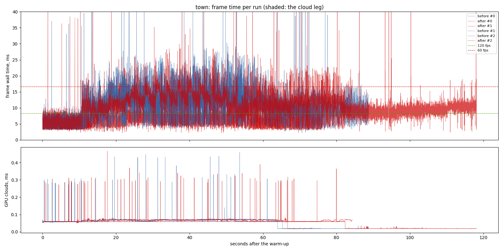

# Town batching and caster culling (`crab-breeze-lessons` ranks 2 and 5), 2026-11-12

**What was measured.** The `town` scenario (a walk from Ashenstead's middle out
through the walled town, rain forced), the branch head `0a1fbc9` ("before")
against the same with ranks 2 and 5 ("after"), both release builds at
`--frame-latency 2`, three runs each, interleaved, the RTX 3070 desktop with
nothing else running (the perf lock held).

**Findings.**

1. **The tail is about a millisecond shorter; the median is unchanged.** Over
   the runs that walked the same route (all three before, `after_1` and
   `after_2`), p95 is 15.70-15.86 ms after against 16.56-17.25 before, p99
   20.95-21.07 against 21.84-22.95, p50 9.87-9.90 against 9.62-10.00. The
   town walk still misses 60 fps at p99.
2. **`after_0` walked another route** (stalled at 14, 19 and 69 m, much of it
   indoors and out of the rain), so its frames (p50 6.12 ms) are not
   comparable; the table's medians fall on `after_1` and `after_2`. A walk
   that stalls differently is the real-time walk's own, not this change's.
3. **GPU: no change past the spread.** The shadow pass is 2.06 ms p50 after
   against 2.10 before: culling the towns' casters per cascade saves little
   here, where the towns' chunks are mostly inside every cascade's box and
   the pass is the terrain's. GPU total p50 9.42 against 9.64.
4. **The look is unchanged.** `tools/capture_repeat.py --against`, before
   against after, GPU captures at `--frames 300`: the Holbrook lane, the
   middle of Ashenstead and Holinghaven's quay, each at 10:00 and 22:00,
   with `dressing_cascades` 4 and 3: five of six scenes 0 pixels over 1/255
   in both. The quay at 22:00 differs by 789 and 172 pixels in specks on a
   far jungle slope, and the before exe alone differs from itself there by
   295 pixels in one of three repeats: a capture flicker that predates this
   change.

- revision: `619643c` (uncommitted changes)
- adapter: NVIDIA GeForce RTX 3070 (Vulkan); window 1440 x 900, uncapped (`--no-vsync`)
- clock pinned at 10.0 h; first 10.0 s after loading (the ready line, else the first frame) thrown away; 3 run(s) per variant, interleaved
- budgets: p95 within 8.3 ms (120 fps), p99 within 16.7 ms (60 fps); **over** marks a miss. Each cell is the median over the valid runs.

## town

| variant | valid runs | fps | p50 | p95 | p99 | p99.9 | max | GPU total p50 | GPU clouds p50 / p95 |
| --- | ---: | ---: | ---: | ---: | ---: | ---: | ---: | ---: | ---: |
| before | 3/3 | 102.86 | 9.74 | 16.93 **over** | 22.43 **over** | 36.25 | 74.43 | 9.64 | 0.06 / 0.07 |
| after | 3/3 | 104.43 | 9.87 | 15.70 **over** | 20.95 **over** | 29.07 | 85.83 | 9.42 | 0.06 / 0.07 |

GPU time per pass, p50 (ms; median over the valid runs):

| variant | cloud_march | cloud_puffs | cloud_resolve | lens_mist | lite_bloom | main_opaque_pass_3d | main_transparent_pass_3d | other | planet_cull | planet_shadow | rain | ssr_capture | tonemapping | upscaling | water_compose | water_lens | weather_overlay |
| --- | ---: | ---: | ---: | ---: | ---: | ---: | ---: | ---: | ---: | ---: | ---: | ---: | ---: | ---: | ---: | ---: | ---: |
| before | 0.00 | 0.03 | 0.00 | 0.00 | 0.08 | 0.03 | 4.54 | 0.04 | 0.19 | 2.10 | 1.40 | 0.03 | 0.03 | 0.02 | 0.18 | 0.29 | 0.00 |
| after | 0.00 | 0.03 | 0.00 | 0.00 | 0.08 | 0.04 | 4.91 | 0.04 | 0.18 | 2.06 | 1.38 | 0.03 | 0.03 | 0.02 | 0.18 | 0.29 | 0.00 |

Frames over 30 ms per run, and how many recur at the same place (25 m of route, 5 m of walk, or 1 s) in at least half of the scenario's other runs, of any variant. Those that recur are the game's own work at that place; the rest come and go between repeats (async work landing at another moment, or the machine):

| variant | spikes per run | recurring | not recurring |
| --- | --- | ---: | ---: |
| before | 13, 12, 6 | 10 | 21 |
| after | 8, 8, 17 | 10 | 23 |

