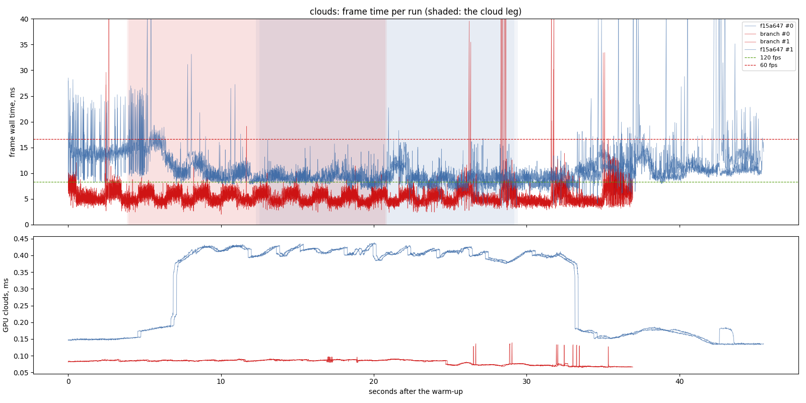
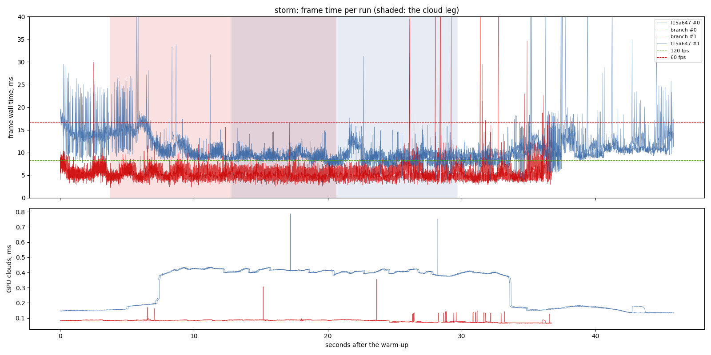
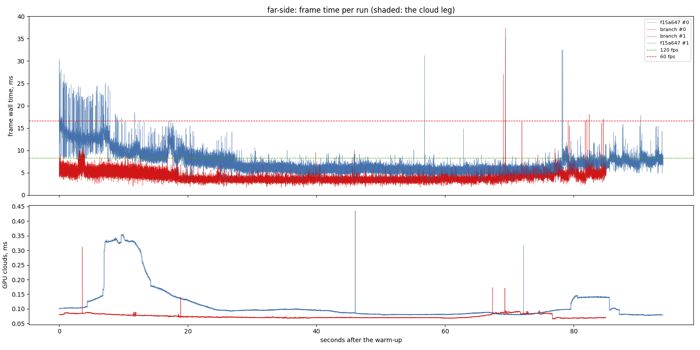
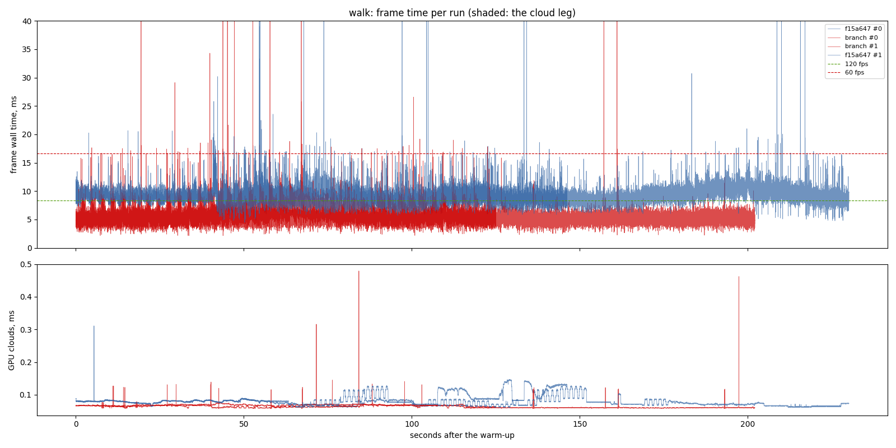
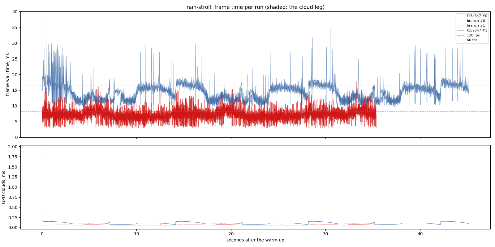
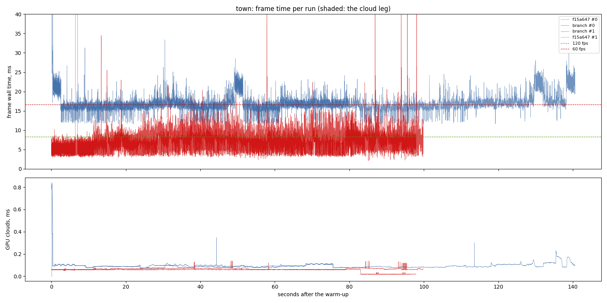
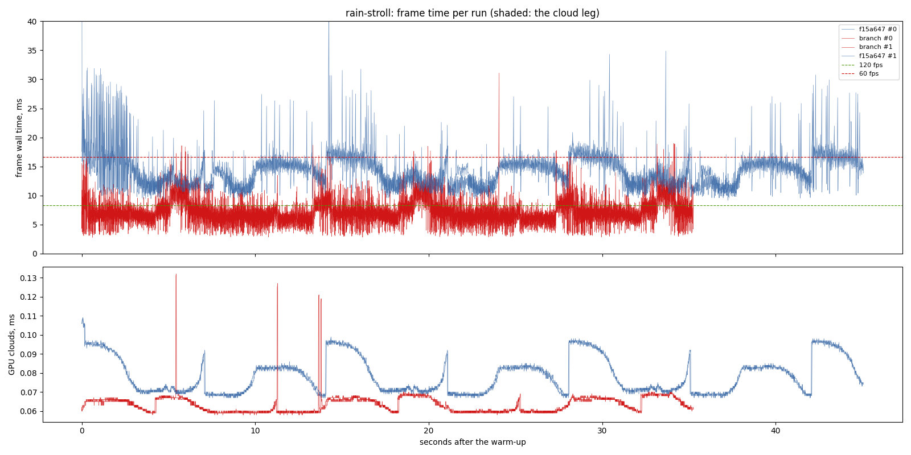

# Worst case 60: main's lighting against the branch (2026-11-12)

The owner's goal for `lighting-perf`: "get worst case to 60", p99 within
16.7 ms in every scenario on the desktop. The final sitting: `f15a647` (the
lighting model as merged to main, its exe and its own assets, at its own
default frame latency of 1) against the branch at `c05ae5f` (`lighting-perf`
2.1, 2.2, 2.4, 2.5, 2.8, 2.9, 2.10, frame latency 2, the loading screen, the
towns' shared materials). RTX 3070 (Vulkan), i7-9700F, 1440 x 900,
uncapped (`--no-vsync`), release builds, 2 repeats interleaved (A B B A),
clock 10:00, then `rain-stroll` again at 22:00. Nothing else ran (the
machine's shared lock held for the sitting).

## Findings

- **The goal is met: every scenario is inside 16.7 ms at p99.** Each cell is
  the suite's median of the two runs (the higher of the two):

| scenario | `f15a647` p50 / p95 / p99 | branch p50 / p95 / p99 | p99 within 16.7 ms |
| --- | ---: | ---: | --- |
| rain-stroll | 13.88 / 17.94 / 25.38 | **7.18 / 10.70 / 12.86** | yes (12.86) |
| rain-stroll, 22:00 | 13.66 / 18.20 / 27.07 | **6.79 / 10.92 / 13.10** | yes (13.10) |
| town | 16.37 / 20.17 / 23.94 | **7.32 / 11.30 / 14.22** | yes (14.22) |
| storm | 9.55 / 15.42 / 22.69 | **5.01 / 7.54 / 9.85** | yes (9.85) |
| clouds | 9.57 / 15.01 / 22.74 | **4.98 / 7.53 / 9.55** | yes (9.55) |
| far-side | 6.14 / 11.03 / 14.38 | **3.78 / 5.92 / 6.95** | yes (6.95) |
| walk | 9.14 / 11.43 / 14.45 | **5.65 / 8.38 / 9.93** | yes (9.93) |

- **On foot in the rain** (the last scenarios over the floor before 2.8)
  the frame is about half of `f15a647`'s: the lane 13.9 to 7.2 ms p50 and
  25.4 to 12.9 ms p99, at night 27.1 to 13.1 ms p99. Of that, 2.8 (L8's
  traces at half size) is the last 4 ms of p99
  (`docs/benchmarks/2026-11-12-reflect-half/`), 2.9 (the rain at half size)
  and 2.1 the rest of the GPU, frame latency 2 the CPU-GPU overlap.
- **The town walk** reads 6.11 / 11.32 and 7.32 / 14.22 ms (p50 / p99) in
  its two runs, against 16.3 / 23.5-23.9 for `f15a647`. Its two runs differ
  in how much wet lane they see (the same two modes as in the 2.8 sitting);
  the worse is still 2.5 ms inside the floor.
- **In flight** p99 halves (clouds 22.7 to 9.6, storm 22.7 to 9.9 ms); most
  of that is frame latency 2, with GPU total down about 1.1 ms.
- **What is still over a budget is p95 against 120 fps** (8.3 ms) on foot
  in the rain and in the town (10.7-11.3 ms), not the 60 fps floor. The
  frames over 30 ms that remain are the recurring storm-descent spikes (the
  other agent's `loading-screen` work) and single landings.
- **`f15a647` runs at latency 1**, its own default; that is main as the
  owner plays it, so the comparison is main against the branch, not one
  change. The per-change A/Bs are in the design.

## Limits

- Two repeats; the walk's and the town's runs differ by more than the other
  scenarios' (route and weather), so their cells carry about 1-2 ms of
  spread at p99.
- Uncapped, windowed, real time; with vsync on the game shows the same
  frames paced to the display.

## The sitting, 10:00

- revision: `c05ae5f`
- adapter: NVIDIA GeForce RTX 3070 (Vulkan); window 1440 x 900, uncapped (`--no-vsync`)
- clock pinned at 10.0 h; first 10.0 s after loading (the ready line, else the first frame) thrown away; 2 run(s) per variant, interleaved
- budgets: p95 within 8.3 ms (120 fps), p99 within 16.7 ms (60 fps); **over** marks a miss. Each cell is the median over the valid runs.

## clouds

| variant | valid runs | fps | p50 | p95 | p99 | p99.9 | max | GPU total p50 | GPU clouds p50 / p95 |
| --- | ---: | ---: | ---: | ---: | ---: | ---: | ---: | ---: | ---: |
| f15a647 | 2/2 | 96.74 | 9.57 | 15.01 **over** | 22.74 **over** | 45.37 | 76.88 | 5.46 | 0.40 / 0.43 |
| branch | 2/2 | 189.67 | 4.98 | 7.53 | 9.55 | 20.18 | 81.06 | 4.36 | 0.09 / 0.09 |

On the cloud leg only (the stretch the plan flies through cloud):

| variant | fps | p50 | p95 | p99 | max | GPU total p50 / p95 | GPU clouds p50 / p95 |
| --- | ---: | ---: | ---: | ---: | ---: | ---: | ---: |
| f15a647 | 110.42 | 8.88 | 11.54 **over** | 14.71 | 22.74 | 4.98 / 6.50 | 0.41 / 0.43 |
| branch | 193.13 | 5.03 | 7.17 | 7.94 | 19.12 | 4.56 / 6.43 | 0.09 / 0.09 |

GPU time per pass, p50 (ms; median over the valid runs):

| variant | cloud_march | cloud_puffs | cloud_resolve | lens_mist | lite_bloom | main_opaque_pass_3d | main_transparent_pass_3d | other | planet_cull | planet_shadow | planet_terrain | rain | rain_half | reflect_compose | reflect_half | ssr_capture | tonemapping | upscaling | water_compose | water_lens | weather_overlay |
| --- | ---: | ---: | ---: | ---: | ---: | ---: | ---: | ---: | ---: | ---: | ---: | ---: | ---: | ---: | ---: | ---: | ---: | ---: | ---: | ---: | ---: |
| f15a647 | - | - | - | - | - | - | - | - | - | - | - | - | - | - | - | - | - | - | - | - | - |
| branch | 0.18 | 0.15 | 0.00 | 0.01 | 0.08 | 0.00 | 0.19 | 0.04 | 0.17 | 0.85 | 1.46 | 0.00 | 0.00 | 0.04 | 0.09 | 0.04 | 0.00 | 0.02 | 0.50 | 0.10 | 0.00 |

Frames over 30 ms per run, and how many recur at the same place (25 m of route, 5 m of walk, or 1 s) in at least half of the scenario's other runs, of any variant. Those that recur are the game's own work at that place; the rest come and go between repeats (async work landing at another moment, or the machine):

| variant | spikes per run | recurring | not recurring |
| --- | --- | ---: | ---: |
| f15a647 | 7, 16 | 15 | 8 |
| branch | 6, 6 | 8 | 4 |

Left out: the fresh world's planet rebuild, 2 frame(s) of 5878-6086 ms.

## storm

| variant | valid runs | fps | p50 | p95 | p99 | p99.9 | max | GPU total p50 | GPU clouds p50 / p95 |
| --- | ---: | ---: | ---: | ---: | ---: | ---: | ---: | ---: | ---: |
| f15a647 | 2/2 | 96.68 | 9.55 | 15.42 **over** | 22.69 **over** | 36.24 | 58.02 | 5.46 | 0.40 / 0.43 |
| branch | 2/2 | 188.96 | 5.01 | 7.54 | 9.85 | 22.95 | 71.04 | 4.33 | 0.09 / 0.09 |

On the cloud leg only (the stretch the plan flies through cloud):

| variant | fps | p50 | p95 | p99 | max | GPU total p50 / p95 | GPU clouds p50 / p95 |
| --- | ---: | ---: | ---: | ---: | ---: | ---: | ---: |
| f15a647 | 109.70 | 8.98 | 11.53 **over** | 14.03 | 31.22 | 4.97 / 6.51 | 0.41 / 0.42 |
| branch | 193.30 | 5.01 | 7.19 | 8.12 | 16.55 | 4.45 / 6.42 | 0.09 / 0.09 |

GPU time per pass, p50 (ms; median over the valid runs):

| variant | cloud_march | cloud_puffs | cloud_resolve | lens_mist | lite_bloom | main_opaque_pass_3d | main_transparent_pass_3d | other | planet_cull | planet_shadow | planet_terrain | rain | rain_half | reflect_compose | reflect_half | ssr_capture | tonemapping | upscaling | water_compose | water_lens | weather_overlay |
| --- | ---: | ---: | ---: | ---: | ---: | ---: | ---: | ---: | ---: | ---: | ---: | ---: | ---: | ---: | ---: | ---: | ---: | ---: | ---: | ---: | ---: |
| f15a647 | - | - | - | - | - | - | - | - | - | - | - | - | - | - | - | - | - | - | - | - | - |
| branch | 0.18 | 0.15 | 0.00 | 0.01 | 0.08 | 0.00 | 0.19 | 0.04 | 0.17 | 0.83 | 1.43 | 0.00 | 0.00 | 0.04 | 0.09 | 0.04 | 0.00 | 0.02 | 0.50 | 0.10 | 0.00 |

Frames over 30 ms per run, and how many recur at the same place (25 m of route, 5 m of walk, or 1 s) in at least half of the scenario's other runs, of any variant. Those that recur are the game's own work at that place; the rest come and go between repeats (async work landing at another moment, or the machine):

| variant | spikes per run | recurring | not recurring |
| --- | --- | ---: | ---: |
| f15a647 | 8, 8 | 6 | 10 |
| branch | 5, 4 | 5 | 4 |

Left out: the fresh world's planet rebuild, 2 frame(s) of 6229-6325 ms.

## far-side

| variant | valid runs | fps | p50 | p95 | p99 | p99.9 | max | GPU total p50 | GPU clouds p50 / p95 |
| --- | ---: | ---: | ---: | ---: | ---: | ---: | ---: | ---: | ---: |
| f15a647 | 2/2 | 147.87 | 6.14 | 11.03 **over** | 14.38 | 24.23 | 32.52 | 2.77 | 0.09 / 0.21 |
| branch | 2/2 | 249.71 | 3.78 | 5.92 | 6.95 | 9.32 | 37.35 | 2.76 | 0.07 / 0.09 |

GPU time per pass, p50 (ms; median over the valid runs):

| variant | cloud_march | cloud_puffs | cloud_resolve | lens_mist | lite_bloom | main_opaque_pass_3d | main_transparent_pass_3d | other | planet_cull | planet_shadow | planet_terrain | rain | rain_half | reflect_compose | reflect_half | ssr_capture | tonemapping | upscaling | water_compose | water_lens | weather_overlay |
| --- | ---: | ---: | ---: | ---: | ---: | ---: | ---: | ---: | ---: | ---: | ---: | ---: | ---: | ---: | ---: | ---: | ---: | ---: | ---: | ---: | ---: |
| f15a647 | - | - | - | - | - | - | - | - | - | - | - | - | - | - | - | - | - | - | - | - | - |
| branch | 0.00 | 0.02 | 0.00 | 0.00 | 0.08 | 0.00 | 0.24 | 0.04 | 0.10 | 0.35 | 0.69 | 0.00 | 0.00 | 0.01 | 0.02 | 0.03 | 0.00 | 0.03 | 0.63 | 0.02 | 0.00 |

Frames over 30 ms per run, and how many recur at the same place (25 m of route, 5 m of walk, or 1 s) in at least half of the scenario's other runs, of any variant. Those that recur are the game's own work at that place; the rest come and go between repeats (async work landing at another moment, or the machine):

| variant | spikes per run | recurring | not recurring |
| --- | --- | ---: | ---: |
| f15a647 | 2, 2 | 2 | 2 |
| branch | 1, 1 | 2 | 0 |

Left out: the fresh world's planet rebuild, 2 frame(s) of 6104-6332 ms.

## walk

| variant | valid runs | fps | p50 | p95 | p99 | p99.9 | max | GPU total p50 | GPU clouds p50 / p95 |
| --- | ---: | ---: | ---: | ---: | ---: | ---: | ---: | ---: | ---: |
| f15a647 | 2/2 | 107.85 | 9.14 | 11.43 **over** | 14.45 | 19.13 | 71.67 | 5.19 | 0.08 / 0.13 |
| branch | 2/2 | 170.84 | 5.65 | 8.38 **over** | 9.93 | 17.05 | 67.68 | 5.17 | 0.07 / 0.07 |

GPU time per pass, p50 (ms; median over the valid runs):

| variant | cloud_march | cloud_puffs | cloud_resolve | lens_mist | lite_bloom | main_opaque_pass_3d | main_transparent_pass_3d | other | planet_cull | planet_shadow | planet_terrain | rain | rain_half | reflect_compose | reflect_half | ssr_capture | tonemapping | upscaling | water_compose | water_lens | weather_overlay |
| --- | ---: | ---: | ---: | ---: | ---: | ---: | ---: | ---: | ---: | ---: | ---: | ---: | ---: | ---: | ---: | ---: | ---: | ---: | ---: | ---: | ---: |
| f15a647 | - | - | - | - | - | - | - | - | - | - | - | - | - | - | - | - | - | - | - | - | - |
| branch | 0.00 | 0.02 | 0.00 | 0.00 | 0.08 | 0.01 | 0.13 | 0.04 | 0.18 | 1.93 | 2.19 | 0.07 | 0.07 | 0.01 | 0.03 | 0.03 | 0.03 | 0.02 | 0.06 | 0.00 | 0.00 |

Frames over 30 ms per run, and how many recur at the same place (25 m of route, 5 m of walk, or 1 s) in at least half of the scenario's other runs, of any variant. Those that recur are the game's own work at that place; the rest come and go between repeats (async work landing at another moment, or the machine):

| variant | spikes per run | recurring | not recurring |
| --- | --- | ---: | ---: |
| f15a647 | 5, 12 | 0 | 17 |
| branch | 7, 3 | 0 | 10 |

Left out: the fresh world's planet rebuild, 2 frame(s) of 6392-6588 ms.

## rain-stroll

| variant | valid runs | fps | p50 | p95 | p99 | p99.9 | max | GPU total p50 | GPU clouds p50 / p95 |
| --- | ---: | ---: | ---: | ---: | ---: | ---: | ---: | ---: | ---: |
| f15a647 | 2/2 | 70.68 | 13.88 | 17.94 **over** | 25.38 **over** | 31.28 | 234.35 | 9.41 | 0.09 / 0.15 |
| branch | 2/2 | 137.24 | 7.18 | 10.70 **over** | 12.86 | 17.34 | 19.27 | 6.56 | 0.06 / 0.07 |

GPU time per pass, p50 (ms; median over the valid runs):

| variant | cloud_march | cloud_puffs | cloud_resolve | lens_mist | lite_bloom | main_opaque_pass_3d | main_transparent_pass_3d | other | planet_cull | planet_shadow | planet_terrain | rain | rain_half | reflect_compose | reflect_half | ssr_capture | tonemapping | upscaling | water_compose | water_lens | weather_overlay |
| --- | ---: | ---: | ---: | ---: | ---: | ---: | ---: | ---: | ---: | ---: | ---: | ---: | ---: | ---: | ---: | ---: | ---: | ---: | ---: | ---: | ---: |
| f15a647 | - | - | - | - | - | - | - | - | - | - | - | - | - | - | - | - | - | - | - | - | - |
| branch | 0.00 | 0.04 | 0.00 | 0.00 | 0.09 | 0.51 | 0.06 | 0.04 | 0.18 | 2.14 | 2.19 | 0.07 | 0.39 | 0.05 | 0.35 | 0.03 | 0.03 | 0.02 | 0.07 | 0.30 | 0.00 |

Frames over 30 ms per run, and how many recur at the same place (25 m of route, 5 m of walk, or 1 s) in at least half of the scenario's other runs, of any variant. Those that recur are the game's own work at that place; the rest come and go between repeats (async work landing at another moment, or the machine):

| variant | spikes per run | recurring | not recurring |
| --- | --- | ---: | ---: |
| f15a647 | 5, 0 | 0 | 5 |
| branch | 0, 0 | 0 | 0 |

Left out: the fresh world's planet rebuild, 2 frame(s) of 6503-6531 ms.

## town

| variant | valid runs | fps | p50 | p95 | p99 | p99.9 | max | GPU total p50 | GPU clouds p50 / p95 |
| --- | ---: | ---: | ---: | ---: | ---: | ---: | ---: | ---: | ---: |
| f15a647 | 2/2 | 59.76 | 16.37 | 20.17 **over** | 23.94 **over** | 31.31 | 229.27 | 6.59 | 0.09 / 0.11 |
| branch | 2/2 | 133.86 | 7.32 | 11.30 **over** | 14.22 | 19.60 | 571.78 | 6.85 | 0.06 / 0.07 |

GPU time per pass, p50 (ms; median over the valid runs):

| variant | cloud_march | cloud_puffs | cloud_resolve | lens_mist | lite_bloom | main_opaque_pass_3d | main_transparent_pass_3d | other | planet_cull | planet_shadow | planet_terrain | rain | rain_half | reflect_compose | reflect_half | ssr_capture | tonemapping | upscaling | water_compose | water_lens | weather_overlay |
| --- | ---: | ---: | ---: | ---: | ---: | ---: | ---: | ---: | ---: | ---: | ---: | ---: | ---: | ---: | ---: | ---: | ---: | ---: | ---: | ---: | ---: |
| f15a647 | - | - | - | - | - | - | - | - | - | - | - | - | - | - | - | - | - | - | - | - | - |
| branch | 0.00 | 0.03 | 0.00 | 0.00 | 0.08 | 0.25 | 0.01 | 0.04 | 0.18 | 2.05 | 2.89 | 0.07 | 0.38 | 0.03 | 0.17 | 0.03 | 0.03 | 0.02 | 0.32 | 0.29 | 0.00 |

Frames over 30 ms per run, and how many recur at the same place (25 m of route, 5 m of walk, or 1 s) in at least half of the scenario's other runs, of any variant. Those that recur are the game's own work at that place; the rest come and go between repeats (async work landing at another moment, or the machine):

| variant | spikes per run | recurring | not recurring |
| --- | --- | ---: | ---: |
| f15a647 | 6, 6 | 0 | 12 |
| branch | 2, 5 | 0 | 7 |

Left out: the fresh world's planet rebuild, 2 frame(s) of 6594-6686 ms.

## The sitting, 22:00

## rain-stroll

| variant | valid runs | fps | p50 | p95 | p99 | p99.9 | max | GPU total p50 | GPU clouds p50 / p95 |
| --- | ---: | ---: | ---: | ---: | ---: | ---: | ---: | ---: | ---: |
| f15a647 | 2/2 | 71.46 | 13.66 | 18.20 **over** | 27.07 **over** | 31.56 | 79.04 | 9.30 | 0.07 / 0.10 |
| branch | 2/2 | 142.80 | 6.79 | 10.92 **over** | 13.10 | 18.37 | 31.09 | 6.17 | 0.06 / 0.07 |

GPU time per pass, p50 (ms; median over the valid runs):

| variant | cloud_march | cloud_puffs | cloud_resolve | lens_mist | lite_bloom | main_opaque_pass_3d | main_transparent_pass_3d | other | planet_cull | planet_shadow | planet_terrain | rain | rain_half | reflect_compose | reflect_half | ssr_capture | tonemapping | upscaling | water_compose | water_lens | weather_overlay |
| --- | ---: | ---: | ---: | ---: | ---: | ---: | ---: | ---: | ---: | ---: | ---: | ---: | ---: | ---: | ---: | ---: | ---: | ---: | ---: | ---: | ---: |
| f15a647 | - | - | - | - | - | - | - | - | - | - | - | - | - | - | - | - | - | - | - | - | - |
| branch | 0.00 | 0.01 | 0.00 | 0.00 | 0.09 | 0.24 | 0.05 | 0.04 | 0.18 | 2.36 | 2.01 | 0.07 | 0.37 | 0.05 | 0.34 | 0.03 | 0.03 | 0.02 | 0.07 | 0.29 | 0.00 |

Frames over 30 ms per run, and how many recur at the same place (25 m of route, 5 m of walk, or 1 s) in at least half of the scenario's other runs, of any variant. Those that recur are the game's own work at that place; the rest come and go between repeats (async work landing at another moment, or the machine):

| variant | spikes per run | recurring | not recurring |
| --- | --- | ---: | ---: |
| f15a647 | 10, 7 | 0 | 17 |
| branch | 1, 0 | 0 | 1 |

Left out: the fresh world's planet rebuild, 2 frame(s) of 6497-6499 ms.

