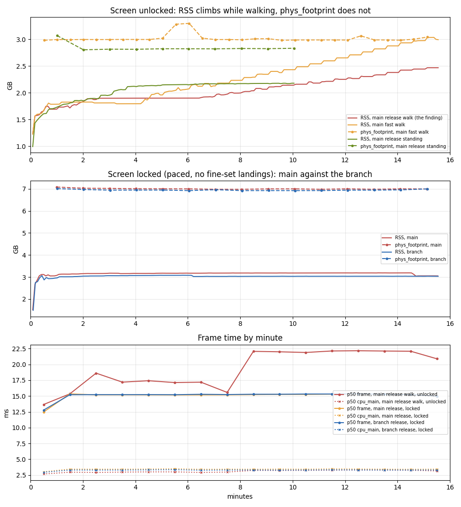

# Memory leak: RSS against footprint, and the fish schools' churn (2026-11-19)

`openspec/changes/memory-leak`. M4 Max (64 GB, unified memory), macOS 15
(Darwin 24.6), built-in display 3456 x 2234, `--no-vsync`, dry weather
(`PBD_WEATHER_SCRIPT=0:dry`), `--world leak-walk --time 10`, a throwaway
world deleted after each run. Walks are `--walk-distance 50000` (the walker
stalls and turns often, so `walked_m` is path length, not distance from the
spawn). `main` is `df18dcc4`.

## 1. The finding: RSS climbs, footprint does not (screen unlocked)

| run | RSS at min 1 | RSS at min 15 | phys_footprint |
| --- | ---: | ---: | --- |
| main release walk (the first measurement; RSS only) | 1.73 GB | 2.50 GB | not sampled |
| main fast walk (`walk-main-fast-mem.csv`) | 1.83 GB | 3.11 GB | 3.05-3.12 GB throughout |
| main release `--stand 600` at the spawn (`stand-main-release-mem.csv`) | 1.77 GB | 2.23 GB at min 5, flat after | 2.87-2.90 GB from min 2 |

- `PBD_MEMORY_TRACE` over the fast walk (`walk-main-fast-assets.csv`):
  11,648 entities, 518-554 meshes holding 24-27 MB, 213 images, 131
  standard and 39-43 field-lit materials, flat from 30 s to 15 min.
  Nothing the game holds grows.
- `footprint` at minute 1 and minute 15 of the fast walk
  (`walk-main-fast-footprint-min*.txt`): the dirty columns hold still
  (IOAccelerator 1,921 to 1,930 MB, `MALLOC_MEDIUM` dirty 176 to 159 MB,
  `MALLOC_LARGE_REUSABLE` dirty 58 to 96 MB); the reclaimable column is the
  rise: `MALLOC_MEDIUM` 745 to 1,081 MB, `MALLOC_LARGE_REUSABLE` 373 to
  1,236 MB (44 to 403 regions). These are blocks the game has freed; the
  allocator keeps them mapped for reuse and macOS takes them back under
  memory pressure, so RSS counts them and `phys_footprint` (Activity
  Monitor's Memory column) does not.

## 2. Why the allocator holds so much: large allocations by call stack

The `alloc-trace` build (`--features alloc-trace`, `PBD_ALLOC_TRACE`)
counted every allocation of 256 KiB or more by call stack; the tables are
named with `tools/alloc_trace.py`. Over minutes 5-10 of a main walk
(`alloc-main-min5-10.txt`), 41.9 GB in five minutes:

| source | per minute |
| --- | ---: |
| `fish::draw::build` / `bodies::emit_swimmer`: school meshes laid into new buffers every frame, grown by doubling, plus `compute_flat_normals` | 5,439 MiB |
| Bevy's `RenderMesh::extract_render_asset` copying the changed meshes to the render world | 1,670 MiB |
| the fine set and its tier (`lod::record`, `generate_fine_live`, `cells_in_band`, light bake) | 530 MiB |
| water flow (`rebuild_water`, `FineSet` clones in water ticks) | 162 MiB |
| the river cache save every 30 s while the cache grows (an 84 MB file built in memory and the memos copied out) | 123 MiB |
| ambience beds decoded whole each time one comes up (7-14 MB each) | 94 MiB |

The branch's walk, minutes 2-7 (`alloc-branch-min2-7.txt`): no stack under
`fish::draw` or `fish::bodies` reaches 256 KiB. The extraction copy is left
(one exact-size copy a frame, freed in the frame), and the rest is as on
main.

## 3. Main against the branch, release, screen locked

The screen was locked for the whole sitting in which both release builds
were run one after the other (`CGSSessionScreenIsLocked = Yes`). Locked, the
game runs paced at 15.2 ms with its window unfocused, and the fine set stops
landing (version 7 the whole run in both; 6 requests against 42 unlocked),
so this regime never makes the landing and river-save churn the unlocked
walk does. Both runs: GPU memory 5.4 GB (43,800 IOAccelerator regions,
against 1.9 GB and 1,500 unlocked), RSS and footprint flat.
All minutes in `locked-by-minute.md`:

| min | RSS main | RSS branch | footprint main | footprint branch | p50 main | p50 branch | cpu_main main | cpu_main branch |
| ---: | ---: | ---: | ---: | ---: | ---: | ---: | ---: | ---: |
| 1 | 3148 | 3032 | 7251 | 7178 | 15.3 | 15.2 | 3.44 | 3.30 |
| 5 | 3250 | 3153 | 7172 | 7111 | 15.2 | 15.2 | 3.49 | 3.35 |
| 10 | 3258 | 3105 | 7169 | 7087 | 15.3 | 15.3 | 3.43 | 3.30 |
| 14 | 3261 | 3109 | 7169 | 7121 | 15.3 | 15.2 | 3.41 | 3.30 |

What it shows: the branch's main thread is 0.13-0.15 ms a frame faster
(p50 `cpu_main_ms`, every minute) and its RSS 100-150 MB lower. What it
cannot show: the walking RSS climb, which needs the unlocked regime.

## 4. The frame-time step

The first walk stepped from p50 15-17 ms to 22 ms at minute 8, all of it in
`acquire_ms` (15 to 19.5 ms: the CPU waiting for the GPU); `cpu_main_ms`
stayed at 3 ms. The fast repeat stepped at minute 5, with `phys_footprint`
and every asset count flat across it. It is not memory: nothing grows on the
GPU or the CPU at the step. Whether it is the view the walker reached is not
settled here: GPU timestamps read NaN on this Mac, and the locked sitting
paced every frame to 15.2 ms.

## Owed

- The same 15-minute walk, main against the branch, release, screen
  unlocked, nothing else running: RSS and `phys_footprint` by minute. The
  branch removes the largest churn (5.4 GB a minute), so RSS should climb
  more slowly; the landing and river-save churn remains, so it may not be
  flat.
- The frame-time step replayed: stand fresh where the walk was at the step.
