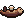
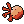
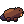

# The field guide

<!-- Written by tools/gen_fish_wiki.py from assets/config/fauna.ron. Do not edit: change the roster and run the generator. -->

Everything that lives in the water, one entry per species, from the same
record the schools, the hook and the in-game field guide (J) read. The
numbers are the guide's own. Where each species lives on the planet is
drawn in the [Fish Range Atlas](fish-ranges/index.html).

## Pale Blue Dot

| | Species | Kind | Water | Temperature |
| --- | --- | --- | --- | --- |
|  | [Minnow](#minnow) | fish | rivers, shallows | 10 to 30 C |
|  | [Silverfin](#silverfin) | fish | shallows, shelf | -2 to 17 C |
|  | [Banded perch](#perch) | fish | rivers | -2 to 24 C |
|  | [Ray](#ray) | fish | shallows, shelf | 16 to 32 C |
|  | [Eel](#eel) | fish | rivers, shallows | 6 to 28 C |
|  | [Reef fish](#reef) | fish | shallows | 23 to 32 C |
|  | [Deepback](#deepback) | fish | shelf, deep | -2 to 9 C |
|  | [Sea serpent](#serpent) | fish | deep | -2 to 32 C |
|  | [Shore crab](#shore-crab) | crustacean | rivers, shallows | 2 to 30 C |
|  | [Spiny lobster](#lobster) | crustacean | shallows, shelf | 4 to 26 C |
|  | [Giant clam](#giant-clam) | mollusc or soft-bodied | shallows | 23 to 32 C |
|  | [Reef turtle](#reef-turtle) | reptile | shallows, shelf | 20 to 32 C |
|  | [Sea otter](#sea-otter) | mammal | shallows, shelf | 2 to 16 C |
|  | [Reed dabbler](#reed-dabbler) | bird | rivers, shallows | 2 to 30 C |
|  | [Pond diver](#pond-diver) | bird | rivers, shallows | 2 to 28 C |
|  | [Den octopus](#octopus) | mollusc or soft-bodied | shallows, shelf | 6 to 32 C |
|  | [Plume worm](#tube-worm) | mollusc or soft-bodied | deep | -2 to 32 C |
|  | [Ice seal](#seal) | mammal | shallows, shelf | -2 to 14 C |
|  | [Beaver](#beaver) | mammal | rivers | 0 to 26 C |
|  | [River otter](#river-otter) | mammal | rivers | 1 to 22 C |

###  Minnow

from Tenebris (Fish) · fish

The first fish most anglers land. Minnows crowd the shallows and river mouths in schools of thirty or more and turn as one when a shadow crosses them. They bite quickly and give up easily.

| | |
| --- | --- |
| WATER | rivers, shallows |
| TEMPERATURE | 10 to 30 C |
| DEPTH | 0-2 m down |
| FOUND | schools of 24-36 |
| LENGTH | about 14 cm |
| STRENGTH | #---- 1/5 |
| HOOK WINDOW | 0.90 s |
| SPEED | 1.0-2.6 m/s |

*Tip:* Cast anywhere near a warm shore. A school finds the lure in seconds.

###  Silverfin

new · fish

A bright, fast surface fish of cool coasts, from the edge of the ice to water as warm as 17 degrees. Silverfin skim the top two meters and scatter at a splash, then close ranks again a few seconds later.

| | |
| --- | --- |
| WATER | shallows, shelf |
| TEMPERATURE | -2 to 17 C |
| DEPTH | 0-2 m down |
| FOUND | schools of 18-30 |
| LENGTH | about 22 cm |
| STRENGTH | #---- 1/5 |
| HOOK WINDOW | 0.90 s |
| SPEED | 1.2-3.2 m/s |

*Tip:* Let the splash settle before you expect a bite.

###  Banded perch

new · fish

Striped, deep-bodied and curious. Perch hold the river channels in loose groups of a dozen, in any river that does not freeze, and one will follow a lure a long way before it commits.

| | |
| --- | --- |
| WATER | rivers |
| TEMPERATURE | -2 to 24 C |
| DEPTH | 0-2 m down |
| FOUND | schools of 8-14 |
| LENGTH | about 38 cm |
| STRENGTH | ##--- 2/5 |
| HOOK WINDOW | 0.78 s |
| SPEED | 0.8-2.4 m/s |

*Tip:* Nibbles come in threes. Wait for the float to go under.

###  Ray

from Tenebris (FlatFish) · fish · bottom dweller

A flat grazer that lies on the sand and lifts off in slow wingbeats. Rays travel alone or in pairs along the bed of warm shallows and shelf, well out from the beach.

| | |
| --- | --- |
| WATER | shallows, shelf |
| TEMPERATURE | 16 to 32 C |
| DEPTH | on the bed, 2-40 m |
| FOUND | schools of 1-2 |
| LENGTH | about 60 cm |
| STRENGTH | ##--- 2/5 |
| HOOK WINDOW | 0.78 s |
| SPEED | 0.5-1.2 m/s |

*Tip:* Cast long, over sand. A ray never schools, so a bite is one fish, not one of many.

###  Eel

from Tenebris (LongFish) · fish · bottom dweller

Long, dark and patient. Eels keep to the bed of rivers and shallows in ones and twos and fight in hard, twisting runs.

| | |
| --- | --- |
| WATER | rivers, shallows |
| TEMPERATURE | 6 to 28 C |
| DEPTH | on the bed, 1-6 m |
| FOUND | schools of 1-2 |
| LENGTH | about 90 cm |
| STRENGTH | ###-- 3/5 |
| HOOK WINDOW | 0.67 s |
| SPEED | 0.7-1.9 m/s |

*Tip:* Ease off whenever it runs. More lines are lost to eels than to anything else.

###  Reef fish

from Tenebris (LargeFish) · fish

The prize of warm water. Tall-finned and nervous, reef fish shoal in small groups over tropical shallows that never fall below 23 degrees, and give the shortest bite window of anything in the sea.

| | |
| --- | --- |
| WATER | shallows |
| TEMPERATURE | 23 to 32 C |
| DEPTH | 1-3 m down |
| FOUND | schools of 6-12 |
| LENGTH | about 42 cm |
| STRENGTH | ##### 5/5 |
| HOOK WINDOW | 0.43 s |
| SPEED | 0.6-1.6 m/s |

*Tip:* The hook window is under half a second. Watch the float, not the fish.

###  Deepback

new · fish

A heavy cold-water fish of the shelf and the deep. Small schools cruise below two and a half meters, and a hooked deepback runs long and tires slowly.

| | |
| --- | --- |
| WATER | shelf, deep |
| TEMPERATURE | -2 to 9 C |
| DEPTH | 2-6 m down |
| FOUND | schools of 4-7 |
| LENGTH | about 70 cm |
| STRENGTH | ####- 4/5 |
| HOOK WINDOW | 0.55 s |
| SPEED | 0.6-1.8 m/s |

*Tip:* Fish where the shelf drops close to the shore, where the water turns dark.

###  Sea serpent

from Tenebris (SerpentFish) · fish

Rare and solitary, found only past the drop-off in any deep sea that does not freeze. A serpent seldom takes a lure and pulls like a boat. Every angler has a story about one that got away.

| | |
| --- | --- |
| WATER | deep |
| TEMPERATURE | -2 to 32 C |
| DEPTH | 4-6 m down |
| FOUND | schools of 1-1 |
| LENGTH | about 130 cm |
| STRENGTH | ####- 4/5 |
| HOOK WINDOW | 0.55 s |
| SPEED | 0.8-2.2 m/s |

*Tip:* There is at most one in any water. Deep water, a long cast and patience.

###  Shore crab

new · crustacean · bottom dweller · not taken on a line

A small green-brown crab of every warm or cool shore, in rock pools, river mouths and the sand of the shallows. It walks sideways along the bed and scuttles off when a shadow comes near.

| | |
| --- | --- |
| WATER | rivers, shallows |
| TEMPERATURE | 2 to 30 C |
| DEPTH | on the bed, 0-6 m |
| FOUND | schools of 2-4 |
| LENGTH | about 10 cm |
| STRENGTH | #---- 1/5 |
| HOOK WINDOW | 0.90 s |
| SPEED | 0.1-0.3 m/s |
| PLACES | coasts, rock pools, estuaries, mudflats |

*Tip:* Look in the shallows by the rocks. It does not take a lure.

###  Spiny lobster

new · crustacean · bottom dweller · not taken on a line

A long-feelered crawler of rocky shelf and reef, from cool kelp to warm coral. It keeps to the bed in ones and twos and backs away from anything that swims too close.

| | |
| --- | --- |
| WATER | shallows, shelf |
| TEMPERATURE | 4 to 26 C |
| DEPTH | on the bed, 2-40 m |
| FOUND | schools of 1-2 |
| LENGTH | about 40 cm |
| STRENGTH | #---- 1/5 |
| HOOK WINDOW | 0.90 s |
| SPEED | 0.1-0.2 m/s |
| PLACES | kelp, reefs |

*Tip:* On the bed of the shelf, under kelp or along a reef. It does not take a lure.

###  Giant clam

new · mollusc or soft-bodied · bottom dweller · not taken on a line

A clam as wide as a cart wheel, set in the sand of warm reef shallows with its blue mantle open to the sun. It shuts when anything comes within four meters and opens again once it has gone.

| | |
| --- | --- |
| WATER | shallows |
| TEMPERATURE | 23 to 32 C |
| DEPTH | on the bed, 1-6 m |
| FOUND | schools of 1-3 |
| LENGTH | about 60 cm |
| STRENGTH | #---- 1/5 |
| HOOK WINDOW | 0.90 s |
| SPEED | 0.0-0.0 m/s |
| PLACES | reefs |

*Tip:* Swim up slowly and it still shuts. Wait a while at a distance and it opens.

###  Reef turtle

new · reptile · protected: it may not be caught

A slow, old swimmer of warm reefs and the shelf beyond them, alone and unhurried. Reef turtles are protected: none may be caught.

| | |
| --- | --- |
| WATER | shallows, shelf |
| TEMPERATURE | 20 to 32 C |
| DEPTH | 1-8 m down |
| FOUND | schools of 1-1 |
| LENGTH | about 90 cm |
| STRENGTH | ###-- 3/5 |
| HOOK WINDOW | 0.67 s |
| SPEED | 0.4-1.2 m/s |
| PLACES | reefs, coasts |

*Tip:* Watch it go by. A line cast at one is refused.

###  Sea otter

new · mammal · protected: it may not be caught

Rafts of two or three float on their backs over cool kelp and rocky coasts, and paddle off when a swimmer comes near. Sea otters are protected: none may be caught.

| | |
| --- | --- |
| WATER | shallows, shelf |
| TEMPERATURE | 2 to 16 C |
| DEPTH | 1-40 m down |
| FOUND | schools of 1-3 |
| LENGTH | about 120 cm |
| STRENGTH | ###-- 3/5 |
| HOOK WINDOW | 0.67 s |
| SPEED | 0.2-0.8 m/s |
| PLACES | kelp, coasts |

*Tip:* Cool coasts, over kelp. Keep your distance and they stay.

###  Reed dabbler

new · bird · protected: it may not be caught

The common duck of rivers, marsh pools and quiet shallows. Dabblers float in small flocks, tip up to feed with their tails in the air, paddle off when you come close and sleep on the water at night. Ducks are protected; their eggs and feathers are gathered, not taken.

| | |
| --- | --- |
| WATER | rivers, shallows |
| TEMPERATURE | 2 to 30 C |
| DEPTH | 0-6 m down |
| FOUND | schools of 3-8 |
| LENGTH | about 50 cm |
| STRENGTH | #---- 1/5 |
| HOOK WINDOW | 0.90 s |
| SPEED | 0.2-0.6 m/s |
| PLACES | marsh, rock pools, estuaries, riffles |

*Tip:* Slow water near reeds. Come up quietly or they paddle off.

###  Pond diver

new · bird · protected: it may not be caught

A dark little duck that dives for its food and comes up somewhere else. Pond divers keep to deeper pools and slow river reaches in ones and twos. Ducks are protected.

| | |
| --- | --- |
| WATER | rivers, shallows |
| TEMPERATURE | 2 to 28 C |
| DEPTH | 1-6 m down |
| FOUND | schools of 1-3 |
| LENGTH | about 42 cm |
| STRENGTH | #---- 1/5 |
| HOOK WINDOW | 0.90 s |
| SPEED | 0.2-0.7 m/s |
| PLACES | marsh, rock pools |

*Tip:* Watch the water where it went under; it surfaces a few meters off.

###  Den octopus

new · mollusc or soft-bodied · bottom dweller · not taken on a line

A clever crawler of reefs and rocky shelf that keeps a den with shells piled at its door. It takes the color of the rock when still and flushes red when it moves. Come within six meters and it inks and jets home, and stays hidden until you have gone.

| | |
| --- | --- |
| WATER | shallows, shelf |
| TEMPERATURE | 6 to 32 C |
| DEPTH | on the bed, 1-40 m |
| FOUND | schools of 1-1 |
| LENGTH | about 50 cm |
| STRENGTH | ##--- 2/5 |
| HOOK WINDOW | 0.78 s |
| SPEED | 0.1-0.3 m/s |
| PLACES | reefs |

*Tip:* Look for the shells at its door, then keep back and wait.

###  Plume worm

new · mollusc or soft-bodied · bottom dweller · not taken on a line

White tubes taller than a person crowd round the deep vents, each with a red plume out in the warm water. The plume snaps back into its tube when anything comes within five meters. They live on the vent, not on the light.

| | |
| --- | --- |
| WATER | deep |
| TEMPERATURE | -2 to 32 C |
| DEPTH | on the bed, 90-145 m |
| FOUND | schools of 10-16 |
| LENGTH | about 140 cm |
| STRENGTH | #---- 1/5 |
| HOOK WINDOW | 0.90 s |
| SPEED | 0.0-0.0 m/s |
| PLACES | deep vents |

*Tip:* Only at the vents on the deepest floor. Nothing worth taking; the vent is the prize.

###  Ice seal

new · mammal · protected: it may not be caught

Gray seals of the cold seas and the kelp. They lie out on the floes and slide in when you come within nine meters, then surface somewhere else a while later. Seals are protected: none may be caught.

| | |
| --- | --- |
| WATER | shallows, shelf |
| TEMPERATURE | -2 to 14 C |
| DEPTH | 1-40 m down |
| FOUND | schools of 1-3 |
| LENGTH | about 160 cm |
| STRENGTH | ###-- 3/5 |
| HOOK WINDOW | 0.67 s |
| SPEED | 0.3-1.5 m/s |
| PLACES | under the ice, kelp |

*Tip:* Cold water, near the ice or the kelp. Where seals are, the fish are.

###  Beaver

new · mammal · protected: it may not be caught

A big brown rodent of slow rivers. Beavers fell trees, dam the stream with sticks and build a lodge in the pond behind the dam. Beavers are protected: none may be caught.

| | |
| --- | --- |
| WATER | rivers |
| TEMPERATURE | 0 to 26 C |
| DEPTH | 0-4 m down |
| FOUND | schools of 1-2 |
| LENGTH | about 100 cm |
| STRENGTH | ##--- 2/5 |
| HOOK WINDOW | 0.78 s |
| SPEED | 0.2-0.8 m/s |
| PLACES | rock pools, riffles |

*Tip:* Look where a stream is dammed with sticks. Come close and it slaps its tail and dives.

###  River otter

new · mammal · protected: it may not be caught

A long, quick swimmer of cool rivers and lakes. It climbs out on the bank to look around and groom. River otters are protected: none may be caught.

| | |
| --- | --- |
| WATER | rivers |
| TEMPERATURE | 1 to 22 C |
| DEPTH | 0-6 m down |
| FOUND | schools of 1-2 |
| LENGTH | about 100 cm |
| STRENGTH | ##--- 2/5 |
| HOOK WINDOW | 0.78 s |
| SPEED | 0.3-1.1 m/s |
| PLACES | riffles, rock pools, estuaries |

*Tip:* Quiet river banks. It swims off if you come close.
